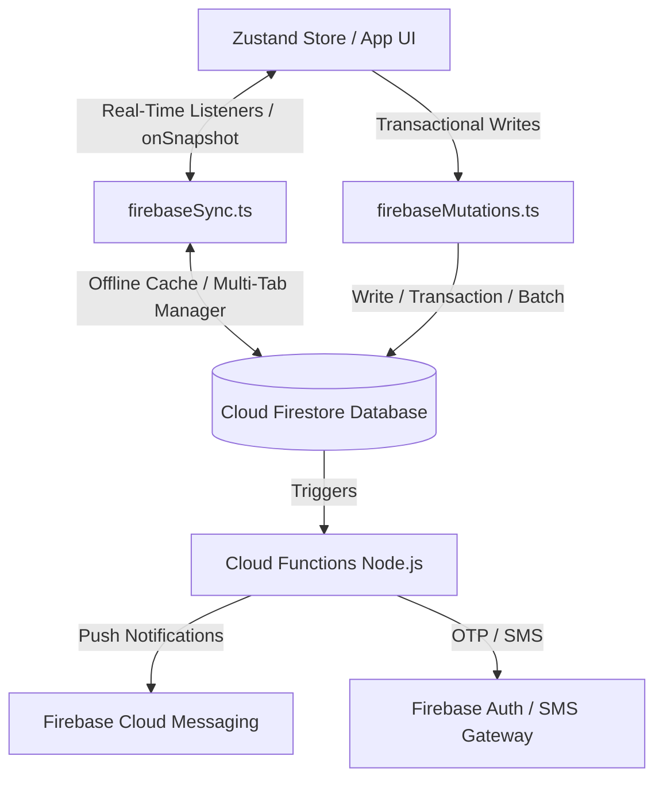

# ⚡ OYNA Backend Mimarisi ve Sistem Mantığı Teknik Şartnamesi (Master Specification)

Bu belge, **OYNA** premium, oyunlaştırılmış ve modern spor ekosisteminin veri modellerini, transactional iş akışlarını, oyunlaştırma (gamification) algoritmalarını ve backend sistem mantığını tanımlayan **yaşayan teknik şartnamedir (Master Specification)**. Gelecekte geliştirilecek tüm API'ler, veritabanı şemaları, Cloud Functions kodları ve microservice yapıları bu belgedeki akışlara göre inşa edilecektir.

---

## 1. 📐 Genel Sistem Mimarisi & Veri Akışı

OYNA, **Real-Time Client-First (Zustand + Firestore Live Listeners)** mimarisine sahiptir. Local cache ve offline-persistence desteğiyle mobil ağ kesintilerinde dahi kesintisiz çalışır.



---

## 2. 🗄️ Firestore Veritabanı Şeması & Veri Modelleri

Uygulamanın `types.ts` ve `store.ts` içerisindeki veri yapılarına dayanan Firestore koleksiyon şemaları aşağıda tanımlanmıştır:

### 2.1. `users` Koleksiyonu (Oyuncular, Kaptanlar, Kaleciler, Hakemler)
Her kullanıcı, OYNA ekosisteminde tek bir ana profile sahiptir ancak birden fazla rolü ve statüyü dinamik olarak yönetebilir.
* **Path:** `/users/{uid}`
* **Schema:**
```typescript
interface IUser {
  id: string;                  // Firebase Auth UID
  name: string;                // Ad Soyad
  email: string;               // E-posta adresi
  phone?: string;              // Telefon numarası (+90 5XX XX XX)
  avatar?: string;             // Profil fotoğrafı URL'i
  roles: UserRole[];           // ['PLAYER', 'CAPTAIN', 'GOALKEEPER', 'REFEREE', 'OWNER']
  communities: string[];       // Katıldığı Topluluk ID'leri
  fairPlayScore: number;       // 0-100 arası dinamik FP Skoru (Default: 100)
  reliabilityScore: number;    // Maç katılım güvenilirlik yüzdesi (0-100)
  rating: number;              // 1.0 - 5.0 arası genel performans reytingi
  isVerified: boolean;         // Onaylı Profil / Mavi Tik bayrağı
  isBanned: boolean;           // Banlanma durumu
  banExpiresAt: string | null; // Ban bitiş tarihi (ISO string)
  isPro: boolean;              // Premium Üyelik durumu
  joinDate: string;            // Kayıt tarihi (Örn: "15 Oca 2024")
  matchCount: number;          // Toplam tamamlanan maç sayısı
  wallet?: number;             // Cüzdan bakiyesi (TL)
  preferredZones?: string[];   // Tercih edilen semtler/bölgeler
  playerCard?: {               // FIFA Ultimate Team Tarzı Dinamik Kart Verisi
    overall: number;           // Genel Değer (OVR)
    tier: 'gold' | 'silver' | 'bronze';
    stats: {
      pace: { value: number; videoUrl: string | null };      // Hız
      shooting: { value: number; videoUrl: string | null };  // Şut
      passing: { value: number; videoUrl: string | null };   // Pas
      dribbling: { value: number; videoUrl: string | null }; // Çalım
      defense: { value: number; videoUrl: string | null };   // Defans
      physical: { value: number; videoUrl: string | null };  // Fizik
    }
  }
}
```

### 2.2. `matches` Koleksiyonu (Maç Lobileri & Maç Kartları)
Bireysel katılım açık maçlarını ve lobi durumlarını yöneten ana koleksiyondur.
* **Path:** `/matches/{matchId}`
* **Schema:**
```typescript
interface MatchListing {
  id: string;                  // Maç ID
  title: string;               // Maç Başlığı (Örn: "Cuma Gecesi Derbisi")
  location: string;            // Tesis/Saha Adı (Fiziksel Konum)
  time: string;                // Maç Saati (Örn: "21:00")
  date: string;                // Maç Tarihi (Örn: "19 Mayıs 2026")
  price: number;               // Kişi Başı Katılım Ücreti
  difficulty: 'Ciddi' | 'Taktiksel' | 'Rahat';
  minRating: number;           // Minimum Reyting Gereksinimi (Örn: 3.5)
  image: string;               // Maç Görseli / Cover URL
  badges: string[];            // Arayüz etiketleri (Örn: ["Kaleci Lazım", "Hakemli"])
  missingPositions: {          // Eksik pozisyonlar ve sayıları
    role: string;              // 'GK' | 'DEF' | 'MID' | 'FW'
    count: number;
  }[];
  slots: {                     // Taktik Sahasındaki 7x7 veya 6x6 Slotlar
    id: string;                // Slot ID (Örn: "s1")
    role: string;              // Mevki Kısaltması (Örn: 'SAV', 'ORT', 'HÜC')
    x: number;                 // Sahadaki X yüzdesi (0-100)
    y: number;                 // Sahadaki Y yüzdesi (0-100)
    status: 'OPEN' | 'TAKEN';  // Slot durumu
    player?: {                 // Eğer doluysa oyuncu snapshot'ı
      id: string;
      name: string;
      avatar: string;
      rating: number;
      style: string;
    }
  }[];
  status: 'DRAFT' | 'ACTIVE' | 'WAITING_APPROVAL' | 'COMPLETED' | 'CANCELLED';
  creatorId: string;           // Maçı oluşturan kullanıcının UID'si
  communityId?: string;        // Eğer bir topluluğa özel maç ise Topluluk ID'si
  needsGoalkeeper?: boolean;   // Otomatik kaleci ilanı tetikleme bayrağı
  needsReferee?: boolean;      // Otomatik hakem ilanı tetikleme bayrağı
}
```

### 2.3. `teams` Koleksiyonu (Takımlar & Kulüpler)
Kullanıcıların Taktik Studio'da kurduğu veya Rakip Bul'da yarıştığı kulüp verileridir.
* **Path:** `/teams/{teamId}`
* **Schema:**
```typescript
interface Team {
  id: string;                  // Takım ID
  name: string;                // Takım Adı (Örn: "Boğaziçi Kaplanları FC")
  shortName: string;           // Kısaltma (Örn: "BĞZ")
  location: string;            // Merkez konum/ilçe
  logo: string;                // Logo SVG/Emoji/Resim URL
  color1: string;              // Ana Kulüp Rengi (Hex)
  color2: string;              // İkinci Kulüp Rengi (Hex)
  crest?: string;              // Arma Şekli ('shield' | 'crown' | 'sword' | 'lightning')
  captain: string;             // Kaptan Kullanıcı ID (UID)
  teamValue: string;           // Dinamik Kulüp Piyasa Değeri (Örn: "75000")
  wins: number;                // Toplam Galibiyet
  losses: number;              // Toplam Mağlubiyet
  playStyle: string;           // Oyun Karakteristiği (Örn: "Hücum", "Pas Oyunu")
  players: string[];           // Kadrodaki oyuncuların UID listesi
  roster: {                    // Taktik Studio yerleşimi ve kadro snapshot'ı
    id: string;
    name: string;
    avatar: string;
    rating: number;
    position: string;          // Mevki (SNT, KL, STP, OS vb.)
    x: number;                 // Taktik tahtası X koordinatı
    y: number;                 // Taktik tahtası Y koordinatı
  }[];
}
```

### 2.4. `pitches` Koleksiyonu (Tesisler / Halı Sahalar)
* **Path:** `/pitches/{pitchId}`
* **Schema:**
```typescript
interface Pitch {
  id: string;
  name: string;
  district: string;            // İlçe
  location: string;            // Tam adres
  distance: string;            // Kullanıcıya uzaklık metni
  rating: number;              // Ortalama OYNA puanı
  googleRating: number;        // Google Haritalar Puanı
  googleReviews: number;       // Google Yorum Sayısı
  pricePerPerson: number;
  totalPrice: number;          // Saha kiralama toplam bedeli
  image: string;               // Kapak Görseli
  images: string[];            // Galeri Görselleri
  amenities: string[];         // Hizmetler (["Duş", "Otopark", "Kamera Kaydı"])
  lighting: number;            // Işık kalitesi puanı (0-100)
  grassQuality: number;        // Çim kalitesi puanı (0-100)
  lockerRoomQuality: number;   // Soyunma odası puanı (0-100)
  goalQuality: number;         // Kale/Ağ kalitesi puanı (0-100)
  occupancy: number;           // Yoğunluk oranı (%)
  lightingGrade?: 'A' | 'B' | 'C';
  grassGrade?: 'A' | 'B' | 'C';
  lockerRoomGrade?: 'A' | 'B' | 'C';
  coordinates: { lat: number; lng: number }; // Coğrafi koordinatlar
  slots: {                     // Saat slotları
    time: string;              // "20:00", "21:00"
    status: 'available' | 'booked' | 'selected';
  }[];
  courts?: {                   // Tesis bünyesindeki alt sahalar
    id: string;
    name: string;
    type: 'OPEN' | 'CLOSED';   // Açık / Kapalı Saha
    price: number;
    slots: { time: string; status: 'available' | 'booked' }[];
  }[];
}
```

---

## 3. ⚙️ Kritik İş Mantığı & Akış Senaryoları (Workflows)

Sıfır hata ile kodlanacak backend servislerimizin mantık şemaları ve tetikleyicileri şunlardır:

### 3.1. Maç Odası Rezervasyonu & Transactional Slot Kilitleme
* **Mantık:** Birden fazla oyuncu aynı slota tıkladığında **Firestore Transaction** çalıştırılır. Slotun durumu kontrol edilir, eğer boşsa (`OPEN`), oyuncu ID'si slota atanır ve slot `TAKEN` yapılır.
* **Backend Kodu Akış Şeması:**
```typescript
export const joinMatchSlot = async (matchId: string, slotId: string, playerSnapshot: any) => {
  const matchDocRef = doc(db, 'matches', matchId);
  
  return await runTransaction(db, async (transaction) => {
    const matchSnap = await transaction.get(matchDocRef);
    if (!matchSnap.exists()) throw new Error("Maç bulunamadı!");
    
    const matchData = matchSnap.data();
    const updatedSlots = matchData.slots.map((slot: any) => {
      if (slot.id === slotId) {
        if (slot.status === 'TAKEN') throw new Error("Bu mevki zaten dolu!");
        return { ...slot, status: 'TAKEN', player: playerSnapshot };
      }
      return slot;
    });
    
    transaction.update(matchDocRef, { slots: updatedSlots });
  });
};
```

### 3.2. 🏆 Dinamik Reyting & Fair Play (FP) Güncelleme Formülü
Maç bitiminde (`status: 'COMPLETED'`) her oyuncunun performansı ve sportmenliği kaptanlar ve diğer oyuncular tarafından puanlanır.
* **Formül:**
  $$\text{Yeni FP Skoru} = (\text{Eski FP Skoru} \times 0.9) + (\text{Gelen Oyların Ortalaması} \times 10 \times 0.1)$$
  $$\text{Yeni Reyting} = (\text{Eski Reyting} \times 0.95) + (\text{Maç Performans Puanı} \times 0.05)$$
* **Güvenilirlik Skoru İptal Cezası:** Maça 2 saatten az kala maçı iptal eden veya katılımını çeken oyuncunun `reliabilityScore` değeri otomatik olarak **-15 puan** düşer. FP Skoru ise **-10 puan** cezalandırılır.

### 3.3. 💼 Kaleci ve Hakem Kiralama Pazaryeri (Marketplace Bidding)
* **Senaryo:** Bir kaptan maç oluştururken "Kaleci/Hakem Gerekli" kutucuğunu işaretlediğinde, arka planda bir `directOffers` tetiklenir.
* **Akış:**
  1. `matches` belgesine yazılan `needsGoalkeeper: true` alanı Firestore Cloud Function'ı tetikler.
  2. Cloud Function, maça en fazla 10km mesafede bulunan ve maç saatinde müsait olan `goalkeepers` listesini sorgular (Geohash ile).
  3. Eşleşen kalecilere **Firebase Cloud Messaging (FCM)** ile push bildirimi duser: *"Muslera! Yakınında 350 TL bütçeli bir maç var. Kalede devleşmek ister misin?"*
  4. Kaleci "Teklifi Kabul Et" dediğinde, Firestore transaction ile kaleci maç slotuna yerleştirilir ve ödeme havuzundan kalecinin ücreti bloke edilir.

### 3.4. 📈 Takım "Tahmini Piyasa Değeri" Güncelleme Motoru (FUT Modu)
Takımların oluşturulurken manuel girilen değeri, maç yaptıkça tamamen dinamik ve algoritmik bir değere dönüşür.
* **Piyasa Değeri Algoritması:**
  $$\Delta De\breve{g}er = (\text{Rakip Takım De\breve{g}eri} \times 0.05) \times \text{Sonuç Katsayısı} \times \text{Fair Play Katsayısı}$$
  * *Sonuç Katsayısı:* Galibiyet (`1.5`), Beraberlik (`0.5`), Mağlubiyet (`-0.8`).
  * *Fair Play Katsayısı:* Takımın maç sonu aldığı toplam FP puan ortalamasının 100'e oranı (örn: `0.95`).

---

## 4. 🔒 Güvenlik Kuralları & Yetkilendirme (Firestore Security Rules)

Tüm istemci doğrudan yazma işlemlerini denetleyecek katı güvenlik kuralları:

```javascript
rules_version = '2';
service cloud.firestore {
  match /databases/{database}/documents {
    
    // Yardımcı Fonksiyonlar
    function isSignedIn() {
      return request.auth != null;
    }
    function isOwner(userId) {
      return request.auth.uid == userId;
    }
    function isCaptain(teamId) {
      return get(/databases/$(database)/documents/teams/$(teamId)).data.captain == request.auth.uid;
    }

    // 1. Kullanıcı Profil Güvenliği
    match /users/{userId} {
      allow read: if isSignedIn();
      allow write: if isOwner(userId); // Sadece kullanıcı kendi profilini değiştirebilir
    }

    // 2. Takım Güvenliği
    match /teams/{teamId} {
      allow read: if isSignedIn();
      allow create: if isSignedIn();
      allow update, delete: if isCaptain(teamId); // Sadece takım kaptanı güncelleyebilir
    }

    // 3. Maç Güvenliği
    match /matches/{matchId} {
      allow read: if isSignedIn();
      allow create: if isSignedIn();
      // Maç slotunu güncelleme transaction'larına izin verilir
      allow update: if isSignedIn() && (
        resource.data.creatorId == request.auth.uid || 
        request.resource.data.slots != resource.data.slots
      );
    }
  }
}
```

---

## 5. 🚀 Gelecek Yol Haritası & Genişletilebilirlik Planı

Backend sisteminin gelecekteki ölçekleme adımları ve entegrasyon stratejileri:

1. **iyzico / Param Split Payment Entegrasyonu:**
   * Kredi kartından çekilen paranın, maç lobisi onaylandığı anda otomatik olarak saha sahibinin Param üye iş yeri ID'sine ve OYNA platform komisyon hesabına paylaştırılması.
2. **GeoFirestore Coğrafi Arama Entegrasyonu:**
   * Semt bazlı metin araması yerine, `latitude` ve `longitude` kullanılarak 5km - 10km yarıçapındaki aktif halı sahaların ve boş kaleci ilanlarının milisaniyeler içinde harita üzerinde kümelenerek (Marker Clustering) gösterilmesi.
3. **MOTM Reveal & AI-Coach Cloud Functions:**
   * Maç bitiminde oyuncuların verdiği oyları analiz eden ve maçın oyuncusunu animasyonlu bir FUT paketi açılışı kartı olarak tasarlayıp sunan dinamik backend motoru.
   * Oyuncuların pas/şut istatistiklerini analiz ederek haftalık gelişim tavsiyeleri veren basit bir OpenAI/Vertex AI entegrasyonu.

---

> [!TIP]
> Bu teknik master şartname, OYNA backend mimarisinin **kalbidir**. Proje büyüdükçe ve yeni entegrasyonlar (ödeme kanalları, push notification sunucuları) geldikçe bu belge yeni alt başlıklarla genişletilmeye devam edecektir.
