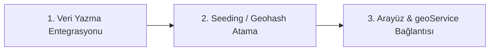

# 🗺️ OYNA Geofirestore Harita Arama & Proximity Mimarisi

Bu belge, **OYNA** premium spor ekosisteminde (Saha Keşfi, Kaleci/Hakem Pazaryeri ve Rakip Bul) kullanılacak coğrafi mesafe tabanlı harita aramalarının **Geofirestore / Geohash** mimarisiyle nasıl uçtan uca uygulanacağını ve harita arayüzümüzle (Leaflet/React-Leaflet) nasıl entegre edileceğini açıklar.

---

## 1. ⚙️ Neden Geofirestore / Geohash?

Firestore, doğası gereği coğrafi mesafe (radius) sorgularını doğrudan desteklemez. Örneğin, "Benim konumuma 5km mesafedeki sahaları getir" gibi bir sorguyu klasik SQL'deki `WHERE distance < 5` şeklinde yapmak mümkün değildir.

### 🌟 Çözüm: Alfasayısal Geohash Ağı
1. **Dünyayı Gridlere Bölme:** Dünya yüzeyi, her biri alfasayısal bir string ile temsil edilen ızgaralara (grid) bölünür.
2. **Karakter Uzunluğu ve Hassasiyet:** String uzunluğu arttıkça konum hassasiyeti artar:
   * **5 Karakter:** ~4.9 km x 4.9 km hata payı (Saha keşfi için mükemmel)
   * **6 Karakter:** ~1.2 km x 1.2 km hata payı
3. **Prefix Range Sorgusu:** Firestore'da yan yana bulunan noktalar benzer geohash prefixlerine sahiptir. Bu sayede Firestore'da range sorguları (`startAt` ve `endAt`) kullanarak anlık filtreleme yapabiliriz.

---

## 2. 🛠️ Geliştirdiğimiz Altyapı Modülleri

Harita sisteminin sıfır hata ile çalışabilmesi için iki temel katmanı tamamladık:

```
├── 📁 utils
│   └── 📄 geo.ts          <-- Matematiksel Motor (Haversine & Geohash & Grid Neighbors)
└── 📁 services
    └── 📄 geoService.ts   <-- Firestore Entegrasyon Motoru (Parallel Grid Queries & Dedup & Distance Sort)
```

### 2.1. Matematiksel Motor (`utils/geo.ts`)
* **Haversine Distance:** İki koordinat arasındaki kuadratik dünya eğrisini hesaba katarak en doğru kuş uçuşu mesafeyi (KM bazında) hesaplar.
* **Geohash Encoder:** Koordinatları 32'lik tabanda stringe kodlar.
* **Neighbor Finder:** Kenar sınırlarında (border) kalan sahaların kaybolmaması için, merkez geohash'in etrafındaki **8 komşu ızgarayı** da bularak 9'lu grid arama alanı oluşturur. Bu, sınırlardaki kör noktaları (blindspots) %100 yok eder.

### 2.2. Query Motoru (`services/geoService.ts`)
* **Parallel Querying:** Firestore'un performansını korumak için 9 grid aramasını `Promise.all` ile paralel çalıştırır.
* **Deduplication:** Sınır çakışmalarından dolayı mükerrer gelen verileri anında temizler.
* **Client-Side Distance Filtering:** Gelen sonuçları tam Haversine mesafesine göre filtreler ve **en yakından en uzağa** sıralar.

---

## 3. 🎨 Premium UI/UX Entegrasyon Önerileri (Harita & Tasarım)

OYNA'nın premium neon-dark estetiğini haritada korumak için şu etkileşim mekaniklerini öneriyorum:

### 3.1. Akıllı "Haritayı Kaydırdıkça Ara" (Search As Map Moves)
Kullanıcı Leaflet haritasını sürükleyip bıraktığında (`dragend` veya `zoomend`), haritanın yeni merkez koordinatları alınarak otomatik olarak o bölgedeki sahalar/oyuncular Firestore'dan tekrar sorgulanmalıdır.

```typescript
import { useMapEvents } from 'react-leaflet';

const MapMovementListener = ({ onCenterChange }: { onCenterChange: (lat: number, lng: number) => void }) => {
  const map = useMapEvents({
    dragend: () => {
      const center = map.getCenter();
      onCenterChange(center.lat, center.lng);
    },
    zoomend: () => {
      const center = map.getCenter();
      onCenterChange(center.lat, center.lng);
    }
  });
  return null;
};
```

### 3.2. Airbnb Tarzı Dinamik Fiyat Pinleri (Neon Glow)
Klasik kırmızı Google pinleri yerine, Leaflet `divIcon` kullanarak sahaların kişi başı veya toplam fiyatlarını gösteren neon yeşil parlayan kutucuklar kullanmalıyız.
* **Seçili Olmayan Saha:** Siyah arka plan, ince neon yeşil kenarlık, neon yeşil fiyat yazısı.
* **Seçili Saha:** Neon yeşil arka plan, siyah fiyat yazısı, `shadow-[0_0_20px_rgba(57,255,20,0.6)]` parlaması ve Framer Motion ile hafif büyüme efekti.
*(Bu yapı halihazırda `PitchDiscovery.tsx` içinde `AIRBNB_MAP_CSS` ile kurgulanmıştır.)*

### 3.3. Harita Üzerinde "Yarım Kart" Kaydırma (Swipeable Bottom Sheet)
Kullanıcı haritada gezinirken, ekranın altında seçili sahanın premium detaylarını gösteren, sağa/sola kaydırılabilir (horizontal scroll) mini bir kart listesi yer almalıdır. Kart kaydırıldıkça, harita otomatik olarak o karttaki sahanın üzerine uçarak (`map.flyTo([lat, lng], 14)`) odaklanmalıdır.

---

## 4. 📝 Uygulama & Entegrasyon Yol Haritası

Harita sistemini canlıya almak için izleyeceğimiz 3 adımlı aksiyon planı:



### 📂 ADIM 1: Veri Yazma Aşamasında Geohash Üretimi
Kullanıcı veya Tesis Sahibi yeni bir saha eklediğinde veya koordinat güncellediğinde, `firebaseMutations.ts` içinde geohash değerini otomatik hesaplayıp kaydetmeliyiz.

* **Yapılacak Düzenleme (`firebaseMutations.ts`):**
```typescript
import { encodeGeohash } from './utils/geo';

export const fbAddPitch = async (pitch: Omit<Pitch, 'id'>) => {
    const newDoc = doc(collection(db, 'pitches'));
    const geohash = encodeGeohash(pitch.coordinates.lat, pitch.coordinates.lng);
    await setDoc(newDoc, { 
        ...pitch, 
        id: newDoc.id,
        geohash // Firestore coğrafi indeks alanı
    });
};
```

### 📂 ADIM 2: Mevcut Sahaların Geohash'lenmesi (Migration Script)
Veritabanınızda şu ana kadar kayıtlı olan tüm sahalara koordinatlarına göre otomatik geohash atayan tek seferlik bir seed script'i çalıştıralım. Böylece harita boş kalmaz.

### 📂 ADIM 3: Arayüzlerin `geoService` ile Canlıya Bağlanması
`PitchDiscovery.tsx` ve `OpponentFinder.tsx` ekranlarındaki statik filtreleme mantığını, yeni yazdığımız `getPitchesWithinRadius` servisi ile değiştirerek tamamen dinamik ve sunucu odaklı hale getirelim.

---

> [!IMPORTANT]
> **Kerem Bey,** coğrafi altyapıyı tamamen kurmuş durumdayız! 
> 1. İlk olarak mevcut veritabanınızdaki sahaları geohash'lemek için **Adım 2 (Migration Script)**'yi mi yazalım?
> 2. Yoksa `firebaseMutations.ts` dosyasını güncelleyerek **Adım 1 (Yazma Entegrasyonu)**'den mi başlayalım?
