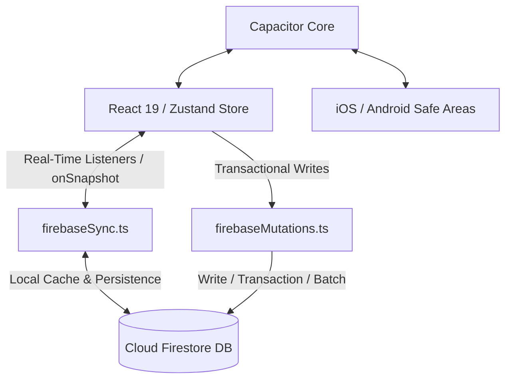

# ⚡ OYNA Ekosistemi: Mimari, Tasarım Temeli ve Vizyon Master Belgesi

Bu belge, **OYNA** premium, oyunlaştırılmış ve modern spor (futbol) ekosisteminin tasarım felsefesini, teknik mimarisini ve ürün perspektifini tanımlayan kapsamlı rehberdir. Bu master doküman, uygulamanın kod kalitesini, UI/UX standartlarını ve iş mantığını korumak ve geliştirmek amacıyla hazırlanmıştır.

---

## 1. 👁️ Vizyon ve Bakış Açısı (The OYNA Perspective)

OYNA, sıradan bir "halı saha eşleştirme" veya "saha kiralama" uygulaması değildir. Temel amacı; sokak futbolu ve amatör futbol ekosistemini **EA Sports FIFA Ultimate Team (FUT)**, **Football Manager (FM)** ve **Athletic-Tech** vizyonuyla dijitalleştirmek, oyunculara kendilerini birer profesyonel futbolcu gibi hissettirecek bir oyunlaştırma dünyası sunmaktır.

### 🌟 Ana Perspektif Direkleri:
1. **Profesyonel Futbolcu Hissiyatı:** Her oyuncunun bir FUT kartı gibi sergilendiği, performans istatistiklerinin (Hız, Şut, Pas vb.) doğrulanarak karta işlendiği ve MVP/MOTM (Maçın Oyuncusu) seçilenlerin özel animasyonlarla paket açılış kutlamaları yaşadığı bir ekosistem.
2. **Güven ve Sportmenlik (Fair Play):** Sistem, rekabeti desteklerken sportmenliği en üstte tutar. Dinamik **FP (Fair Play) Skoru** ve **Güvenilirlik Skoru (Reliability)** ile toksik davranışlar filtrelenir.
3. **Rol Odaklı Özelleşmiş Deneyim:** Uygulama tek bir arayüz sunmaz; kullanıcının rolüne göre (`PLAYER`, `CAPTAIN`, `GOALKEEPER`, `REFEREE`, `OWNER`) tamamen farklı modüller ve dashboard'lar sunan yaşayan bir organizmadır.
4. **Hizmet ve Finans Havuzu:** Kaleci ve hakemlerin birer serbest yetenek olarak kiralandığı, takımların birbirine meydan okuduğu ve ödemelerin havuz sistemiyle (Split Payment) bölüşüldüğü uçtan uca bir pazar yeri.

---

## 2. 🎨 Tasarım Manifestosu ve UI/UX Prensipleri

Uygulamanın görsel tasarımı **premium, dinamik, agresif ve neon** bir dille oluşturulmuştur. Aşağıdaki kurallar tüm UI bileşenlerinde istisnasız uygulanır:

### 2.1. Renk Paleti ve Zemin Mantığı (Dark Mode & Cyberpunk)
* **Temel Arka Planlar:** Derin lacivert ve siyah tonları kullanılır (`bg-[#0A0E14]`, `bg-[#06080A]` veya `bg-black`). Düz açık gri, beyaz zeminler kesinlikle yasaktır.
* **Glassmorphism (Cam Kartlar):** Paneller, kartlar ve modallar düz renk yerine yarı saydam ve arkasını bulanıklaştıran cam efektiyle oluşturulur:
  ```tailwind
  bg-[#161B22]/80 backdrop-blur-md border border-white/5 shadow-[0_8px_32px_rgba(0,0,0,0.4)]
  ```
* **İnce Kenarlıklar (Borders):** Kartların sınırlarını belirlemek için çok ince, yarı saydam çizgiler kullanılır (`border border-white/5` veya `border border-white/10`).
* **Neon Vurgular (Accent Colors):** 
  * **Ana Vurgu (Neon Yeşil/Sarı):** Butonlar, aktif durumlar ve kritik veriler için **Neon Yeşili (`#39FF14`)** veya **Neon Sarısı (`#FFFF00`)** kullanılır.
  * **Durum Vurguları:** Premium durumlar için mor/altın geçişleri, cezalar ve kartlar için parlak kırmızı ve zümrüt yeşili tonları.

### 2.2. Agresif ve Taktiksel Tipografi
* **Büyük Başlıklar ve Sayılar:** Futbolun hızını yansıtmak adına kalın, eğik ve dar harf aralıklı (uppercase, italic, tracking-tighter) yapılar seçilir.
* **Data Etiketleri ve Alt Başlıklar:** Çok küçük boyutlu, kalın, büyük harf ve geniş harf aralıklı (`text-[10px] uppercase font-bold tracking-widest text-white/50`) formatta yazılır.

### 2.3. Geometri ve Glow (Parlama) Efektleri
* **Köşeler:** Kaba ve sivri köşeler kullanılmaz. Butonlar, kartlar ve görseller yuvarlatılmış köşelere (`rounded-[32px]`, `rounded-2xl`, veya tam yuvarlak `rounded-full`) sahiptir.
* **Ambient Glow:** Aktif elementlerin arkasından sızan renkli ambient ışıklar ve neon gölgeler eklenir:
  ```tailwind
  shadow-[0_0_20px_rgba(57,255,20,0.25)]
  ```
* **Doku Overlays:** Kartların üzerine absolute konumlandırılmış karbon fiber veya ince çizgili taktiksel arka plan dokuları eklenerek zenginlik katılır.

### 2.4. Animasyonlar ve Mikro Etkileşimler
* **Framer Motion Kullanımı:** Arayüzün canlı hissettirmesi için tıklanabilir tüm elementlerde organik hover ve tap efektleri kullanılır:
  ```typescript
  whileHover={{ scale: 1.02 }}
  whileTap={{ scale: 0.98 }}
  ```
* **Giriş Animasyonları (Staggered Entry):** Listeler ekrana girerken aşağıdan yukarı doğru, hafif gecikmeli ve spring fizik mekaniğiyle animasyonlandırılır.

---

## 3. ⚙️ Teknik Mimari ve Teknoloji Yığını

Uygulamanın mimarisi, mobil öncelikli (mobile-first), gerçek zamanlı (real-time) ve çevrimdışı çalışmaya elverişli bir yapıdadır.



### 3.1. Frontend Teknolojileri
* **Core Framework:** React 19 + TypeScript + Vite.
* **Styling & CSS:** TailwindCSS v4. Tema tanımlamaları, iOS Safe Area değişkenleri (`--safe-top`, `--safe-bottom`) ve global mesh gradient animasyonları `index.css` içerisinde tanımlanmıştır.
* **State Management:** **Zustand (`store.ts`)**. Navigasyon, aktif kullanıcı rolleri, geçici seçimler (seçili kaleci, hakem, maç detayı) tek bir global store üzerinden yönetilir.
* **Visuals & Charts:** İstatistikler için Recharts, harita entegrasyonu için Leaflet ve React-Leaflet, ikonlar için sadece `lucide-react`.

### 3.2. Backend ve Senkronizasyon Katmanı
* **Firebase Authentication:** Telefon/OTP ve E-posta tabanlı güvenli giriş altyapısı.
* **Cloud Firestore:**
  * **`firebaseSync.ts` (Okuma/Dinleme):** Gerçek zamanlı Firestore dinleyicileri (`onSnapshot`), veritabanındaki güncellemeleri anlık olarak Zustand store'a aktarır. Çevrimdışı önbellekleme aktiftir.
  * **`firebaseMutations.ts` (Yazma):** Tüm veritabanı yazma, güncelleme ve silme operasyonları bu servis üzerinden kontrollü bir şekilde gerçekleştirilir. Çakışmaları önlemek için Firestore Transaction ve Write Batch yapıları kullanılır.
* **Firestore Security Rules (`firestore.rules`):** Rol tabanlı yetkilendirme sistemi istemci tarafındaki tüm yazma işlemlerini veritabanı seviyesinde doğrular (Örn: Sadece takım kaptanı takım kadrosunu güncelleyebilir).

### 3.3. Mobil Entegrasyon (Capacitor)
* Uygulama, Capacitor kullanılarak yerel iOS ve Android paketlerine dönüştürülebilir.
* Notch ve Dynamic Island uyumluluğu için `viewport-fit=cover` ve CSS Safe Area padding sınıfları (`safe-top`, `safe-bottom`) kullanılmıştır.

---

## 4. 🧩 Ana Modüller ve İş Akışları (Workflows)

### 4.1. Yetenek Pazaryeri (Marketplace - Talent Hub)
* **Kiralama & Teklif Verme:** Kaptanlar eksik kadroları için dışarıdan kaleci (`GOALKEEPER`) veya hakem (`REFEREE`) kiralayabilir.
* **FOMO Arayüzü:** İlanların üzerinde anlık kaç kişinin ilanı incelediği gösterilerek ("🔥 12 Kaleci İnceliyor") hızlı karar alma tetiklenir.
* **Teklif Akışı:** Kaptan doğrudan teklif gönderebilir veya kaleciler/hakemler açık ilana kendi tekliflerini (bidding) iletebilir.

### 4.2. Taktik Stüdyosu (Studio - Tactics Studio)
* **Kadrolama ve Formasyonlar:** Kaptanlar 5+1, 6+1 veya 7+1 taktik dizilimlerini (`2-3-1`, `3-2-1` vb.) seçebilir.
* **Sürükle-Bırak Yerleşim:** Oyuncuların konumları taktik tahtası (`LiveTacticBoard.tsx`) üzerinde sürüklenerek özelleştirilebilir, bu veriler Firestore üzerinden tüm takım üyelerine anlık senkronize olur.
* **Taktik Çizim:** Tahta üzerinde gerçek zamanlı çizim yapabilme özelliği ile maç öncesi planlamalar görselleştirilir.

### 4.3. Finans ve Ödeme Altyapısı
* **Güvenli Ödeme Havuzu (Split Payment Pool):** Maç kiralama ücreti tüm oyuncular arasında bölüştürülür. Kaptan garantörlüğü (`Safety Net`) ile rezervasyon güvence altına alınır.
* **Dijital Maç Bileti:** Ödeme tamamlandığında, QR kod barındıran dinamik bir dijital maç kartı oluşturulur. Tesis girişinde QR okutularak katılım doğrulanır.
* **İptal Cezası:** Maça 2 saatten az süre kala maçı iptal eden veya katılımını geri çeken kullanıcının Güvenilirlik Skoru otomatik olarak düşürülür.

### 4.4. Topluluk ve Kulüpler (Community Hub)
* **E-Posta Doğrulaması:** Üniversite veya şirket topluluklarına katılmak için domain doğrulaması yapılır (Örn: `@boun.edu.tr`).
* **Transfer Merkezi:** Boşta olan oyuncuların transfer listesinde kendilerini sergilemesi, takımların oyunculara teklif iletmesi.
* **Turnuva Braketleri:** Otomatik oluşturulan eleme usulü dinamik turnuva braket ekranları (`TournamentBracket.tsx`).

### 4.5. AI Coach (Hoca AI)
* **Gemini API Entegrasyonu:** Oyuncuların geçmiş maç performanslarını, Fair Play puanlarını ve taktik tercihlerini analiz ederek taktiksel öneriler sunan, takımlara rakip analizi yapan yapay zeka asistanı.

---

## 5. 🗺️ Coğrafi Konum ve Mesafe Altyapısı (Proximity Search)

* **Geohash ve Mesafe Sorguları:** Firestore'un coğrafi sorgu kısıtlamalarını aşmak için **Geohash** algoritması kullanılır (`utils/geo.ts`).
* **Komşu Hücre Taraması (Neighbor Grid Lookup):** Sınır bölgelerinde kalan sahaların kaçırılmaması için merkez geohash'in etrafındaki 8 komşu hücre paralel olarak sorgulanır (`Promise.all`).
* **Haritada Fiyat Pinleri (Airbnb Style):** Leaflet üzerinde standart pinler yerine, fiyatları gösteren yarı saydam parlayan butonlar kullanılır. Seçilen saha otomatik olarak haritada ortalanır (`map.flyTo`).

---

## 6. 🚀 Gelecek Yol Haritası ve Geliştirme Odakları

1. **Ödeme Entegrasyonları:** İyzico veya Param API'leri ile Split Payment altyapısının gerçek bankacılık sistemine bağlanması.
2. **Video Analiz & AI Clip:** Maç içi kameralardan gelen görüntülerin işlenerek oyuncu kartlarındaki istatistiklerin (Hız, Şut Gücü) otomatik güncellenmesi.
3. **Turnuva Lig Motoru:** Puan durumu, gol krallığı ve kart cezalarını otomatik yöneten lig motoru.

---
> [!NOTE]
> Bu master belgesi, **OYNA** projesinin DNA'sını oluşturur. Ekosisteme eklenecek her yeni kod satırı, bu felsefe ve mimari standartlara sadık kalınarak geliştirilmelidir.
