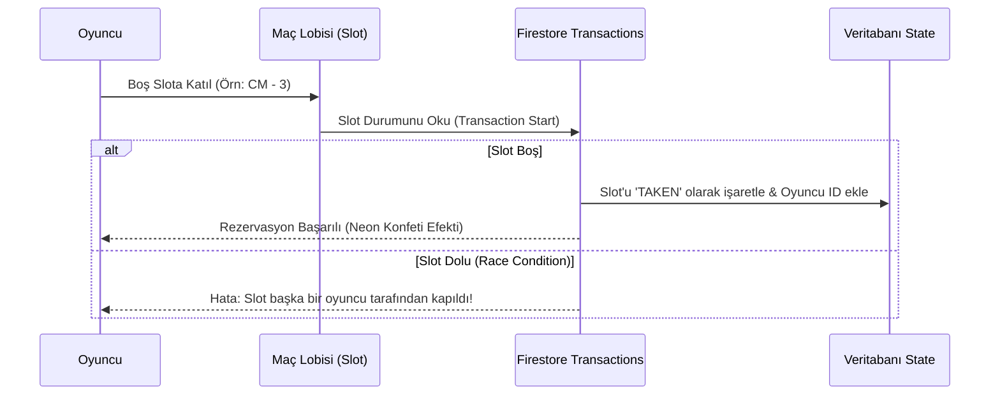
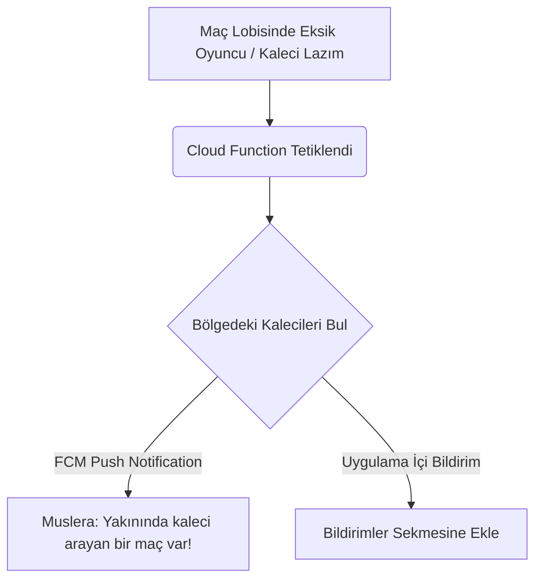

> **ARŞİV — Supabase öncesi.** Bu belge, proje Firebase/Firestore kullanırken yazılmıştır. Backend artık tamamen Supabase'e taşınmıştır (`supabaseClient.ts`, `supabaseAuth.ts`); aşağıdaki Firestore'a özgü sorular ve mimari önerileri güncel mimariyi yansıtmıyor. Yalnızca tarihsel referans ve henüz cevaplanmamış iş mantığı sorularını (örn. anlaşmazlıklı maç skoru senaryosu) görmek için saklanmaktadır.

# ⚡ OYNA Backend Geçiş Planı & Sıfır Hata Soru Manifestosu

Bu belge, **OYNA** premium, oyunlaştırılmış ve modern spor ekosisteminin frontend ve mevcut Firebase mock/listener yapısını, **sıfır hata (zero-defect) ve sıfır eksik** ile üretim (production) kalitesinde bir backend mimarisine taşımak için yanıtlanması gereken kritik mimari, veri ve iş mantığı sorularını içerir.

Mevcut yapıda Firebase Firestore, Zustand store ve `firebaseMutations.ts` ile basic veri yazma/okuma işlemleri yapılsa da, uygulamanın **EA Sports / FIFA Ultimate Team** hissiyatını veren "Athletic-Tech" vizyonuna ulaşması için arkada çok daha güçlü bir transactional bütünlük, güvenlik kuralları ve optimize edilmiş servisler çalışmalıdır.

---

## 1. 👥 Kullanıcı Kimlik Doğrulama & Rol Yönetimi

OYNA ekosisteminde kullanıcılar birden fazla role sahip olabilir veya rolleri arasında geçiş yapabilirler (Oyuncu, Kaptan, Kaleci, Hakem, Saha Sahibi).

### 🔍 Kritik Sorular:
1. **Çoklu Giriş Yöntemleri:** Şu anda sadece Google ile giriş (`signInWithPopup`) entegre edilmiş durumda. iOS (Capacitor/App Store) yayını için **Apple Sign-In** ve sporcuların sahada hızlıca giriş yapabilmesi için **SMS (OTP - Tek Kullanımlık Şifre)** doğrulaması eklemeli miyiz?
2. **Rol Geçişleri ve Veri Ayrımı:** Bir kullanıcı hem aktif bir **Oyuncu/Kaptan** hem de kiralanabilir bir **Kaleci** veya **Hakem** olabilir mi? Eğer olabiliyorsa:
   - Kaleci ve Hakemlerin profil detayları, saatlik/maçlık ücretleri ve tercih ettikleri bölgeler `users` tablosu altında tek bir şemada mı birleştirilmeli, yoksa mevcut `goalkeepers` ve `referees` koleksiyonları gibi bağımsız koleksiyonlar halinde mi tutulmalı?
3. **Profil Doğrulama (Verification):** Admin panelinde bulunan `verifyUser` (Mavi Tik/Onaylı Profil) işlemi hangi kriterlere göre yapılacak? Otomatik bir doğrulama algoritması olacak mı (örn: 10+ maç tamamlamış ve FP skoru > 90 olanlar) yoksa tamamen manuel mi kalacak?

---

## 2. ⚽ Maç Operasyonları, Slot Yönetimi & Transactional Güvenlik

Maç bulma (`Match Discovery`), Kadro Oluşturma (`Match Lobby`) ve Taktik Tahtası (`Taktik Studio`) uygulamanın en kritik modülleridir.

### 🔍 Kritik Sorular:
1. **Race Condition Önleme:** İki oyuncu aynı anda maç lobisindeki son boş slota tıkladığında veritabanı düzeyinde çakışmayı önlemek için Firestore **Transactions (runTransaction)** mimarisini tamamen kurmalı mıyız?
2. **Fair Play (FP) ve Güvenilirlik Skoru:** Bir oyuncu maça katılma sözü verip gelmediğinde ya da maçı son dakika iptal ettiğinde:
   - FP skoru ve "Reliability Score" (Güvenilirlik Oranı) otomatik olarak ne kadar düşmeli?
   - Otomatik ban sistemi olacak mı? (Örn: Güvenilirlik skoru %70'in altına düşen oyuncu 3 gün boyunca yeni maç oluşturamaz / maçlara katılamaz).
3. **Disput (Anlaşmazlık) Yönetimi:** Maç skorları kaptanlar tarafından giriliyor. Ev sahibi kaptan maçı "5-3 kazandık", deplasman kaptanı ise "4-4 berabere bitti" diye girdiğinde veritabanı hangi skoru kabul edecek?
   - Hakemli maçlarda hakemin girdiği skor mutlak doğru mu sayılacak?
   - Hakemsiz maçlarda anlaşmazlık durumunda maç "WAITING_APPROVAL" durumunda kalıp Super Admin paneline dispute olarak mı düşecek?

---

## 3. 💳 Finansal Model, Ödeme Bölüşümü & Cüzdan (Wallet)

OYNA, oyuncuların saha kiraladığı, kaleci/hakem kiraladığı ve ödemeyi bölüştüğü karmaşık bir finansal döngüye sahiptir.

### 🔍 Kritik Sorular:
1. **Ödeme Altyapısı / Gateway:** Hangi yerel veya uluslararası ödeme entegratörünü kullanacağız? (iyzico, Param, Stripe vb.).
2. **Ödeme Bölüşüm Modeli (Split Payment):** Bir maç oluşturulduğunda ödeme nasıl tahsil edilecek?
   - **Model A (Full Payment):** Maçı kuran kaptan tüm saha ücretini tek seferde öder, arkadaşları ona elden veya uygulama içi cüzdandan gönderir.
   - **Model B (Split Payment):** Kaptan sahayı rezerve etmek için sadece kapora öder. Kalan tutar maç saatine kadar lobideki oyuncular arasında eşit bölünerek herkesin kendi kartından çekilir. Ödemesini yapmayan olursa maç iptal edilir.
   - **Model C (Wallet System):** Her kullanıcının bir OYNA Cüzdanı olur. Ödemeler bu cüzdan üzerinden anlık ve komisyonsuz gerçekleşir.
3. **Hakem/Kaleci Hak Edişleri:** Kiralanan hakem ve kalecilerin ücretleri ne zaman hesaplarına aktarılacak? Maç biter bitmez otomatik olarak mı, yoksa kaptanların maçı onaylamasından veya 24 saatlik itiraz süresinin dolmasından sonra mı?
4. **Platform Komisyonu:** Platformun alacağı komisyon oranı (`commissionRate`) ve Pro üyelik fiyatları (`proPrice`) dinamik olarak `settings` dokümanından güncelleniyor. Bu güncellemelerin geçmiş işlemleri etkilememesi için geçmiş faturalandırma kayıtlarını bağımsız bir `transactions` koleksiyonunda arşivlemeli miyiz?

---

## 4. 🧠 Taktik Studio, Kadro Kurucu & Dinamik İstatistikler

Kullanıcıların kendi takımlarını kurup sahaya dizdikleri, FIFA Ultimate Team tarzı premium oyunlaştırma ekranıdır.

### 🔍 Kritik Sorular:
1. **Dinamik Takım Değeri (Team Value):** Takımların toplam değeri (`teamValue`) ve oyuncuların reytingleri (`rating`) hangi formüle göre dinamik olarak hesaplanacak?
   - Maç sonu alınan MVP/MOTM (Maçın Oyuncusu) oylamaları reytingi doğrudan artıracak mı?
2. **Kadro Fotoğrafları ve Galeri:** Oyuncuların mevkilerdeki taktiksel yerleşim kartlarında görselleri yer alıyor. Firestore ve Firebase Storage entegrasyonunda, profil fotoğraflarının otomatik kırpılması ve premium kart şablonuna (Gold/Silver/Bronze) uygun şekilde render edilmesi için backend tabanlı bir image-processing (Cloud Functions) kurgulayalım mı?
3. **Taktik Kaydetme Limitleri:** Standart bir oyuncu kaç farklı taktik diziliş kaydedebilir? Pro oyuncular için sınırsız taktik hakkı veya özel taktik şablonları olacak mı?

---

## 5. 🔔 Bildirim Mimarisi & Real-Time Push Notifications

Uygulamanın canlı hissettirmesi için push notification'lar hayati önem taşır.

### 🔍 Kritik Sorular:
1. **Bildirim Kanalları:** Bildirimleri sadece uygulama içi (`Zustand store + App State`) olarak mı göstereceğiz, yoksa **Firebase Cloud Messaging (FCM)** entegrasyonu ile mobil cihaz kapalıyken bile anlık push notification gönderecek miyiz?
2. **Kritik Bildirim Senaryoları:** Hangi olaylar kesinlikle anlık bildirim tetiklemelidir?
   - "Kaleci/Hakem teklif verdi"
   - "Maç saatiniz yaklaşıyor (Son 2 saat ödeme uyarısı)"
   - "Maçın Oyuncusu (MOTM) oylaması başladı!"
   - "Takımınıza yeni bir transfer teklifi var"

---

## 6. 🗄️ Veritabanı Mimarisi & Ölçeklenebilirlik (Firestore Rules)

Firestore'un güvenli ve hızlı çalışması için şema tasarımı ve güvenlik kuralları mükemmel olmalıdır.

### 🔍 Kritik Sorular:
1. **Coğrafi Sorgular (Geo-queries):** Oyuncuların yakınlarındaki sahaları (`pitches`) ve rakipleri (`opponentAds`) bulabilmesi için coğrafi mesafe hesaplamalarını backend (GeoFirestore / Geohash) düzeyinde mi yapmalıyız, yoksa şimdilik ilçe/semt bazlı metin eşleşmesi yeterli mi?
2. **Firestore Security Rules:** Şu anda kurallar oldukça esnek veya test modunda olabilir. Üretime geçişte:
   - Sadece takım kaptanının takım kadrosunu değiştirebilmesi,
   - Sadece maça katılmış oyuncuların post-match oylama yapabilmesi gibi katı kuralları Firestore Security Rules düzeyinde mi yazacağız, yoksa bunları güvenli Cloud Functions (API endpoints) arkasına mı alacağız?
3. **Yedekleme ve Felaket Kurtarma (Backup & Disaster Recovery):** Canlı veritabanının günlük otomatik yedeklenmesi ve test ortamı ile prod ortamının ayrılması için nasıl bir pipeline kurgulayalım?

---

> [!IMPORTANT]
> **Kerem Bey,** bu soruların yanıtları OYNA platformunun backend mimarisinin **temel kolonlarını** oluşturacaktır. Soruları inceledikten sonra öncelik verdiğiniz maddeleri ve iş modelinize en uygun yanıtları paylaşırsanız, backend kodlamasına sıfır hata toleransı ile hemen başlayabiliriz!
