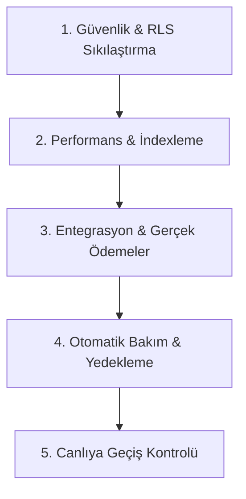

# OYNA Platformu - Veritabanı Üretim (Production) ve Optimizasyon Kılavuzu

Bu kılavuz, Oyna uygulamasının canlıya (App Store, Google Play ve Web) geçişi öncesinde veritabanının (Supabase/PostgreSQL) kesintisiz, güvenli ve yüksek performanslı çalışabilmesi için hazırlanmış bir **dünya standartlarında mühendislik planıdır**. 

Kod bilginiz olmasa dahi bu adımları takip ederek geliştirici ekibinizi yönlendirebilir, veritabanının durumunu denetleyebilir ve uygulamanın canlıda sorunsuzca çalışmasını sağlayabilirsiniz.

---

## 1. MEVCUT VERİTABANI DURUM ANALİZİ VE TEHLİKELİ ALANLAR

Uygulamanın veritabanı PostgreSQL 17.6 altyapısı üzerine kurulmuştur ve Supabase ile yönetilmektedir. Hali hazırda 193 göç (migration) adımıyla olgunlaşmış bir şemaya sahiptir. Ancak canlı yayına çıkmadan önce giderilmesi gereken bazı **mimari zayıflıklar** ve **güvenlik açıkları** bulunmaktadır:

### ⚠️ Kritik Güvenlik ve RLS Açıkları
1.  **Cüzdan İşlemleri (`wallet_transactions`):** Cüzdan geçmişi hassas finansal veriler barındırır. Canlıya geçmeden önce bu tablonun sadece ilgili kullanıcı ve sistem yöneticileri (`is_platform_admin()`) tarafından okunabildiğinden emin olunmalıdır. Aksi halde bir kullanıcı, başka bir kullanıcının para giriş/çıkış loglarını görebilir.
2.  **Aşırı Serbest RLS Kuralları (`USING true`):** Eski test aşamalarından kalma bazı RLS politikaları, authenticated (giriş yapmış) herkese okuma yetkisi vermektedir. Canlı yayında bu durum veri sızıntılarına (KVKK ihlallerine) yol açabilir.

### ⚙️ Entegrasyon ve Mantık Hataları
1.  **Admin Rol Çakışması:** Yeni saha onay bildirimlerinde sistem `eq('role', 'ADMIN')` sorgusunu yapmaktadır. Fakat sistemin gerçek admin rol belirteci `SUPER_ADMIN` veya profil tablosundaki `is_admin = true` bayrağıdır. Bu mantıksal uyumsuzluk canlıda onay mekanizmasını tıkayacaktır.
2.  **Ödeme Entegrasyonunun Eksikliği (`SIMULATION` Modu):** Kapora bloke ve tahsilat süreçleri veritabanında tamamen simülasyon modundadır. İyzico API bağlantıları kurulana kadar gerçek ödeme alınamaz.

---

## 2. DÜNYA STANDARTLARINDA CANLI YAYINA HAZIRLIK VE OPTİMİZASYON PLANI

Veritabanını sıfır hata ile canlıya almak için 5 ana aşamalı bir optimizasyon süreci uygulanacaktır:



### AŞAMA 1: Güvenlik ve RLS (Satır Bazlı Güvenlik) Sıkılaştırması
Canlı ortamda hiçbir kullanıcının izinsiz veriye erişememesi için aşağıdaki SQL politikaları Supabase üzerinde güncellenmelidir:

*   **Cüzdan Logları Güvenliği:**
    ```sql
    ALTER TABLE public.wallet_transactions ENABLE ROW LEVEL SECURITY;
    CREATE POLICY "Kullanıcılar yalnızca kendi cüzdan hareketlerini görebilir" ON public.wallet_transactions
      FOR SELECT TO authenticated
      USING (user_id = auth.uid() OR public.is_platform_admin());
    ```
*   **Kimlik Belgesi Koruma (KVKK Uyum):** Kaleci ve hakemlerin yüklediği kimlik fotoğraflarının bulunduğu `provider-docs` private storage bucket RLS kuralları en sıkı seviyede tutulmalı, dışarıya açık URL (public link) üretilmesi engellenmelidir.

### AŞAMA 2: Performans ve İndexleme (Hızlı Yanıt Süresi)
Uygulama yayına girdiğinde binlerce oyuncu aynı anda maç arayacak ve slot rezerve edecektir. Veritabanının milisaniyeler içinde yanıt vermesi için foreign key (yabancı anahtar) kolonlarına index eklenmelidir:

*   **Kritik İndex Scriptleri:**
    ```sql
    -- Maçların hızlı aranması ve konum filtreleri için indexler
    CREATE INDEX IF NOT EXISTS idx_matches_status_date ON public.matches(status, date);
    CREATE INDEX IF NOT EXISTS idx_pitches_city_district ON public.pitches(city, district) WHERE verification_status = 'approved';
    CREATE INDEX IF NOT EXISTS idx_wallet_transactions_user_status ON public.wallet_transactions(user_id, status);
    ```

### AŞAMA 3: İş Mantığı ve Entegrasyon Onarımları
1.  **TC Kimlik Doğrulama Kilitlenmesini Önleme:** `pgcrypto` kütüphanesinin Supabase veritabanında kurulduğundan ve yetkilendirildiğinden emin olunmalıdır:
    ```sql
    CREATE EXTENSION IF NOT EXISTS pgcrypto WITH SCHEMA extensions;
    GRANT EXECUTE ON ALL FUNCTIONS IN SCHEMA extensions TO authenticated;
    ```
2.  **Admin Rollerindeki `ADMIN` / `SUPER_ADMIN` Uyuşmazlığının Giderilmesi:** `PartnerOnboarding.tsx` ve diğer tüm frontend kodlarındaki `.eq('role', 'ADMIN')` filtreleri `.eq('is_admin', true)` olarak revize edilmelidir.

---

## 3. VERİTABANI YÖNETİMİ VE BAKIM REHBERİ (YÖNETİCİ KILAVUZU)

Kod bilginiz olmadan veritabanını sağlıklı şekilde yönetebilmeniz için bilmeniz gereken kritik operasyonlar aşağıdadır:

### 1. Yedekleme ve Kurtarma (Backups & PITR)
*   **Strateji:** Canlı veritabanında Supabase üzerinden **Point-in-Time Recovery (PITR)** özelliğini aktif edin. Bu özellik, veritabanında yaşanabilecek bir veri kaybı veya yanlış işlem durumunda verileri saniyeler öncesine geri döndürmenizi sağlar.
*   **Yedek Sıklığı:** Günlük fiziksel yedekleme otomatik olarak Supabase tarafından yapılır. Kritik kampanya veya güncelleme dönemlerinden önce manuel yedek alınmalıdır.

### 2. Otomatik Vacuuming (Veritabanı Temizliği)
*   Oyuncular sürekli slot seçip bıraktıkça, PostgreSQL veritabanında "dead tuples" (çöp veriler) birikir. Supabase'in `Auto-Vacuum` özelliğinin aktif olduğunu kontrol edin. Haftalık olarak tabloların optimize edilmesi performansın düşmesini engeller.

### 3. Loglama ve Denetim (Audit Logs)
*   Admin panelinden yapılan tüm işlemler (kullanıcı banlama, bakiye ekleme/çıkarma, saha onaylama) `admin_audit_log` tablosuna yazılır. Bir adminin yetkisini kötüye kullanıp kullanmadığını denetlemek için bu tabloyu admin panelinden veya Supabase SQL editöründen izleyebilirsiniz.

---

## 4. CANLIYA GEÇİŞ (GO-LIVE) KONTROL LİSTESİ

Uygulamanın yayına alınacağı gün bu kontrol listesini teknik ekibinize onaylatın:

| Adım | İşlem Açıklaması | Sorumlu Rol | Durum |
| :--- | :--- | :--- | :--- |
| **1** | RLS politikalarının test edilmesi (Hiçbir tablo public açık olmamalı) | Veritabanı Yöneticisi | [ ] Bekliyor |
| **2** | `pgcrypto` uzantısının şema yetkilendirmesinin yapılması | Veritabanı Yöneticisi | [ ] Bekliyor |
| **3** | `payment_provider` parametresinin `IYZICO` olarak set edilmesi | Sistem Yöneticisi | [ ] Bekliyor |
| **4** | Tesis ve partner onay bildirimlerindeki rol filtrelerinin düzeltilmesi | Frontend Geliştirici | [ ] Bekliyor |
| **5** | PITR (Point-in-Time Recovery) özelliğinin aktif edilmesi | Sistem Yöneticisi | [ ] Bekliyor |
| **6** | Canlı Iyzico API anahtarlarının sisteme girilmesi ve test ödemesi | Proje Yöneticisi | [ ] Bekliyor |
