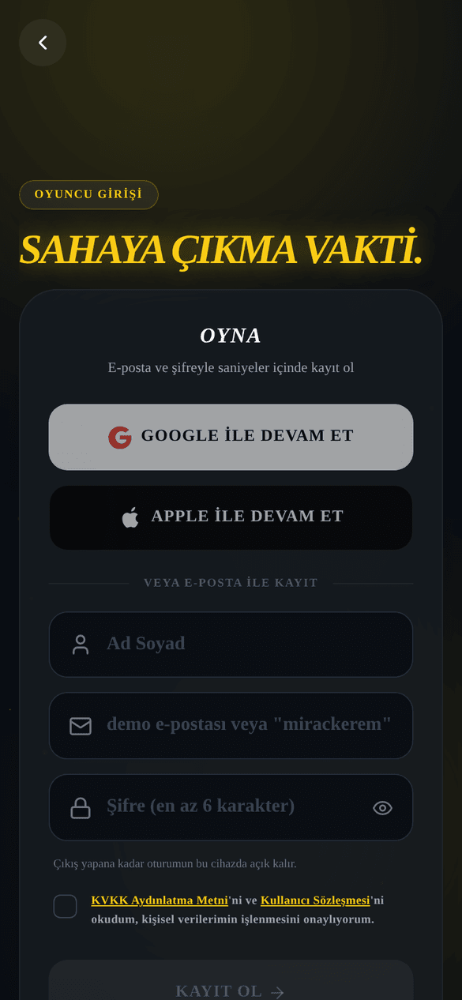
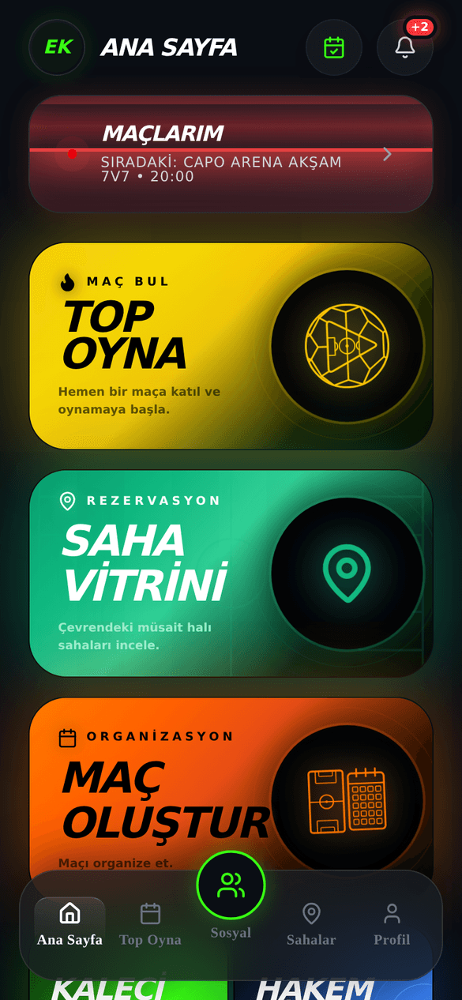
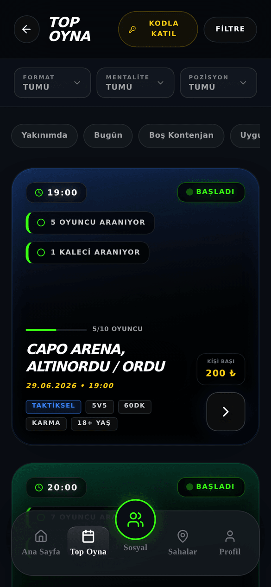
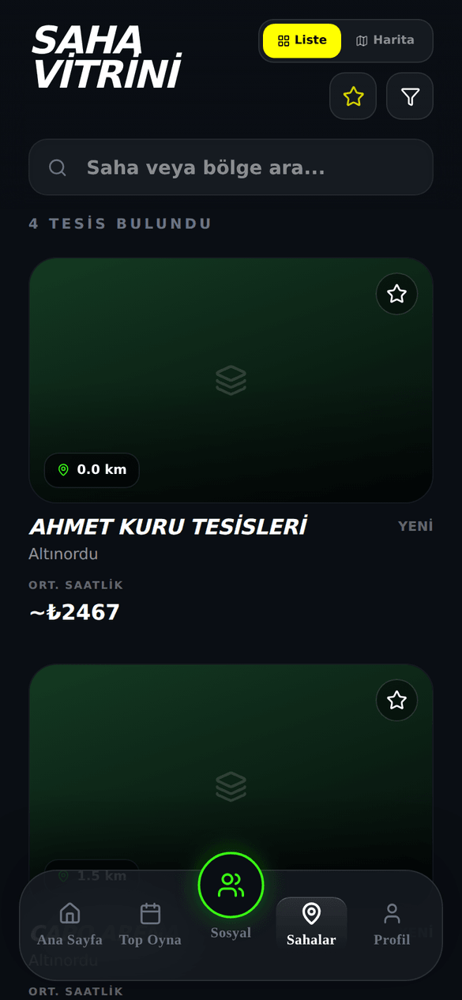

# OYNA Genel Kullanım Kılavuzu

_Son güncelleme: 26 Temmuz 2026 · Uygulama sürümü 3.0.0_

> Bu kılavuz, OYNA'yı ilk kez açan herkes içindir. Uygulamanın ne işe yaradığını, nasıl kayıt olacağını ve en sık yapılan işleri kısaca anlatır. Detaylar için her bölümde ilgili rol kılavuzuna yönlendirme bulacaksın.

## 1. Giriş

OYNA, halı saha futbolunun tek uygulaması. Çevrendeki açık maçları bulup katılırsın, kendi maçını kurup arkadaşlarını davet edersin, halı saha kiralarsın. Maçın için kaleci veya hakem mi lazım? Onaylı kaleci ve hakemleri uygulama içinden kiralarsın. Takımını kurar, taktiklerini çizer, maç geçmişini takip edersin.

Para tarafı güvenli: Ödemeler uygulama içindeki cüzdanın ve kayıtlı kartların üzerinden, banka doğrulamalı (3D Secure) olarak yapılır. Kaleci-hakem ücretleri ve maç kaporaları önce emanete alınır; iş tamamlanınca karşı tarafa geçer, tamamlanmazsa sana iade edilir. Kart bilgilerin OYNA'da saklanmaz; ödeme altyapısı iyzico'dur.

OYNA'da herkes bir "oyuncu" olarak başlar. İstersen kaleci, hakem veya saha sahibi olarak da başvurur, aynı hesapla roller arasında geçiş yaparsın. Bu kılavuz genel resmi verir; derinlemesine bilgi rol kılavuzlarındadır.

### Bir bakışta: hangi bölüm ne işe yarar

| Bölüm/Sekme | Ne işe yarar |
|---|---|
| **Ana Sayfa** | Komuta merkezin: maçların, hızlı kısayollar ve bildirimler burada. |
| **Top Oyna** | Çevrendeki açık maçları bul ve katıl. |
| **Sosyal** | Arkadaşlarını yönet, takım kur, takımına katıl. |
| **Sahalar** | Halı sahaları incele, kapora ödeyerek rezervasyon yap. |
| **Profil** | Oyuncu kartın, güven puanın, maç geçmişin ve ayarların. |
| **MAÇLARIM** | Katıldığın maçlar ve saha rezervasyonların tek listede. |
| **Cüzdan** | Para yükle, kartlarını yönet, işlem geçmişini gör. |
| **TAKTİK STÜDYO** | Diziliş ve taktik çiz, takımınla paylaş. |
| Mesajlar | Arkadaşlarınla ve takımınla yazış. |
| Ayarlar | Hesap, bildirim, konum, gizlilik ve yasal belgeler. |

## 2. Başlarken

_Şekil: Giriş ve kayıt ekranı — tüm giriş yolları tek ekranda._

OYNA'ya birkaç farklı yoldan girebilirsin:

1. **E-posta + şifre:** Ad soyad, e-posta ve en az 6 karakterli bir şifre ile **KAYIT OL**; sonraki girişlerde **GİRİŞ YAP**.
2. **Google ile giriş** — tek dokunuşla.
3. **Apple ile giriş** — iPhone'da tek dokunuşla.
4. **Kod ile giriş:** Şifre yerine e-postana veya telefonuna gelen tek kullanımlık kodla gir (**KOD İLE GİRİŞ YAP**).
5. **Misafir modu:** Kayıt olmadan göz atmak için **ÖNCE MAÇLARA GÖZ AT** butonuna dokun. Maçlara ve sahalara bakabilirsin; katılmak veya ödeme yapmak istediğinde kayıt olman istenir.

Devam etmeden önce ekrandaki **KVKK Aydınlatma Metni** ve **Kullanıcı Sözleşmesi** onay kutusunu işaretlemen gerekir; metinlere dokunarak tam hallerini okuyabilirsin. Şifreni unuttuysan **Şifremi unuttum** ile e-postana kod isteyip yeni şifre belirlersin.

Kayıttan sonra kısa bir tanışma sihirbazı açılır: konum izni, yaş aralığı, ad-soyad ve oyun stilin sorulur. İstediğin adımı **Atla** ile geçebilir, sonra Profil ekranındaki **Tamamla →** şeridinden geri dönebilirsin.

**13-17 yaş:** OYNA'yı kullanmak için en az 13 yaşında olmalısın. 13-17 yaş arasındaysan hesabın "sınırlı mod"da açılır: gezinmek ve ücretsiz maçlara katılmak serbest, ödeme gerektiren işlemler kapalıdır. Ödemeleri açmak için **Ayarlar → Veli Onayı** ekranından bir Veli Bağlantı Kodu üretip veline gönderirsin; velin onay formunu doldurunca sınırlama kalkar.

## 3. Roller: OYNA'da kim kimdir?

| Rol | Ne yapar | Kılavuzu |
|---|---|---|
| **Oyuncu** | Maç bulur, maç kurar, saha kiralar, takım yönetir. Herkesin temel rolü. | [Oyuncu Kılavuzu](01-oyuncu-kilavuzu.md) |
| **Kaleci** | Maçlara kiralık kaleci olarak katılır, maç başı ücret kazanır. | [Kaleci & Hakem Kılavuzu](02-kaleci-hakem-kilavuzu.md) |
| **Hakem** | Maçları yönetir, resmî skoru girer, maç başı ücret kazanır. | [Kaleci & Hakem Kılavuzu](02-kaleci-hakem-kilavuzu.md) |
| **Saha Sahibi** | Tesisini OYNA vitrinine ekler; rezervasyon, takvim ve kasayı yönetir. Ekibine **Müdür** ve **Personel** ekleyebilir. | [Saha Sahibi Kılavuzu](03-saha-sahibi-kilavuzu.md) |
| Admin | OYNA ekibidir: başvuruları onaylar, ödemeleri ve platformu yönetir. Son kullanıcıyı ilgilendirmez. | [Admin Kılavuzu](04-admin-kilavuzu.md) |

Kaleci, hakem ve saha sahibi rolleri başvuruya tabidir; başvurular OYNA ekibi tarafından incelenir (genellikle 24 saat içinde). Oyunculuğun her zaman açık kalır.

## 4. Alt menü: 5 sekme

_Şekil: Ana Sayfa ve alttaki 5 sekmeli menü._

Uygulamanın altındaki menüde 5 sekme vardır:

1. **Ana Sayfa** — Komuta merkezin. Üstte sıradaki maçının geri sayımı; altında büyük kartlar: **MAÇLARIM**, **TOP OYNA**, **SAHA VİTRİNİ**, **MAÇ OLUŞTUR**, **KALECİ BUL**, **HAKEM KİRALA** ve **TAKTİK STÜDYO**. Sağ üstteki zil ikonundan bildirimlerini açarsın.
2. **Top Oyna** — Açık maç listesi. Mesafe, ücret, cinsiyet ve yaş filtreleriyle sana uyan maçı bulursun; özel maçlara **Kodla Katıl** ile girersin.
3. **Sosyal** — Ortadaki yeşil buton. **Arkadaşlar** ve **Takımlar** sekmeleri: arkadaş ekle, takım kur, takım davetlerini yönet.
4. **Sahalar** — **SAHA VİTRİNİ**: çevrendeki halı sahaları listede veya haritada gör, favorile, rezervasyon yap.
5. **Profil** — Oyuncu kartın, güven puanın, maç geçmişin, **Cüzdan** kısayolun ve sağ üstte Ayarlar dişlisi.

## 5. En sık yapılan 5 iş

### 5.1 Maça katıl

_Şekil: Top Oyna — açık maçlar ve filtreler._

Adım adım:

1. Alt menüden **Top Oyna** sekmesine gir.
2. Filtreleri kullan (arama çapı, ücret, cinsiyet, yaş) veya hızlı çiplere dokun (`Bugün`, `Boş Kontenjan`, `Uygun Fiyat`).
3. Bir maç kartına dokun; Maç Lobisi açılır.
4. Sahadaki boş bir pozisyona dokunarak yerini seç.
5. Ücretli maçta **ÖDE VE KATIL** ile ödemeyi tamamla; ücretsiz maçta **SAHAYA ÇIK** yeterli.

Kadro doluysa **YEDEK OLARAK GİR** ile sıraya girebilirsin. Özel (kodlu) bir maça davetliysen Top Oyna'daki anahtar ikonuna dokunup kodu gir. Ayrıntılar: [Oyuncu Kılavuzu](01-oyuncu-kilavuzu.md).

### 5.2 Maç kur

1. Ana Sayfa'da **MAÇ OLUŞTUR** kartına dokun.
2. Format seç (3v3'ten 11v11'e).
3. **Saha & Saat** kartından sahayı ve saati seç (**Bu Saati Seç**).
4. İstersen **Kadro**, **Kaleci & Hakem** ve **Gelişmiş** ayarlarını düzenle (görünürlük, cinsiyet, yaş grubu, sertlik).
5. **YAYINLA & DAVET ET** butonuna dokun. Saha kaporası cüzdan bakiyenden güvenceye alınır; bakiyen yetersizse önce **Yükle**.

Kişi başı ücret, saha ücretinden otomatik hesaplanır. Kadro, toplam kadronun 2 eksiğine ulaştığında maç kesinleşir; maç dolmazsa iptal olur ve kaporan kesintisiz çözülür. Kapora ve iade kurallarının tamamı yayınlamadan önce **İade kuralları** bağlantısında yazar.

### 5.3 Saha kirala

_Şekil: Saha Vitrini — liste ve harita görünümü._

1. Alt menüden **Sahalar** sekmesine gir.
2. Listeden veya haritadan bir saha seç; filtre ve favori yıldızını kullanabilirsin.
3. Saha detayında kortu seç, **Tarih Seç** ile günü ve boş saati işaretle.
4. **Kaporayı Öde** ile ödemeyi tamamla. Kapora rezervasyon güvencesidir; kalan tutarı maç günü tesiste ödersin.
5. Rezervasyonun **Maçlarım** ekranındaki **Rezervasyonlar** segmentinde görünür; oradan iptal edebilir veya rezervasyonu maça çevirebilirsin.

### 5.4 Kaleci / hakem kirala

1. Ana Sayfa'da **KALECİ BUL** veya **HAKEM KİRALA** kartına dokun.
2. Listeden puanına, ücretine ve mesafesine bakarak bir sağlayıcı seç.
3. **Maçını Seç** — planlanmış maçlarından birini işaretle. (Maçın yoksa önce bir maç oluşturman gerekir.)
4. **Onayla ve Talep Gönder** — ücret emanete alınır; %10 platform komisyonu bedele dahildir, ek ücret çıkmaz.
5. Sağlayıcı kabul edince bildirim gelir. Ücret maçtan sonra sağlayıcıya aktarılır; sağlayıcı gelmezse sana iade edilir.

Aynı işlemi maç lobisindeki **Kaleci Ekle** / **Hakem Ekle** kartlarından da yapabilirsin (yalnız maçın kaptanıysan).

### 5.5 Para yükle

1. **Profil** sekmesine gir, **Cüzdan** kısayoluna dokun.
2. **Para Yükle** butonuna dokun.
3. Tutarı seç: hazır seçenekler 300, 500, 750, 1000, 1500₺; en az 300₺, en çok 20.000₺.
4. Kayıtlı kartını seç veya yeni kart ekle.
5. Bankanın SMS doğrulamasını (3D Secure) uygulama içinde tamamla; bakiye cüzdanında görünür.

## 6. Güven puanı

Profilinde 0-100 arası bir **Güven Puanı** görürsün. Bu puan sahadaki güvenilirliğini özetler: maçlarına zamanında gelmek, fair-play oynamak ve maç sonrası değerlendirmelerde iyi puan almak puanını yükseltir; kurduğun maçı son 24 saatten kısa süre kala iptal etmek gibi davranışlar düşürür. Puanın yüksekse yedek listesinden kadroya terfide öne geçersin ve verdiğin değerlendirmeler daha çok ağırlık taşır. Kısacası: sözünde dur, puanın seni taşısın.

## 7. Bildirimler

Bildirimlerini Ana Sayfa'nın sağ üstündeki zil ikonundan açarsın; maç, kadro, ödeme ve sistem bildirimleri kategorilere ayrılmıştır ve bir bildirime dokununca ilgili ekrana gidersin. Hangi bildirimlerin geleceğini **Ayarlar → Bildirimler**'den yönetirsin: hazır ayarlar (**Hepsi**, **Sadece Maç**, **Sessiz**), sessiz saatler ve kategori anahtarları vardır. Maçına 1 saat kala gelen hatırlatma güvenlik gereği kapatılamaz.

## 8. Rol değiştirme: "Sahada Rolün"

Tek hesapla birden çok rol taşıyabilirsin. **Profil → Ayarlar → Sahada Rolün** ekranında:

1. **Kaleci** veya **Hakem** olmak için başvuru formunu doldurursun (kimlik fotoğrafı ve ücret bilgisi istenir).
2. **Tesis** satırından saha sahibi kaydı başlatırsın.
3. Zaten sahip olduğun rolde **SAHİP** rozeti görünür; dokununca **Rol Değiştir** penceresi açılır ve paneller arasında anında geçersin — yeniden giriş yapman gerekmez.

Başvurun incelenirken oyuncu olarak oynamaya devam edebilirsin. Bir tesiste çalışıyorsan, sahibinin verdiği 6 haneli kodu **Ayarlar → Tesise Katıl**'a girerek tesis ekibine katılırsın.

## 9. Destek ve yasal belgeler

- **Destek:** **Ayarlar → Yardım Merkezi** seni destek e-postasına yönlendirir: `destek@oyna.app`.
- **Yasal belgeler:** **Ayarlar → Yasal & Sözleşmeler** altında 8 belgenin tam metni vardır: Kullanım Şartları, Topluluk Kuralları, Gizlilik Politikası, KVKK Aydınlatma, KVKK Açık Rıza, Veli Muvafakatnamesi, Çerez Politikası, Mesafeli Satış ve İptal/İade.
- **Hesap silme:** **Ayarlar → Hesabı Kalıcı Olarak Sil** — bu işlem geri alınamaz.

## Sık Sorulan Sorular

**OYNA'ya kayıt olmak ücretli mi?**
Hayır, kayıt ve uygulama tamamen ücretsiz. Yalnız katıldığın ücretli maçlar, saha kaporaları ve kaleci/hakem kiralama gibi işlemlerde ödeme yaparsın.

**Kayıt olmadan uygulamaya bakabilir miyim?**
Evet. Giriş ekranındaki **ÖNCE MAÇLARA GÖZ AT** ile misafir olarak gezersin; katılmak veya ödeme yapmak istediğinde kayıt istenir.

**Kaç yaşında olmam gerekiyor?**
En az 13. 13-17 yaş arası hesaplar sınırlı modda açılır: ödeme yapabilmek için veli onayı gerekir.

**Katıldığım maçtan ayrılırsam param geri gelir mi?**
Ayrıl butonuna bastığında sana iade edilecek tutar ekranda gösterilir; onayladığında iade cüzdanına geçer. Maça ne kadar süre kaldığına göre iade tutarı değişebilir.

**Saha rezervasyonumu iptal edersem ne olur?**
OYNA varsayılan kuralı: maça 24 saatten fazla varsa tam iade (ödeme altyapısı kesintisi hariç), 6-24 saat kala %50 iade, 6 saatten az kala iade yok. Tesis kendi iade politikasını belirlemişse iptal ekranında sana o oran gösterilir.

**Kurduğum maçı iptal edersem kaporam ne olur?**
Maça 24 saatten fazla varsa kaporan iade edilir (ödeme altyapısı komisyonu hariç). 24 saatten az kala iptal edersen iade yapılmaz ve güvenilirlik puanın düşer.

**Kurduğum maç dolmazsa ne olur?**
Kadro gerekli sayıya ulaşmazsa maç kendiliğinden iptal olur ve kaporan kesintisiz olarak çözülür — para senden hiç çıkmamış olur.

**Kart bilgilerim güvende mi?**
Evet. Ödemeler iyzico altyapısıyla ve banka doğrulamalı (3D Secure) yapılır; kart bilgilerin OYNA'da saklanmaz.

**Kiraladığım kaleci maça gelmezse?**
Maç lobisinden "gelmedi" bildirimi yaparsın; ödediğin ücret sana iade edilir ve ceza tutarı kalecinin teminatından tahsil edilip sana aktarılır.

**Hem oyuncu hem kaleci olabilir miyim?**
Evet. **Ayarlar → Sahada Rolün**'den kaleci başvurusu yaparsın; onaylanınca **Rol Değiştir** ile iki panel arasında geçersin.

**Cüzdanıma yüklediğim parayı geri çekebilir miyim?**
Cüzdanda "Bakiyeni geri çek" seçeneği vardır; ancak para çekme şu an geçici olarak kapalı olabilir. Açık olduğunda IBAN'ına iletilir ve genellikle 1-2 iş günü sürer.

**Şifremi unuttum, ne yapmalıyım?**
Giriş ekranında **Şifremi unuttum**'a dokun; e-postana gelen kodu girip yeni şifre belirlersin. Dilersen şifresiz, **KOD İLE GİRİŞ YAP** ile de girebilirsin.

**Takım kurmak zorunda mıyım?**
Hayır. Tek başına da maç bulup katılabilirsin; takımlar tamamen isteğe bağlıdır.

## Bilinen Sınırlamalar

- Cüzdandan para çekme şu an geçici olarak kapalı olabilir; açıldığında uygulama içinden duyurulur.
- Maç bittikten sonra **Maçlarım → Geçmiş** bölümünde çıkan "Maçı Değerlendir" kartıyla takım arkadaşlarını ve kaleci/hakemi puanlarsın; ayrıca bildirim de gelir.
- Rezervasyon QR biletini sahada okutan bir turnike/giriş sistemi yok; bileti tesis görevlisine gösterirsin (bilete Maçlarım'daki rezervasyon kartındaki **Bilet** düğmesinden ulaşırsın).
- "Maçın Adamı" (MVP) ayrı bir oyla seçilmez; maçın MVP'si verilen puanlardan hesaplanır ve profilinde sayaç olarak görünür.
- Maçlarını ay görünümünde gösteren ayrı bir takvim ekranı yok; her şey **Maçlarım** listesindedir.
- Hakemin girdiği maç skoru resmîdir; skora uygulama içinden itiraz edilemez.
- Uygulama içinden **destek talebi** açıp yanıtları uygulama içinde görebilirsin; ayrıca e-posta kanalı da vardır. Anlık (canlı sohbet) destek yoktur.
- Telefon (push) bildirimleri platform genelinde henüz açık değildir; bildirimler uygulama içinde görünür.
- Maç kurarken katılımcılar için asgari puan barajı ayarlanamaz.
- Uygulama şu an yalnızca Türkçe'dir.
