# OYNA Oyuncu Kılavuzu

_Son güncelleme: 26 Temmuz 2026 · Uygulama sürümü 3.0.0_

> Bu kılavuz, OYNA'da maç bulmak, maç kurmak, saha kiralamak ve takımıyla oynamak isteyen oyuncular içindir. Kaleci veya hakem olarak hizmet vermek istiyorsan [Kaleci & Hakem Kılavuzu](02-kaleci-hakem-kilavuzu.md)'na, tesisini yönetmek istiyorsan [Tesis Kılavuzu](03-tesis-kilavuzu.md)'na bak.

## 1. Giriş

OYNA, halı saha futbolunu tek uygulamada toplayan bir platform. Çevrendeki açık maçları bulur, tek dokunuşla kadroya girersin. İstersen kendi maçını kurar, kaptan olarak kadroyu yönetirsin. Saha kiralar, maçına kaleci veya hakem çağırır, takımını kurar ve taktiğini çizersin.

Para işleri de uygulamanın içinde: katılım ücretini cüzdan bakiyenle veya kartınla ödersin, iadeler cüzdanına döner. Kurallar baştan bellidir — bu kılavuzda hepsini net rakamlarla bulacaksın.

Kayıt olmadan da uygulamayı gezebilirsin (misafir modu). Ama maça katılmak, ödeme yapmak gibi işlemler için ücretsiz bir hesap gerekiyor. Hadi başlayalım.

### Bir bakışta: hangi bölüm ne işe yarar

| Bölüm/Sekme | Ne işe yarar |
|---|---|
| **Ana Sayfa** | Komuta merkezin — tüm akışlara buradan dallanırsın, sıradaki maçının geri sayımını görürsün. |
| **Top Oyna** | Çevrendeki açık maçları filtreleyip katılırsın. |
| **Sosyal** | Arkadaşların, takımların ve mesajların burada. |
| **Sahalar** | Halı saha bulur, kapora ile rezerve edersin. |
| **Profil** | Oyuncu kartın, güven puanın, maç geçmişin ve cüzdan kısayolun. |
| **Maçlarım** | Katıldığın maçlar ve saha rezervasyonların tek ajandada. |
| **Maç Oluştur** | Kaptan olarak kendi maçını kurarsın. |
| **Kaleci Bul / Hakem Kirala** | Maçına onaylı kaleci veya hakem çağırırsın. |
| **Taktik Stüdyo** | Diziliş çizer, koşu-pas animasyonu hazırlar, planını maça atarsın. |
| **Cüzdan** | Para yükler, kartlarını yönetir, işlem geçmişini görürsün. |
| **Bildirimler** | Maç, kadro ve ödeme gelişmelerini kaçırmazsın. |
| **Ayarlar** | Bölge, bildirim tercihleri, veli onayı, ek rol başvurusu, hesap silme. |

## 2. Başlarken

### 2.1 Kayıt ve giriş

Giriş ekranında birden fazla yol var:

1. **E-posta + şifre:** Kayıt için ad soyad, e-posta ve en az 6 karakterlik bir şifre gir.
2. **Google ile giriş** — telefonunda sistem tarayıcısı açılır, onaylarsın.
3. **Apple ile giriş** — iOS cihazlarda.
4. **E-posta kodu** veya **telefon kodu** ile şifresiz giriş: sana gelen tek kullanımlık kodu yazarsın.
5. Şifreni unuttuysan **Şifremi unuttum** akışıyla e-postana kod gelir; kodu doğrulayıp yeni şifre belirlersin.

Kayıt olurken **KVKK Aydınlatma Metni** ve **Kullanıcı Sözleşmesi** onay kutusunu işaretlemen gerekir (kutu önceden işaretli gelmez). Onaylamadan devam edersen şu uyarıyı görürsün: "Devam etmek için önce KVKK Aydınlatma Metni'ni ve Kullanıcı Sözleşmesi'ni onayla." Metinlere dokununca tam halleri ekranda açılır.

### 2.2 İlk kurulum (4 adım)

Kayıttan hemen sonra kısa bir kurulum sihirbazı seni karşılar:

1. **Konum** — "Konumunu ayarla." adımında **Konumu Aç** butonuyla GPS iznini verirsin; çevrendeki maçlar ve sahalar buna göre listelenir.
2. **Yaş** — Yaş aralığını seçersin: 13-17 / 18-23 / 24-30 / 31-40 / 41-50 / 51+.
3. **İsim** — Ad ve soyad (zorunlu); istersen cinsiyet (Kadın/Erkek) ve pozisyon (Kaleci / Savunma / Orta Saha / Hücum) da eklersin.
4. **Stil** — Nasıl oynadığını seçersin: **Ciddi**, **Taktiksel** veya **Rahat**.

Sonunda oyuncu kartın açılır; **Profili Tamamla** ve **Başla** ile uygulamaya geçersin. Her adımda üstteki **Atla** ile geçebilirsin — o zamana kadar girdiklerin kaydedilir. Kurulumu yarım bırakırsan Profil ekranında "Profil tamamlanmadı" şeridi çıkar; **Tamamla →** ile kaldığın yerden devam edersin.

### 2.3 Misafir modu

Giriş ekranındaki **"Önce göz at"** ile kayıt olmadan uygulamayı gezebilirsin: maçları, sahaları, takımları görürsün. Maça katılmak ya da ödeme yapmak istediğinde "Sahaya çıkmaya hazır mısın?" ekranı açılır; **ÜCRETSİZ KAYDOL** veya **GİRİŞ YAP** ile devam edersin, istersen "Şimdilik gezinmeye devam et" dersin.

### 2.4 18 yaş altı ve veli onayı

- OYNA'yı kullanmak için en az **13 yaşında** olman gerekir.
- 13-18 yaş arasındaysan hesabın **sınırlı modda** açılır: gezinebilir ve ücretsiz maçlara katılabilirsin, ama **ödeme gerektiren her işlem kapalıdır**.
- Sınırlamayı kaldırmak için veli onayı gerekir. Adım adım:
  1. **Ayarlar → Veli Onayı** ekranını aç (ödeme yapmaya çalıştığında da otomatik buraya yönlendirilirsin).
  2. Ekranda sana özel bir **Veli Bağlantı Kodu** üretilir; kopyalayıp veline gönder.
  3. Velin kodla açılan formu doldurup onaylar.
  4. Onay durumunu aynı ekrandan izlersin; onay gelince ödemeler açılır.

## 3. Uygulamayı Tanıyalım

<a href="gorseller/oyuncu/01-ana-sayfa.png">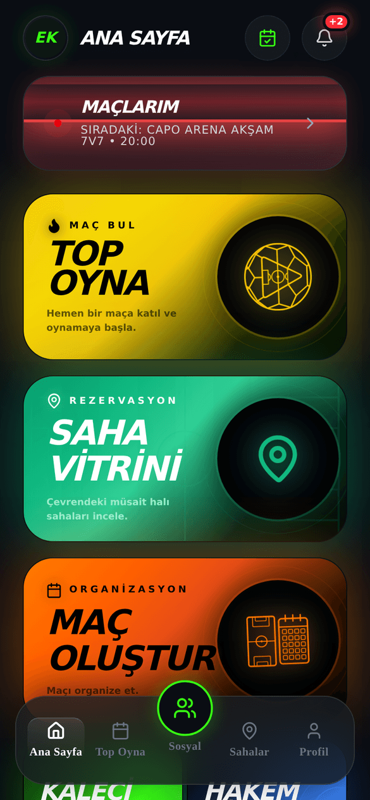</a>

_Şekil: Ana Sayfa — tüm akışlara açılan komuta merkezi._

Alt menüde 5 sekme var:

| Sekme | Ne bulursun |
|---|---|
| **Ana Sayfa** | Büyük aksiyon kartları ve sıradaki maçının geri sayımı. |
| **Top Oyna** | Açık maç listesi ve filtreler. |
| **Sosyal** | Arkadaşlar, takımlar, mesajlar (ortadaki yeşil buton). |
| **Sahalar** | Saha Vitrini — halı saha keşfi ve rezervasyon. |
| **Profil** | Oyuncu kartın, güven puanın, cüzdan kısayolun. |

Bir sekmeye dokunduğunda o bölümün ana ekranına dönersin (geri yığını sıfırlanır).

Ana Sayfa'nın üstünde: sol üstte avatarın (Profil'e gider), sağ üstte **Rezervasyonlarım** takvim ikonu (rezervasyon listene gider) ve **bildirim zili** (okunmamış sayısı rozetle görünür). Yaklaşan maçın varsa geri sayım kartı da burada: "SIRADAKİ MAÇ", "MAÇ ONAYLANDI", "DRAFT MAÇIN VAR - KADROYU KUR" gibi durumları gösterir.

Ana kartlar yukarıdan aşağıya:

- **MAÇLARIM** — maç ve rezervasyon ajandan ("Sıradaki: …" altyazısıyla).
- **TOP OYNA** — "MAÇ BUL / Maça katıl ve oyna".
- **SAHA VİTRİNİ** — "REZERVASYON / Çevrendeki müsait halı sahaları incele".
- **MAÇ OLUŞTUR** — "ORGANİZASYON / Maçı organize et".
- **KALECİ BUL** — "Kaleni koru." · **HAKEM KİRALA** — "Adil oyna."
- **TAKTİK STÜDYO** — "STRATEJİ & ANALİZ". (Stüdyo'nun alt menüde sekmesi yoktur; buradan girilir.)

## 4. Maça Katıl

_Şekil: Top Oyna — açık maçları filtrele ve katıl._

### 4.1 Maç bul ve filtrele

**Top Oyna** ekranında çevrendeki açık maçlar listelenir. Daraltmak için:

- **Filtre paneli:** Arama çapı (5–50 km, 5'er km adımlarla), konum kapalıysa ilçe seçimi, **Kişi Başı Ücret** (Ücretsiz / 150₺ ve Altı / 150-250₺ / 250-350₺ / 350₺ ve Üzeri), **Cinsiyet** (Karma/Erkek/Kadın) ve yaş grubu.
- Liste üstündeki üç açılır menü: **Format**, **Mentalite** (oyun sertliği), **Pozisyon** — seçenekler o an listede olan maçlardan gelir.
- Hızlı çipler: **Bugün**, **Boş Kontenjan**, **Uygun Fiyat**.
- Aktif filtreler çip olarak görünür; **Temizle** ile hepsini kaldırırsın.

Liste iki bölümdür: "Filtreye Uygun Maçlar" ve çapındaki diğer maçlar. Hiç sonuç yoksa "Filtreleri Temizle" veya **"Çapı Genişlet"** (+5 km) önerilir.

### 4.2 Kodla Katıl (özel maçlar)

Bir arkadaşın sana özel maç kodu veya slot devralma kodu gönderdiyse:

1. **Top Oyna** ekranında anahtar ikonlu **Kodla Katıl** butonuna dokun.
2. 4-8 karakterlik kodu gir.
3. Kod bir özel maça aitse doğrudan o maçın lobisine geçersin; bir slot devir koduysa arkadaşının senin için aldığı yer sana geçer.

### 4.3 Maç Lobisi

<a href="gorseller/oyuncu/03-mac-lobisi.png">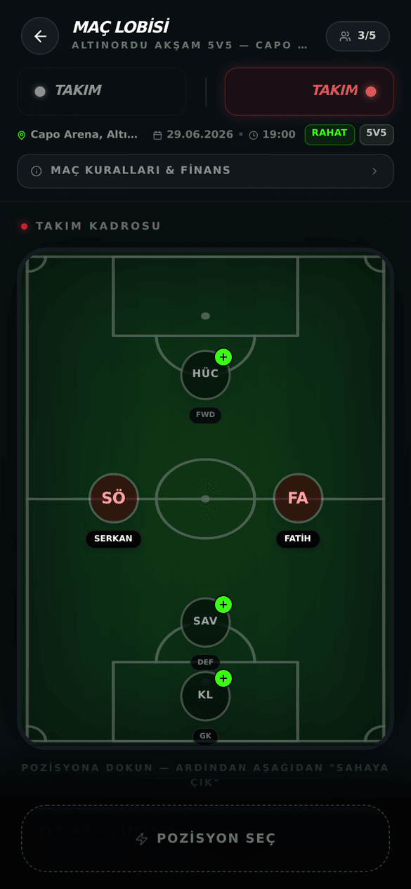</a>

_Şekil: Maç Lobisi — kadro, saha ve katılım tek ekranda._

Bir maç kartına dokununca **Maç Lobisi** açılır. Burada:

- Üstte doluluk (ör. 9/14) ve **Ev Sahibi / Deplasman** taraf seçimi.
- Konum satırına dokununca harita açılır; **Yol Tarifi Al** ile navigasyona geçersin.
- **Maç Kuralları & Finans** kartı maçın formatını, yaş grubunu, cinsiyetini, oyun sertliğini ve katılım ücretini gösterir.
- Taktik sahada dolu bir slota dokunursan oyuncunun bilgi kartı açılır (buradan arkadaşlık isteği de gönderebilirsin).

### 4.4 Adım adım: maça katıl (slot satın al)

1. Sahada boş bir pozisyona dokun ve seç. Birden fazla yer alabilirsin (arkadaşların için) — ödeme, seçtiğin yer sayısı × kişi başı ücrettir.
2. Alttaki butona dokun: ücretli maçta **ÖDE VE KATIL** (seçili slot sayısı ve toplam tutar butonda yazar), ücretsiz maçta **SAHAYA ÇIK**.
3. Ücretliyse ödeme ekranı açılır; bakiye ve/veya kartla öde (bkz. Bölüm 8).
4. Katıldığında yeşil şerit görürsün: "Kadroya alındın!" Boş pozisyonlardaki **+** ile arkadaşlarını davet edebilirsin.

Fazladan aldığın bir yeri arkadaşına devretmek için: slotu arkadaşına davet olarak gönderebilir veya bir **devralma kodu** üretip paylaşabilirsin — arkadaşın Top Oyna'daki **Kodla Katıl** ile bu kodu girip yeri devralır.

Not: Bazı maçlarda minimum puan şartı olabilir; karşılamıyorsan "Bu maç minimum X puan istiyor" uyarısı görürsün.

### 4.5 Yedek listesi

Görüntülediğin taraf doluysa **YEDEK OLARAK GİR** butonu çıkar. Yedekteysen butonda sıran yazar: "YEDEK LİSTESİNDESİN (SIRA: N)". Kadrodan biri ayrılırsa yer, yedek listesinden otomatik doldurulur; sıralamada güvenilirlik puanı yüksek oyuncular önceliklidir. **AYRIL** ile yedeklikten çıkabilirsin.

### 4.6 Maçtan ayrılma ve iade

1. **Maçlarım**'dan maçı aç (yönetim modu) ve sağ üstteki **Maçtan Ayrıl** (yedekteysen **Yedeklikten Ayrıl**) butonuna dokun.
2. Onay penceresinde sana yapılacak **iade tutarı** gösterilir — bu tutar anlık olarak sunucudan hesaplanır ve maça kalan süreye göre değişir.
3. Onaylarsan yerin boşalır ve iade, cüzdanına **iade kredisi** olarak eklenir.

### 4.7 Maçlarım

<a href="gorseller/oyuncu/07-maclarim.png">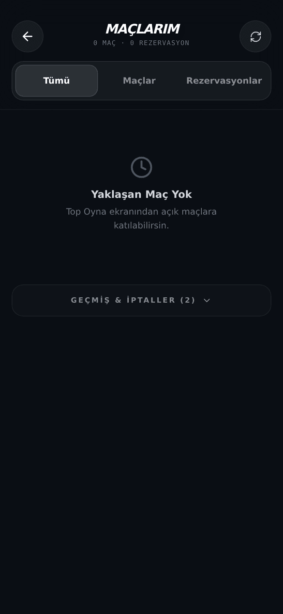</a>

_Şekil: Maçlarım — maçlar ve rezervasyonlar tek kronolojik listede._

**Maçlarım** ekranı maçlarını ve saha rezervasyonlarını tek ajandada toplar:

- Segmentler: **Tümü** | **Maçlar** | **Rezervasyonlar**; üstte "Sıradaki Etkinlik" geri sayımı.
- Kartlarda **MAÇ** (yeşil) veya **REZERVASYON** (beyaz) rozeti ve tarih/saat.
- Maç kartına dokununca lobi yönetim modunda açılır (ayrılma/iptal aksiyonları burada görünür).
- **Geçmiş & İptaller** bölümü katlanır liste olarak en alttadır.

## 5. Maç Kur (Kaptanlık)

Kaptanlık ayrı bir rol değildir: maçı kuran kişi o maçın kaptanıdır.

<a href="gorseller/oyuncu/04-mac-olustur.png">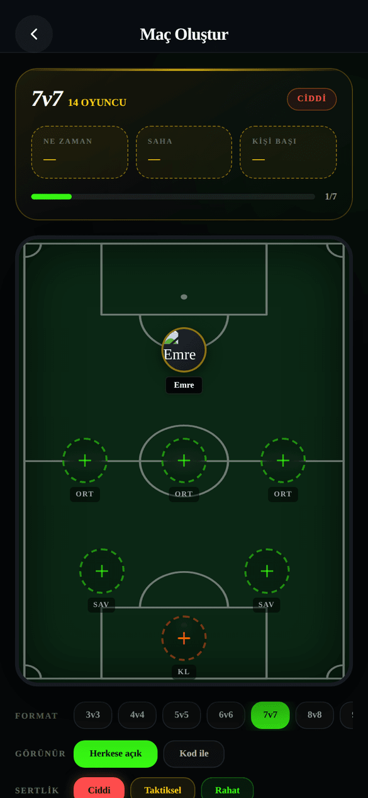</a>

_Şekil: Maç Oluştur — format, saha, kadro ve ayarlar tek sayfada._

### 5.1 Adım adım: maç oluştur

1. Ana Sayfa'dan **MAÇ OLUŞTUR** kartına dokun.
2. **Format** seç: 3v3'ten 11v11'e (varsayılan 7v7; 7v7 ve 8v8 en popülerleri). Format toplam oyuncu sayısını gösterir — 7v7, kaleci dahil takım başına 7 kişi demektir.
3. **Görünür** ayarını seç: **Herkese açık** (Top Oyna'da listelenir) veya **Kod ile** (yalnız kodu bilenler katılır).
4. **Sertlik** seç: **Ciddi / Taktiksel / Rahat**.
5. **Saha & Saat** kartına dokun — Saha Vitrini seçim modunda açılır; saha, tarih ve saat seçip **"Bu Saati Seç"** ile dön (bu adımda ödeme yapılmaz).
6. İstersen **Kadro** kartından arkadaşlarını seç veya takım kadronu tek dokunuşla yükle; **Kaleci & Hakem** kartından profesyonel destek işaretle (talep, kapora ödendikten sonra gönderilir).
7. **Gelişmiş** kartından maç adı, cinsiyet, yaş grubu, takım adları gibi ayarları düzenle. **Kişi Başı Ücret** burada salt-okunurdur ve "Otomatik" hesaplanır.
8. Alttaki **YAYINLA & DAVET ET** butonuna dokun. Eksik varsa buton sebebini söyler ("Önce saha ve saat seç" gibi).
9. Kapora varsa ödeme ekranı açılır — **maç kaporası yalnız cüzdan bakiyenden ödenir**, kart seçeneği çıkmaz. Bakiyen yetersizse kırmızı şeritte eksik tutar yazar ve **Yükle** ile cüzdana geçersin.

### 5.2 Ücret ve kapora nasıl hesaplanır?

- **Kişi başı ücret** otomatiktir: sahanın toplam ücreti tüm oyunculara bölünür ve üzerine **%5 platform hizmet payı** eklenir. Kaptan bu tutarı değiştiremez.
- **Kapora**, tesisin belirlediği tutardır; tesis belirtmemişse **saha toplam ücretinin %20'sidir**.

### 5.3 Kapora ve iade kuralları

Yayınlamadan önce alttaki "₺ kapora · İade kuralları" bağlantısından tam metni görebilirsin. Özet tablo:

| Durum | Ne olur |
|---|---|
| Maçı yayınladığın an | Kapora cüzdan bakiyenden **bloke edilir** — para çekilmez, saha sana kilitlenir. |
| Kadro, toplamın **2 eksiğine** ulaştığında | Maç kesinleşir (aktifleşir) ve kapora tahsil edilir. |
| Maç **tamamen dolduğunda** | Kaporandan 1 kişilik katılım ücreti düşülür, **kalanı cüzdanına iade edilir**. |
| Maç yeterince dolmazsa | Maç iptal olur, kapora blokajı **kesintisiz çözülür** (tam iade). |
| Maça **24 saat veya daha fazla** kala iptal edersen | Kapora iade edilir (ödeme altyapısı komisyonu hariç). |
| Maça **24 saatten az** kala iptal edersen | **İade yok** ve **güvenilirlik puanın düşer**. |

### 5.4 Özel maç kodu

Maçı **Kod ile** görünürlükte kurduysan, lobide yalnız senin gördüğün **Özel Maç Kodu** kartı olur. Dokununca kod panoya kopyalanır; **Paylaş** ile arkadaşlarına gönderirsin. Onlar Top Oyna'daki **Kodla Katıl** ile girer.

### 5.5 Rakip takım daveti

**Gelişmiş** ayarlarındaki **Rakip Takım Davet Et** anahtarını açarsan karşı tarafı bir takıma ayırabilirsin; bu durumda maç otomatik olarak kod ile girilen (özel) maça döner.

### 5.6 Kadro yönetimi

- Boş slota dokunup arkadaş davet edebilirsin.
- Bir oyuncuyu kadrodan çıkarabilirsin; yeri yedek listesinden otomatik doldurulur.
- Kaptan olarak slot seçip **SAHAYA ÇIK** ile kendin de sahaya girersin veya **OYUNCU** ile o slota davet gönderirsin.

### 5.7 Skor girme ve maçı tamamlama

Maç saati gelip maç canlı olduğunda lobide "Canlı Maç" paneli açılır:

1. Kaptan olarak ev sahibi ve deplasman skorlarını **+ / −** ile gir.
2. **MAÇI TAMAMLA (X–Y)** butonuna dokun.
3. Maç tamamlanır ve oyuncuların maç sayıları/istatistikleri işlenir.

Girilen skor kesindir; skora itiraz mekanizması yoktur.

### 5.8 Maçı iptal etme (24 saat kuralı)

**Maçlarım**'dan maçını aç, üstteki **Maçı İptal Et** butonuna dokun. İade, 5.3'teki tabloya göre işler: maça 24 saatten az kala iptal edersen kapora iade edilmez ve güvenilirlik puanın düşer. İptalde katılımcılara bildirim gider ve ödedikleri ücretler iade edilir.

## 6. Saha Kirala

_Şekil: Saha Vitrini — liste ve harita görünümüyle saha keşfi._

**Sahalar** sekmesinde **SAHA VİTRİNİ** açılır:

- **Liste / Harita** görünümü arasında geçiş yap (haritada fiyat baloncuklu konumlar).
- Yıldız ikonuyla favorilerini ayır; filtrede ilçe, en yüksek fiyat, en düşük puan, saha tipi, olanaklar ve "sadece indirimliler" var.
- "Saha veya bölge ara..." kutusuyla isimle ara.

<a href="gorseller/oyuncu/06-saha-detay.png">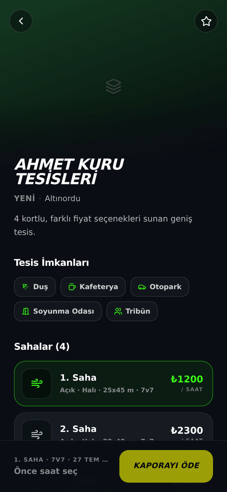</a>

_Şekil: Saha detayı — saha seçimi, takvim ve saat slotları._

### 6.1 Adım adım: saha rezerve et

1. Bir tesise dokun — galeri, olanaklar ve (varsa) onaylı **Aydınlatma** ve **Zemin** kalite notları açılır.
2. Tesisin içinden sahayı seç (Kapalı/Açık, saatlik ücretiyle).
3. **Tarih Seç** — hızlı 5 günden birini veya takvimden (3 ay ileriye kadar) bir gün seç.
4. Saat slotunu seç (GÜNDÜZ/GECE filtresi var; dolu ve kapalı saatler işaretlidir).
5. Alt bardaki **Kaporayı Öde** butonuna dokun ve ödemeyi tamamla. Kapora rezervasyon güvencesidir; **kalan tutarı maç günü tesiste ödersin**.

Tesis online rezervasyonu geçici kapattıysa "Online rezervasyon geçici olarak kapalı" uyarısı görürsün ve buton kilitlenir.

### 6.2 Rezervasyonunu yönet

**Maçlarım → Rezervasyonlar**'daki rezervasyon kartından:

- **Kapora Öde** — kalan kapora borcun varsa.
- **İptal Et** — onaydan önce sana net iade önizlemesi gösterilir.
- **Maça Çevir** — rezervasyonu saha ve saati hazır bir maça dönüştürür (Maç Oluştur ön-dolu açılır).
- **Yol Tarifi** ve **Tekrar Rezerve**.

### 6.3 Rezervasyon iptalinde iade kademeleri

| İptal zamanı (rezervasyon saatine kala) | İade |
|---|---|
| 24 saat veya daha fazla | **Tam iade** (ödeme altyapısı işlem bedeli hariç) |
| 6–24 saat | **%50 iade** |
| 6 saatten az | **İade yok** |

İade, cüzdanına **iade kredisi** olarak döner. Rezervasyon senin kusurun olmadan tesis tarafından iptal edilirse ödediğin tutarın tamamı iade edilir; geç bildirimde ayrıca telafi bedeli ödenir.

## 7. Kaleci & Hakem Kiralama

<a href="gorseller/oyuncu/14-pazaryeri-kaleci.png">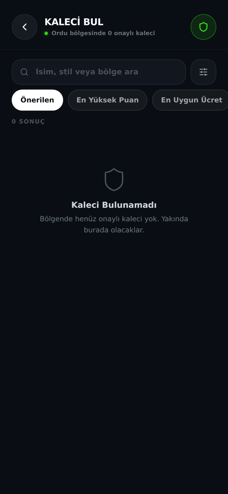</a>

_Şekil: Kaleci pazaryeri — onaylı kaleciler puan, ücret ve mesafeyle listelenir._

### 7.1 Pazaryerinden kirala (3 adım)

Ana Sayfa'dan **KALECİ BUL** veya **HAKEM KİRALA** kartına dokun. Onaylı sağlayıcılar puanı, ücreti ve mesafesiyle listelenir; ilçe, gün ve saate göre filtreleyebilir, "Önerilen / En Yüksek Puan / En Uygun Ücret / En Yakın" sıralamalarını kullanabilirsin. Bir sağlayıcı seçtikten sonra:

1. **Maçını Seç** — planlanmış maçlarından birini seç. Maçın yoksa önce **Maç Oluştur** ile bir maç kurman gerekir.
2. **Talebi Onayla** — ücret **emanete alınır**: sağlayıcı kabul edip maç kesinleşince kendisine aktarılır, gelmezse sana iade edilir. Ücret sabittir ve **%10 platform komisyonu bedele dahildir**. **Onayla ve Talep Gönder** ile ilerle.
3. **Talep Gönderildi** — süreci ekrandaki çubuktan izlersin: Ödeme emanette ✓ → sağlayıcı onayı → maç sonrası aktarım.

### 7.2 Maç lobisinden kirala (kaptanlar)

Kurduğun maçın lobisinde **Kaleci Ekle** ve **Hakem Ekle** kartları vardır. Sıralı öneri listesinden seçersin; ödeme anında emanete alınır ve "Ödeme alındı — {isim} onayı bekleniyor" durumunu görürsün. Sağlayıcı kendisi başvurmuşsa **Gelen Başvurular** bölümünden **Kabul** veya **Reddet** dersin.

İki püf noktası:

- **Kaleci taraf bazlıdır:** her kaptan yalnız kendi tarafının kalecisini kiralar; kiralık kaleci sadece kiralayan tarafın oyuncularına görünür. **Hakem tektir** ve herkese görünür.
- Hakemin/kaptanın girdiği skor resmîdir.

### 7.3 Maç sonu onayı ve no-show

Maç bittikten sonra lobide "{isim} geldi mi?" sorusu çıkar:

- **Onayla** dersen ücret sağlayıcıya ödenir.
- Sağlayıcı gelmediyse **Kaleci Gelmedi (No-show)** butonunu kullan: ceza tutarı sağlayıcının teminatından tahsil edilip sana aktarılır.

## 8. Ödeme & Cüzdan

### 8.1 Ödeme ekranı

Maça katılım, saha kaporası ve maç kurma kaporası aynı ödeme ekranından geçer:

- Ödeme yöntemi şeridinde **OYNA Bakiyesi** anahtarı, kayıtlı kartların ve **yeni kart ekle** seçeneği bulunur.
- **Kısmi ödeme** desteklenir: önce bakiyen kullanılır, kalan karttan çekilir.
- Kartla ödemede banka doğrulaması (3D Secure) **uygulamanın içinde** açılır; SMS kodunu girersin. Yarıda bırakırsan "Banka doğrulaması yarıda kaldı — ödeme alınmadı." mesajını görürsün, para çekilmez.
- Tek istisna: **maç kurma kaporası yalnız cüzdan bakiyesinden** ödenir (kart gösterilmez).
- Sen ödeme yaparken yerin başkası tarafından kapıldıysa ödediğin tutar cüzdanına iade kredisi olarak otomatik eklenir.

Kart bilgilerin OYNA'da saklanmaz; ödemeler güvenli ödeme altyapısı (iyzico) üzerinden işlenir.

### 8.2 Cüzdan

<a href="gorseller/oyuncu/11-cuzdan.png">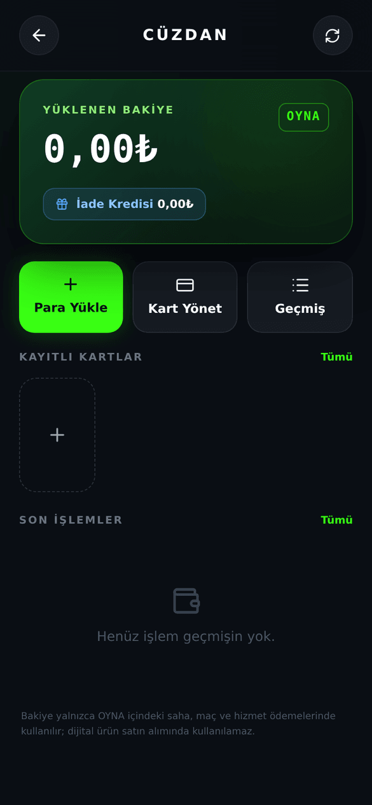</a>

_Şekil: Cüzdan — bakiye, kartlar ve işlem geçmişi._

Cüzdana **Profil → Cüzdan** kısayolundan girersin. Üstte **Yüklenen Bakiye** ve ayrı bir çipte **İade Kredisi** görünür:

- **Yüklenen bakiye:** kendi yüklediğin para.
- **İade kredisi:** iptal ve iadelerden dönen tutar — uygulama içi harcamalarda kullanılır.

Eylemler: **Para Yükle** · **Kart Yönet** · **Geçmiş**. İşlem geçmişini Tümü / Yükleme / Ödeme / İade / Kazanç olarak filtreleyebilirsin.

### 8.3 Adım adım: para yükle

1. Cüzdanda **Para Yükle**'ye dokun.
2. Hazır tutarlardan seç (300, 500, 750, 1000, 1500 ₺) veya elle gir — **en az 300₺, en fazla 20.000₺**.
3. Kartını seç ve banka doğrulamasını (3DS) tamamla.

### 8.4 Bakiye çekme

Yüklenen bakiyeni "Bakiyeni geri çek" bağlantısıyla, kazanç bakiyeni ise **Çek** butonuyla TR IBAN'ına (26 hane) talep edebilirsin; net tutar önizlemesi gösterilir ve genellikle 1–2 iş günü sürer. Bu özellik zaman zaman geçici olarak kapalı olabilir (bkz. Bilinen Sınırlamalar).

## 9. Sosyal

<a href="gorseller/oyuncu/08-sosyal.png">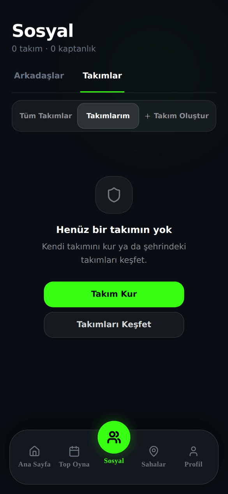</a>

_Şekil: Sosyal — arkadaşlar ve takımlar tek merkezde._

**Sosyal** sekmesinde iki üst sekme var: **Arkadaşlar** ve **Takımlar**.

### 9.1 Arkadaşlar

- **+ Arkadaş Ekle** ile üç yol: **OYNA-ID veya isimle ara**, **Rehberini Bağla** (numaraların cihazında şifrelenir, sunucuya açık halde gitmez) veya **Davet Linki Paylaş**.
- Gelen/giden istekleri tek tek veya **Tümünü Kabul** ile yönetirsin.
- Arkadaşlarını listelere ayırabilirsin: **★ Favoriler** ve kendi oluşturduğun emoji + adlı listeler (ör. "Halı Saha Tayfası").
- Arkadaş satırından profiline bakar, mesaj atar veya birden fazla arkadaşını aynı anda bir maça davet edersin ("Hangi maça?" ekranı açılır).

### 9.2 Adım adım: takım kur

**Takımlar → Takım Oluştur** sekmesinde 4 adımlı sihirbaz:

1. **Kimlik** — takım adı, kısa ad, şehir/ilçe ve format.
2. **Arma & Renk** — armanı ve renklerini tasarla.
3. **Kuruluş** — gizlilik seçimi (Gizli takım = yalnız davetle katılım).
4. **Önizleme** — kontrol et ve kur.

Yarım kalan taslağın saklanır; sekmedeki taslak rozetinden devam edersin.

### 9.3 Takım yönetimi

Takım detayında dört sekme var:

- **Genel** — hızlı aksiyonlar: **Maç Kur**, **Davet Et** (yalnız yönetici), **Taktik Stüdyo**; kuruluş kontrol listesi.
- **Kadro** — üyeler, bekleyen davet ve istekler, rol yönetimi.
- **Taktik** — takımın oyun defteri; taktik önerme/onaylama ve maça plan atama.
- **Maçlar** — yaklaşan ve geçmiş maçlar; skor girişi ve onayı.

Takım sohbetine ve ayarlara (kaptanlığı devret, üye çıkar, takımı arşivle) üstten ulaşırsın. **Takımlarım**'da takım davetlerini kabul/reddeder, arşivlenen takımı geri yüklersin; **Tüm Takımlar**'dan başka takımlara katılma isteği gönderirsin.

### 9.4 Mesajlar

Birleşik gelen kutusunda birebir sohbetler ve **takım sohbetleri** bir aradadır. Birebir sohbette istersen kişiyi engelleyebilirsin; takım sohbetini sessize alabilir, sohbette paylaşılan taktiği açıp Stüdyo'da inceleyebilirsin.

## 10. Taktik Stüdyo

<a href="gorseller/oyuncu/09-taktik-studyo.png">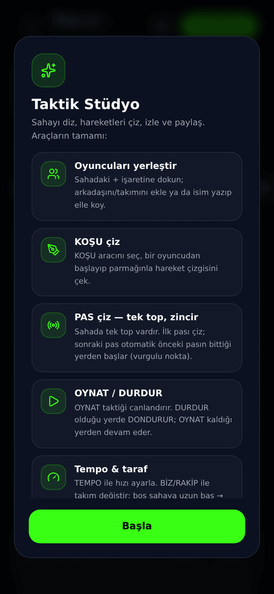</a>

_Şekil: Taktik Stüdyo — diziliş, koşu ve pas animasyonları._

Ana Sayfa'daki **TAKTİK STÜDYO** kartından girersin (takım detayındaki Taktik sekmesinden de açılır):

- 3v3'ten 11v11'e tüm boyutlar; hazır formasyon kütüphanesi veya desen yazarak üretim (ör. "2-3-1").
- Araçlar: **Taşı**, **KOŞU**, **PAS** — sahada tek top vardır, pas zinciri kaldığı yerden devam eder.
- **OYNAT / DURDUR** ile animasyonu izlersin; eşzamanlı veya sıralı oynatma ve 1–10 arası tempo ayarı vardır.
- En fazla **6 plan** tutarsın (A–F harfli, renk temalı).
- **Oyuncu Seç** ile arkadaşlarını/takım kadronu sahaya dizersin; rakip oyuncular da ekleyebilirsin.
- Kaydet: kişisel kütüphanene ya da takımının oyun defterine öneri olarak; planı **yaklaşan maça atayabilirsin**.
- **Paylaş** ile taktiğin görselini gönderirsin. İlk açılışta kısa bir tanıtım turu oynar.

## 11. Profilim

<a href="gorseller/oyuncu/10-profil.png">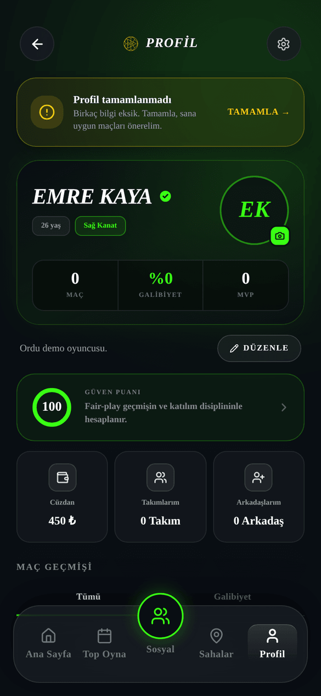</a>

_Şekil: Profil — oyuncu kartı, güven puanı ve maç geçmişi._

### 11.1 Oyuncu kartın ve seviyeler

Profilinde adın, avatarın, pozisyonun, yaş aralığın, oyun stilin, maç sayın ve galibiyet yüzden bulunur. Oyuncu kartın etkinleştirildiyse FIFA tarzı kartını görür, arka yüzünde maç geçmişini incelersin ve **paylaş** butonuyla gönderebilirsin.

Kart seviyesi genel puanına (0–100) göre belirlenir: **80 ve üzeri altın**, **65 ve üzeri gümüş**, altı **bronz**. Hiç maç oynamadıysan kartın "çaylak" görünümündedir ve puan yerine "—" görünür.

### 11.2 Güven puanı

Profilindeki **Güven Puanı** kartı 0–100 arası puanını gösterir; dokununca açıklama açılır: "Maçlarına zamanında gel / Fair-play oyna / Değerlendirmeleri önemse."

- **Puanını yükselten:** maçlarını sorunsuz tamamlamak, zamanında gelmek, fair-play oynamak.
- **Puanını düşüren:** kaptan olarak maçını başlamasına 24 saatten az kala iptal etmek (üstelik kapora da iade edilmez).
- **Puanın işine yarar:** yedek listesinden kadroya terfide güvenilirliği yüksek oyuncular önceliklidir; bazı maçlar minimum puan ister.

### 11.3 Profilini düzenle ve geçmişin

- **Düzenle** ile profil fotoğrafı, pozisyon, doğum tarihi, cinsiyet, oyun stili ve 200 karakterlik kısa tanıtımını değiştirirsin.
- **Maç Geçmişi**'nde (Tümü / Galibiyet sekmeleri) bir maça dokununca maç günlüğü açılır: skor, saha, kadro görüntüsü — ve kalıcı **kişisel maç notu** yazabilirsin.
- Kısayollar: **Cüzdan**, **Takımlarım**, **Arkadaşlarım**. Sağ üstteki dişli **Ayarlar**'a götürür.

## 12. Bildirimler

<a href="gorseller/oyuncu/12-bildirimler.png">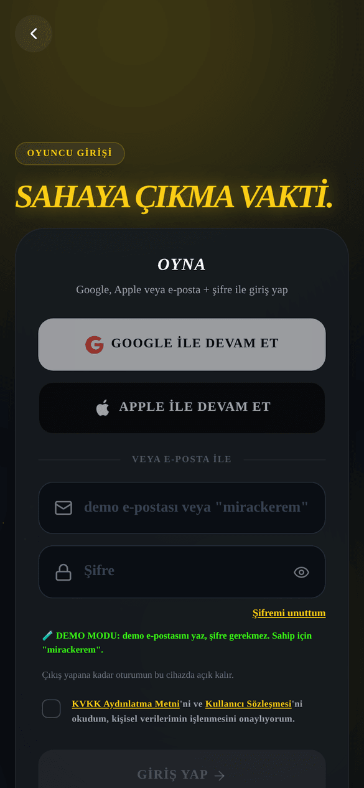</a>

_Şekil: Bildirim merkezi — kategorilere ayrılmış gelişmeler._

Ana Sayfa'daki **zil ikonuna** dokununca bildirim merkezi açılır:

- Kategori çipleri: **Tümü / Maç / Kadro / Ödeme / Sistem**; **"Tümünü Oku"** ile hepsini okundu yaparsın.
- Bir bildirime dokununca ilgili ekrana gidersin; maç ve takım davetlerinde "Davet Edildin" penceresi açılır, **DAVETİ AÇ** ile kabul akışına geçersin.

Bildirim tercihlerini **Ayarlar → Bildirimler**'den yönetirsin:

- Hızlı ön ayarlar: **Hepsi** · **Sadece Maç** · **Sessiz**.
- **Sessiz Saatler** ile belirli saat aralığında bildirim almazsın.
- Kategoriler tek tek açılıp kapanır: Maç, Kadro, Hatırlatıcılar, Keşif, Genel & Kampanyalar, Diğer.
- Bazı kritik bildirimler kapatılamaz ("Zorunlu — kapatılamaz" yazar): maça katılım, maç iptali, davetler ve **maçtan 1 saat önce hatırlatma**. Maçtan 24 saat önceki hatırlatma ile "yakınında maç var" ve kampanya bildirimleri isteğe bağlıdır (son ikisi varsayılan olarak kapalıdır).

## 13. Ayarlar & Yasal

<a href="gorseller/oyuncu/13-ayarlar.png">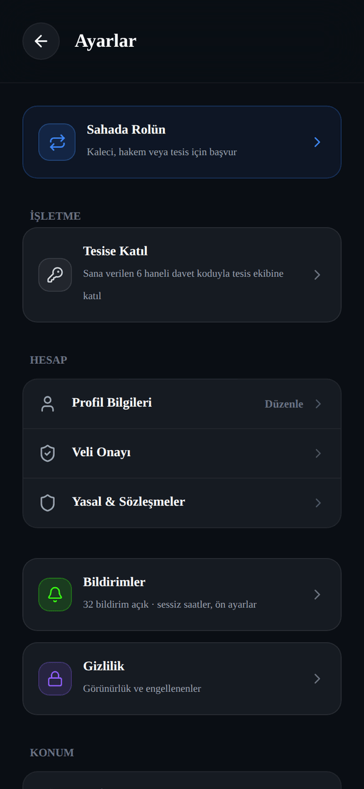</a>

_Şekil: Ayarlar — hesap, konum, bildirim ve yasal bölümler._

Profil'in sağ üstündeki dişliden girersin:

| Öğe | Ne yapar |
|---|---|
| **Sahada Rolün** | Rolünü değiştirir veya yeni role başvurursun (aşağıya bak). |
| **Tesise Katıl** | 6 haneli davet koduyla bir tesisin ekibine katılırsın. |
| **Profil Bilgileri** | E-posta, şifre ve giriş yöntemini yönetirsin. |
| **Veli Onayı** | 18 yaş altı onay akışı (bkz. 2.4). |
| **Bildirimler** | Bildirim tercihleri, sessiz saatler, ön ayarlar. |
| **Gizlilik** | Görünürlük ve engellediğin kişiler. |
| **Bölgelerim** | Birden fazla il/ilçe seçersin. |
| **Konumumu Otomatik Bul** | GPS ile bölgeni belirler. |
| **Arama Yarıçapı** | 5–50 km arası keşif çapı. |
| **Yasal & Sözleşmeler** | Tüm sözleşme ve politikaların tam metni. |
| **Hesabı Kalıcı Olarak Sil** | Hesabını KVKK kapsamında kalıcı siler — "Bu işlem geri alınamaz". |
| **Yardım Merkezi** | destek@oyna.app adresine e-posta açar. |
| **Çıkış Yap** | Oturumu kapatır. |

### 13.1 Kaleci, hakem veya tesis olmak istersen

**Ayarlar → Sahada Rolün** ekranında oyunculuğun her zaman açık kalır; ek rol için başvurursun:

- **Kaleci** — "Maç başı ücretini konuştur, talep al".
- **Hakem** — "Yönettiğin maçtan kazan".
- **Tesis** — "Sahanı ve rezervasyonları yönet".

Başvurun incelenirken "Başvurun inceleniyor — oyuncu olarak oynamaya devam edebilirsin" şeridini görürsün. Sahip olduğun rollerde **SAHİP** rozeti çıkar; dokununca roller arasında geçiş yaparsın. Ayrıntılar için [Kaleci & Hakem Kılavuzu](02-kaleci-hakem-kilavuzu.md) ve [Tesis Kılavuzu](03-tesis-kilavuzu.md).

### 13.2 Yasal belgeler

**Ayarlar → Yasal & Sözleşmeler**'de 8 belgenin tam metni vardır: Kullanım Şartları, Topluluk Kuralları, Gizlilik Politikası, KVKK Aydınlatma, KVKK Açık Rıza, Veli Muvafakatnamesi, Çerez Politikası, Mesafeli Satış ve İptal/İade. OYNA aracı platformdur: saha kiralamada muhatabın tesis, kaleci/hakem hizmetinde bağımsız sağlayıcıdır.

## Sık Sorulan Sorular

**Maçtan ayrılırsam param iade edilir mi?**
Ayrılmadan önce onay penceresinde net iade tutarı gösterilir; tutar maça kalan süreye göre hesaplanır ve cüzdanına iade kredisi olarak döner.

**Kurduğum maçı iptal edersem kaporam ne olur?**
Maça 24 saat veya daha fazla varsa kaporan iade edilir (ödeme altyapısı komisyonu hariç). 24 saatten az kaldıysa iade yapılmaz ve güvenilirlik puanın düşer.

**Maç yeterince dolmazsa ne olur?**
Maç otomatik iptal olur; kaptanın kaporası kesintisiz çözülür, katılan oyuncuların ödemeleri iade edilir.

**Maç ne zaman kesinleşir?**
Kadro, toplam kontenjanın 2 eksiğine ulaştığında maç aktifleşir ve kaptanın kaporası tahsil edilir.

**Kişi başı ücret neye göre belirleniyor?**
Sahanın toplam ücreti oyunculara bölünür, üzerine %5 platform hizmet payı eklenir; kaptan bu tutarı değiştiremez.

**Saha rezervasyonumu iptal edersem ne kadar iade alırım?**
Rezervasyon saatine 24 saat ve üzeri kala tam iade (işlem bedeli hariç), 6–24 saat kala %50 iade, 6 saatten az kala iade yok.

**İadem nereye gelir, banka hesabıma mı?**
Hayır — iadeler cüzdanına "iade kredisi" olarak eklenir ve uygulama içi ödemelerde kullanılır.

**Cüzdanıma en az / en çok ne kadar yükleyebilirim?**
Tek seferde en az 300₺, en fazla 20.000₺.

**Bakiyemi banka hesabıma çekebilir miyim?**
Kazanç ve yüklenen bakiye için TR IBAN'a çekim talebi verilebilir ve genellikle 1–2 iş günü sürer; özellik zaman zaman geçici olarak kapalı olabilir.

**Kart bilgilerim güvende mi?**
Kart bilgilerin OYNA'da saklanmaz; ödemeler güvenli ödeme altyapısı üzerinden 3D Secure doğrulamasıyla geçer.

**Özel (kodlu) maça nasıl katılırım?**
Top Oyna'daki **Kodla Katıl** butonuna dokunup kaptanın paylaştığı 4-8 karakterlik kodu girersin.

**Kiraladığım kaleci maça gelmezse ne olur?**
Maç sonunda **Kaleci Gelmedi (No-show)** bildirirsin; ceza tutarı kalecinin teminatından tahsil edilip sana aktarılır. Ücretin zaten emanetteydi, sağlayıcıya geçmez.

**Skora itiraz edebilir miyim?**
Hayır; girilen skor resmîdir, itiraz mekanizması yoktur.

**18 yaşından küçüğüm, ödeme yapabilir miyim?**
13-18 yaş arası hesaplar sınırlı moddadır; ödemeler ancak veli onayı tamamlanınca açılır (bkz. 2.4).

**Yedek listesindeyim; sıram nasıl işliyor?**
Kadrodan biri ayrılınca yer otomatik olarak yedeklerden doldurulur; güvenilirlik puanı yüksek oyuncular önceliklidir. Sıranı lobideki butonda görürsün.

## Bilinen Sınırlamalar

- Maç sonrası değerlendirme **Maçlarım → Geçmiş & İptaller** bölümündeki "Maçı Değerlendir" kartından açılır (maç bitince bildirim de gelir); değerlendirdiğin maçlarda kart görünmez.
- QR kodlu bilete **Maçlarım → rezervasyon kartı → Bilet** düğmesinden ulaşırsın. Sahada okutan turnike yoktur; bileti görevliye gösterirsin.
- "Maçın Adamı" (MVP) ayrı oyla seçilmez — maçta verilen puanların ortalamasından hesaplanır; profil kartında MVP sayın görünür.
- Bakiye çekme özelliği zaman zaman geçici olarak kapalı olabilir.
- Maçlar için ay/takvim görünümü yok; maçların yalnız Maçlarım listesinde görünür.
- Otomatik dengeli takım kurma (kadroyu güce göre bölme) özelliği yok.
- Kaptan seni kadrodan çıkarırsa ödediğin ücret iade kredisi olarak cüzdanına döner ve bildirim alırsın.
- Maç kurarken katılımcılar için minimum puan barajı ayarlanamıyor.
- Oyuncu kartı her hesapta otomatik açık değildir; etkinleştirilene kadar profilde görünmez.
- "5+1 / 6+1" gibi kaleci ayrı gösterimi yok; formatlar kaleci dahil toplam oyuncu sayısıyla (ör. 7v7) yazılır.
- Girilen maç skoru için itiraz/düzeltme akışı yok.
