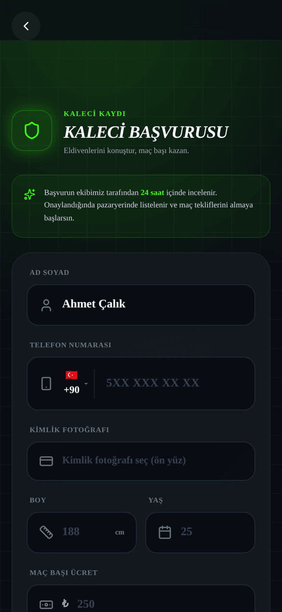
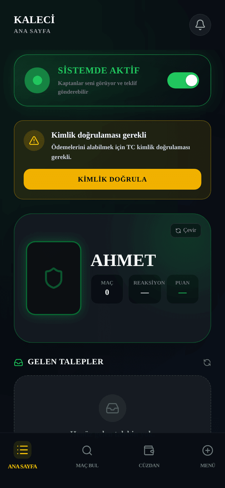
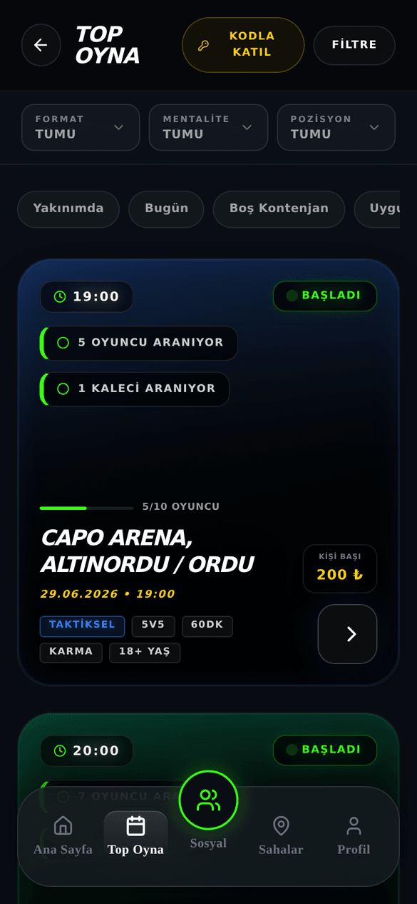
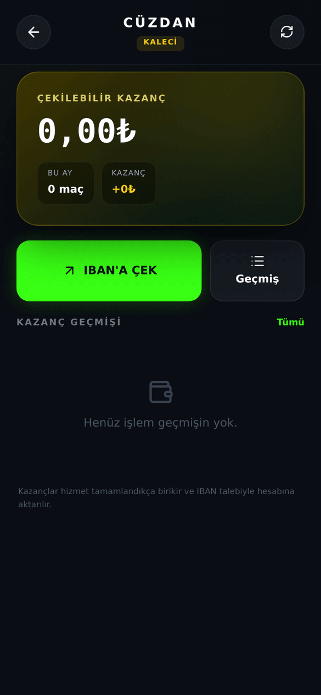
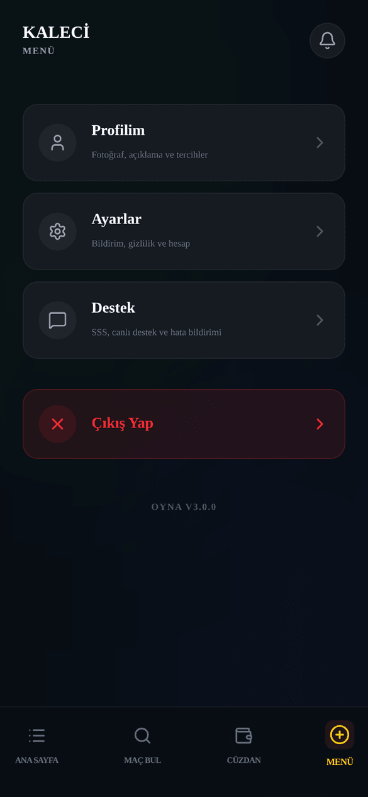
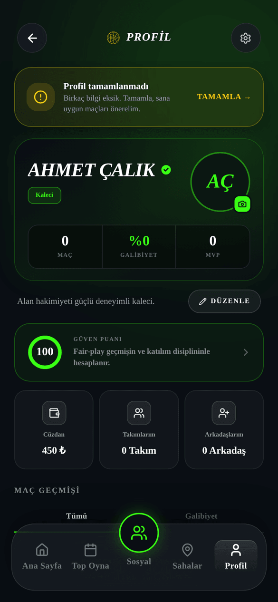
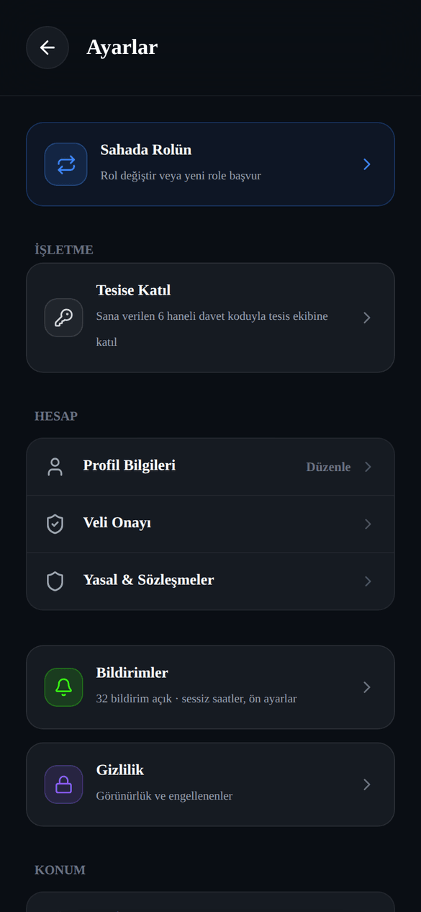

# OYNA Kaleci Kılavuzu

_Son güncelleme: 26 Temmuz 2026 · Uygulama sürümü 3.0.0_

> Bu kılavuz, OYNA'da ücret karşılığı kalecilik yapmak isteyen kişiler içindir. Maça oyuncu olarak katılmak istiyorsan [Oyuncu Kılavuzu](01-oyuncu-kilavuzu.md)'na, hakemlik yapmak istiyorsan [Hakem Kılavuzu](03-hakem-kilavuzu.md)'na bak.

## 1. Giriş

OYNA'da kalecilik bir yan gelir kapısı: takımlar halı saha maçlarına kaleci arıyor, sen de belirlediğin maç başı ücretle bu maçlara çıkıyorsun. Başvurunu yapıyorsun, onaylanınca sana özel kaleci paneli açılıyor. İşler bu panele düşüyor: kaptanlar seni doğrudan kiralayabiliyor, sana teklif gönderebiliyor ya da sen açık maçlara kendin başvurabiliyorsun.

Para işi güvence altında: kaptan ücretini maçtan önce öder, para OYNA'da emanette bekler. Maç oynanıp iki taraf da onay verince ücretin cüzdanına düşer, sen de banka hesabına çekersin. Her maçtan OYNA %10 komisyon alır; panelde her zaman "eline geçecek" net tutarı görürsün.

Bu kılavuz seni sıfırdan alır: başvurudan onaya, ilk işini kabul etmekten paranı çekmeye kadar tüm akışı adım adım anlatır.

### Bir bakışta: hangi bölüm ne işe yarar

| Bölüm/Sekme | Ne işe yarar |
|---|---|
| **Ana Sayfa** | Aktiflik durumun, gelen teklif ve talepler, sıradaki maçların, günlük kazanç özetin |
| **Maç Bul** | Kaleci arayan açık maçları görüp başvurursun; bekleyen başvurularını yönetirsin |
| **Cüzdan** | Kazancını, çekilebilir bakiyeni, ödeme yöntemlerini ve para çekme talebini yönetirsin |
| **Menü** | Profiline, ayarlara, desteğe ve çıkışa buradan ulaşırsın |
| **Profilim** | Fotoğraf, tanıtım yazısı, ücret, oyun tarzı ve çalışma bölgeni düzenlersin |
| **Ayarlar** | Bildirim, gizlilik, görünüm, güvenlik ve rol değiştirme seçenekleri |

## 2. Başlarken: Kaleci Olmak

### Başvuru formuna nasıl ulaşırsın?

- Uygulamayı ilk kez açıyorsan: rol seçim ekranındaki **KALECİ** kartına dokun.
- Zaten oyuncuysan: **Ayarlar** → **Sahada Rolün** bölümünden kaleci başvurusu yap.

_Şekil: Kaleci başvuru formu — kimlik fotoğrafı, boy, yaş ve bölge seçimi dahil tüm alanlar._

### Adım adım: başvuru formunu doldur

1. **Ad Soyad** yaz (en az 3 karakter).
2. **Telefon Numarası** gir (ülke kodu + 10 hane).
3. **Kimlik Fotoğrafı** yükle — kimliğinin ön yüzü, zorunlu. Bu fotoğraf yalnızca doğrulama ekibi tarafından, kısa süreli güvenli erişimle görüntülenir.
4. **Boy** gir (en az 140 cm) ve **Yaş** gir (en az 14).
5. Maç başı ücretini belirle (50₺ – 10.000₺ arası; sonradan değiştirebilirsin).
6. **Kısa Tanıtım** yaz (10–280 karakter) — kaptanlar seni bu yazıyla tanır.
7. **Niyet Mektubu** yaz (10–500 karakter) — neden kalecilik yapmak istediğini anlat.
8. Oyun tarzını seç: **Panter**, **Duvar**, **Libero**, **Atak** veya **Dengeli**.
9. **Tercih Edilen Bölgeler** kısmından en az 1 ilçe seç (81 ilin tamamında arama yapabilirsin).
10. KVKK onay kutusunu işaretle ve **BAŞVURUYU GÖNDER**'e dokun.

> 18 yaşından küçüksen ve veli onayın yoksa form kilitli kalır; önce **Veli Onayına Git** adımını tamamlaman gerekir.

### Onay süreci

Başvurun gönderilince "Profilin inceleniyor" ekranına düşersin. Başvurular **genellikle 24 saat** içinde incelenir. Onaylandığında ekranda kutlama görür, doğrudan kaleci paneline yönlendirilirsin — uygulamayı kapatsan bile bir sonraki açılışta panelin hazırdır.

### Başvurun reddedilirse

Red kararı sana ret nedeniyle birlikte bildirilir. Aynı ekrandaki **Tekrar Başvur** düğmesine dokunduğunda form yeniden açılır ve ret notu formda sana gösterilir; eksikleri düzeltip yeniden gönderebilirsin. İstersen **Çıkış Yap** ile hesaptan çıkabilirsin.

## 3. Panelini Tanı

Kaleci paneli 4 sekmeden oluşur: **Ana Sayfa**, **Maç Bul**, **Cüzdan**, **Menü**.

### Ana Sayfa

_Şekil: Ana Sayfa — aktiflik anahtarı, kimlik kartı, gelen teklifler ve talepler._

- **Aktiflik anahtarı**: **SİSTEMDE AKTİF** / **ŞU AN MEŞGUL** arasında geçiş yaparsın. Meşgulken kaptanların karşısına yeni iş için çıkmazsın.
- **Kimlik doğrulama kartı**: Para çekebilmek için TC kimlik doğrulaman gerekir; **Kimlik Doğrula** düğmesi buradadır. Doğrulanınca "Kimlik doğrulandı" rozeti görürsün.
- **Kaleci kimlik kartın**: Puanını, reaksiyon değerini ve sınıf rozetini gösteren çevrilebilir kart. Henüz verin yoksa alanlar "—" görünür.
- **Gelen Teklifler**: Kaptanların birden fazla kaleciye aynı anda gönderdiği teklifler. Üzerinde "İlk kabul eden işi alır" yazar — hızlı davran.
- **Gelen Talepler**: Kaptanın seni doğrudan kiraladığı işler; Yeni, Yaklaşan ve Tamamlanan olarak gruplanır. **Kabul Et** / **Reddet** düğmeleri buradadır.
- **Günlük Özet**: Günün kazancı ve **Sıradaki Maç** bilgisi.
- **Sıradaki Maçlarım**: Kabul ettiğin maçlar, geri sayımla birlikte.

### Maç Bul

_Şekil: Maç Bul — kaleci arayan açık maçlar ve bekleyen başvuruların._

- **BEKLEYEN BAŞVURULARIM**: Başvurduğun ve kaptan yanıtı beklediğin maçlar. **Geri Çek** ile başvurunu iptal edebilirsin.
- **KALECİ ARAYAN MAÇLAR**: Kaleci arayan açık maçların listesi. **BAŞVUR**'a dokunduğunda başvurun kaptanlara gider ve düğme **Başvuruldu** olur.

### Cüzdan

_Şekil: Cüzdan — toplam kazanç, çekilebilir bakiye ve ödeme yöntemleri._

- **Toplam Kazanç**: Bugüne kadarki tüm kazancın.
- **Çekilebilir** / **Çekim Bekleyen**: Hemen çekebileceğin tutar ile işlemdeki çekim talebin ayrı gösterilir.
- Ödeme yöntemlerin (IBAN veya kart) burada listelenir; **YENİ YÖNTEM EKLE (IBAN / KART)** ile yenisini eklersin.
- **PARAYI ÇEK** düğmesi ve işlem geçmişin de bu sekmededir.

### Menü

_Şekil: Menü — profil, ayarlar, destek ve çıkış._

- **Profilim**: Profil düzenleme ekranını açar.
- **Ayarlar**: Bildirim, gizlilik, görünüm, güvenlik ve rol seçenekleri.
- **Destek**: Ayarlar'daki destek bölümüne götürür (SSS, e-posta ile destek, hata bildirimi).
- **Çıkış Yap**: Hesaptan çıkarsın.

## 4. İş Alma: 3 Yol

Kaleci olarak işe üç yoldan ulaşırsın. Hepsinde ortak kural: kaptan ücretini önden öder, para maç bitene kadar OYNA'da emanette tutulur.

### Yol 1 — Kaptan seni doğrudan kiralar

Kaptan, pazaryerinden profilini seçip sana talep gönderir. Talep, **Ana Sayfa** → **Gelen Talepler**'e düşer.

1. Talebi aç; maç saati, tesis ve "Eline geçecek" tutarı gör.
2. **Kabul Et** veya **Reddet**'e dokun.
3. Reddedersen ücret kaptana anında iade edilir.

**Yanıt süresi kuralı:** Maça 24 saatten fazla varsa yanıt için 4 saatin var; maça daha az kaldıysa süre 60 dakikaya iner (her durumda en az 30 dakika tanınır). Süresi içinde yanıtlamazsan talep kendiliğinden düşer, ücret kaptana iade edilir ve iki taraf da bilgilendirilir.

### Yol 2 — Gelen Teklifler (ilk kabul eden alır)

Kaptan maç kurarken birden fazla kaleciye aynı anda teklif gönderebilir. Bu teklifler **Ana Sayfa** → **Gelen Teklifler**'de görünür ve 24 saat geçerlidir.

1. Teklifi incele: maç bilgisi ve ücret karttadır.
2. **Kabul Et**'e dokun — "İlk kabul eden işi alır": senden önce başka bir kaleci kabul ettiyse "Bu rol başka bir sağlayıcı tarafından üstlenildi." mesajını görürsün.
3. Sen kabul edince diğer kalecilere gönderilen teklifler kendiliğinden kapanır.

### Yol 3 — Maç Bul'dan kendin başvur

1. **Maç Bul** sekmesini aç, **KALECİ ARAYAN MAÇLAR** listesine bak.
2. Uygun maçta **BAŞVUR**'a dokun; başvurun her iki takımın kaptanına iletilir.
3. Başvurun 48 saat geçerlidir; kaptan kabul veya red kararını verir.
4. Fikrin değişirse, kaptan henüz yanıt vermediyse **BEKLEYEN BAŞVURULARIM** altından **Geri Çek** ile başvurunu iptal edebilirsin.

## 5. Kabul Şartları: Sözleşme ve 500₺ Teminat

Bir kaleci işini kabul ederken karşına **Kaleci Hizmet Sözleşmesi** onay ekranı çıkar:

1. Sözleşme metnini oku; ekranda o iş için "Eline geçecek" net tutar ve brüt ücret ayrı ayrı yazar.
2. "Sözleşmeyi okudum, no-show cezasını ve 500₺ teminat şartını kabul ediyorum." kutusunu işaretle.
3. **Onayla & Kabul Et**'e dokun.

Bilmen gerekenler:

- **500₺ teminat**: İş kabul edebilmek için hesabında en az 500₺ bakiye bulunmalı. Bu bakiye bloke edilmez; olası ceza tahsilatının güvencesidir. Bakiyen yetersizse kabul işlemi tamamlanmaz — önce cüzdanına yükleme yapman gerekir.
- **Çakışan saat**: Aynı saat aralığında ikinci bir iş alamazsın; sistem çakışan kabulü engeller.
- Kabul ettiğin işi **İşi Bırak** düğmesiyle bırakabilirsin: maça 24 saatten fazla varsa cezasız, daha geç kalırsan ücretin %50'si kadar ceza kesilir (onay ekranında tutar gösterilir). Maç başladıktan sonra bırakılamaz.

## 6. Ücretini Belirle

- Ücretin **maç başı sabit ücrettir** — saatlik değildir ve pazarlık yoktur; kaptan ya ücretinle kiralar ya kiralamaz.
- Alt sınır 50₺, üst sınır 10.000₺'dir.
- Her maçtan **%10 komisyon** kesilir. Panelde ve sözleşme ekranında her zaman "Eline geçecek" net tutar ayrıca gösterilir. Örnek: ücretin 300₺ ise eline 270₺ geçer.

### Adım adım: ücretini değiştir

1. **Ana Sayfa**'daki fiyat kartına dokun; **STANDART FİYAT** penceresi açılır.
2. Hazır seçeneklerden birini (200₺ / 300₺ / 400₺) seç veya kendi tutarını yaz.
3. Kaydet. Yeni ücret bundan sonra sana gönderilecek talep ve tekliflere yansır; kabul edilmiş işlerin ücreti değişmez.

Aynı ayarı **Menü** → **Profilim** ekranındaki **Maç Başı Standart Ücret** kartından da yapabilirsin.

## 7. Maç Günü

Kabul ettiğin maç, **Ana Sayfa** → **Sıradaki Maçlarım** altında geri sayımla görünür. Maç saatinden önce tesiste hazır ol; kaptanla iletişim ihtiyaçların için maç detayındaki bilgileri kullan.

**Talep durumların** şu şekilde ilerler: talep önce "bekliyor" durumundadır; kabul edince "kabul edildi" olur; maç onaylanınca ücret kesinleşir ve emanetten tahsil edilir; maç sonu onayları tamamlanınca iş "tamamlandı"ya geçer ve ücretin çekilebilir olur.

**Maç iptal edilirse:** İşin kendiliğinden iptal olur, kaptana ücreti iade edilir ve sana bildirim gelir. Oynanmayan maç için sana ödeme yapılmaz, ama herhangi bir ceza da uygulanmaz.

## 8. Maç Sonu ve Ödeme

### İki taraflı onay

Ücretinin serbest kalması için maçtan sonra iki onay gerekir:

1. **Sen**: **Gelen Talepler**'deki iş kartında **Maçı Oynadım · Onayla** düğmesine dokun.
2. **Kaptan**: Kendi ekranından senin maça geldiğini onaylar.

İki onay da tamamlanınca ücretin **Cüzdan**'da "Çekilebilir" bakiyene geçer.

### Puanlama: 1-10

Maçtan sonra maça katılan oyuncular sana 1'den 10'a puan verebilir (puanlama isteğe bağlıdır; kendini puanlayamazsın). Verilen puanların ortalaması profil puanın olur ve seni doğrudan etkiler:

- Kaptanlara gösterilen öneri listelerinde **puanı yüksek kaleciler üstte** çıkar.
- Kimlik kartındaki sınıf rozetin puanına göre belirlenir: **8 ve üzeri → A SINIF**, **6 ve üzeri → B**, **puanın varsa → C**, hiç puanın yoksa **YENİ**.
- İstersen **Ayarlar** → Gizlilik'ten puanını kartında gizleyebilirsin.

## 9. Para Çekme

### Ön şart: TC kimlik doğrulaması

İlk çekimden önce TC kimlik doğrulaması zorunludur:

1. **Ana Sayfa**'daki kimlik kartında **Kimlik Doğrula**'ya dokun.
2. 11 haneli **TC Kimlik No**'nu gir ve gönder.
3. Talebin incelenir; onaylanınca "Kimlik doğrulandı" rozeti görürsün.

### Adım adım: paranı çek

1. **Cüzdan** sekmesini aç.
2. Kayıtlı ödeme yöntemin yoksa **YENİ YÖNTEM EKLE (IBAN / KART)** ile IBAN'ını (veya kartını) ekle.
3. **PARAYI ÇEK**'e dokun; talebin "TALEP ALINDI" olarak onaylanır.
4. Talebin yönetim onayından geçtikten sonra tutar hesabına gönderilir; bu sürede **Çekim Bekleyen** altında görünür.

> Aynı anda yalnızca **tek bekleyen çekim talebin** olabilir; mevcut talebin sonuçlanmadan yenisini oluşturamazsın.

## 10. No-show ve Ceza

Kabul ettiğin maça gitmezsen kaptan seni "gelmedi" (no-show) olarak bildirebilir. Bu durumda:

- O maçın kazancı iptal edilir ve ücret kaptana iade edilir.
- **Ceza tutarı, o maçın saha ücretidir** ve teminat bakiyenden kaptana aktarılır.
- Sana bildirim gelir; durumu **Gelen Talepler**'deki iş kartında görürsün.

### İtiraz hakkın: 48 saat

Haksız yere bildirildiğini düşünüyorsan, bildirimden itibaren **48 saat** içinde iş kartındaki **İtiraz Et** düğmesine dokunarak itiraz edebilirsin. İtirazın kayda alınır ve kartta "İtirazın alındı" durumu görünür. OYNA yönetimi incelemesini bitirdiğinde sonucu bildirimle alırsın: itirazın haklı bulunursa kesilen ceza iade edilir ve ücretin cüzdanına işlenir. 48 saat geçtikten sonra itiraz hakkın kapanır.

## 11. Profil ve Ayarlar

### Profilim

_Şekil: Profilim — fotoğraf, tanıtım, ücret, oyun tarzı ve çalışma alanı._

**Menü** → **Profilim**'den şunları düzenlersin:

- **Profil fotoğrafı**: Kaptanların pazaryerinde gördüğü fotoğraf.
- **Kısa Tanıtım**: Kendini anlattığın metin.
- **Maç Başı Standart Ücret**: Ücret kartın (bkz. Bölüm 6).
- **Oyun Tarzı**: **Panter**, **Duvar**, **Libero**, **Atak**, **Dengeli** seçeneklerinden biri.
- **Çalışma Alanı (Yarıçap)**: Harita üzerinde merkez nokta ve 5–50 km arası yarıçap seçersin.

### Aktiflik Ayarları

_Şekil: AKTİFLİK AYARLARI — gün ve saat seçimi._

**AKTİFLİK AYARLARI** penceresinde hangi günler (Pzt–Paz) ve hangi saatlerde müsait olduğunu işaretleyebilirsin. Bu ayarlar profilinde saklanır; anlık müsaitliğini yönetmenin en kestirme yolu yine de **Ana Sayfa**'daki **SİSTEMDE AKTİF** / **ŞU AN MEŞGUL** anahtarıdır.

### Ayarlar

**Menü** → **Ayarlar** altında bildirim, gizlilik (puan ve telefon görünürlüğü), görünüm ve güvenlik bölümleri ile rol değiştirici bulunur; oyuncu tarafına buradan geçebilirsin.

## Sık Sorulan Sorular

**Başvurum ne kadar sürede onaylanır?**
Genellikle 24 saat içinde. Sonucu beklerken uygulama açık kalmak zorunda değil; karar sana bildirilir.

**Başvurum reddedildi, tekrar başvurabilir miyim?**
Evet. Ret nedeni sana gösterilir; **Tekrar Başvur** ile formu düzeltip yeniden gönderebilirsin.

**Komisyon ne kadar, net kazancımı nereden görürüm?**
Her maçtan %10 komisyon kesilir. Talep, teklif ve sözleşme ekranlarında "Eline geçecek" net tutar her zaman ayrıca yazar.

**Ücretimde pazarlık yapılabilir mi?**
Hayır. Ücretin maç başı sabittir; kaptan ya bu ücretle kiralar ya da kiralamaz.

**500₺ teminat nedir, param bloke mi olur?**
İş kabul etmek için hesabında en az 500₺ bakiye bulunmalıdır. Para bloke edilmez, hesabında durur; yalnızca no-show cezası kesilmesi gerekirse buradan tahsil edilir.

**Kabul ettiğim işi iptal edebilir miyim?**
Şu an uygulama içinden kabul edilmiş bir işi bırakma seçeneği yok. Maça gidemezsen kaptan no-show bildirebilir ve ceza uygulanır; bu yüzden yalnızca gidebileceğin işleri kabul et.

**Maç iptal olursa param ne olur?**
İş kendiliğinden iptal olur ve ücret kaptana iade edilir. Oynanmayan maç için ödeme almazsın ama ceza da yemezsin.

**Aynı saatte iki iş alabilir miyim?**
Hayır; saatleri çakışan ikinci işi sistem kabul ettirmez.

**Param ne zaman çekilebilir olur?**
Maçtan sonra hem sen **Maçı Oynadım · Onayla** dediğinde hem de kaptan onay verdiğinde ücret "Çekilebilir" bakiyene geçer.

**Para çekme talebim ne kadar sürede sonuçlanır?**
Talebin yönetim onayından geçtikten sonra hesabına gönderilir; bu sırada tutar **Çekim Bekleyen** altında görünür. Aynı anda tek bekleyen talebin olabilir.

**Kimlik fotoğrafımı kimler görüyor?**
Yalnızca doğrulama ekibi, kısa süreli güvenli erişimle. Fotoğrafın herkese açık hiçbir yerde gösterilmez.

**Puanım nasıl hesaplanıyor?**
Maça katılan oyuncuların sana verdiği 1-10 puanların ortalamasıdır. 8 ve üzeri **A SINIF**, 6 ve üzeri **B**, puanın varsa **C**, hiç puanın yoksa **YENİ** rozetini görürsün.

**No-show cezası ne kadar?**
Gitmediğin maçın saha ücreti kadardır ve teminat bakiyenden kesilir. Haksız bulduğun bildirime 48 saat içinde **İtiraz Et** ile itiraz edebilirsin.

**Hem kaleci hem oyuncu olabilir miyim?**
Evet. Oyunculuğun her zaman açıktır; **Menü** → **Ayarlar**'daki rol değiştiriciyle taraflar arasında geçiş yapabilirsin.

## Bilinen Sınırlamalar

- Maç sonunda takıma centilmenlik puanı verme özelliği yoktur (kaldırıldı); değerlendirme tek yönlüdür — takım seni puanlar.
- Ücret pazarlığı yoktur: teklif ekranında ücret sabittir ve salt-okunur gösterilir.
- Komisyon her kazançta **%10**'dur (bedele dahildir).
- Profilinde "hazır fotoğraf" seçeneği yoktur; avatar olarak yalnız kendi çektiğin/yüklediğin fotoğraf kullanılır.
- Maç detayında tesis özellikleri listesi ve mesafe bilgisi gösterilmez; yol tarifi sahanın konumuyla harita uygulamasında açılır (konum girilmemişse düğme pasiftir).
- Telefon (push) bildirimleri platform genelinde henüz açık değildir; bildirimler uygulama içinde görünür.
- Profilindeki **Çalışma Alanı (Yarıçap)** ayarı kaydedilir ancak eşleştirmede şu an dikkate alınmaz.
- Profilindeki **Çalışma Alanı (Yarıçap)** ayarı kaydedilir ancak eşleştirmede şu an dikkate alınmaz.
