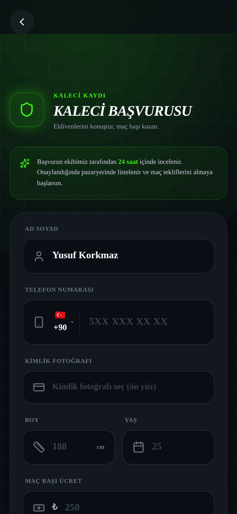
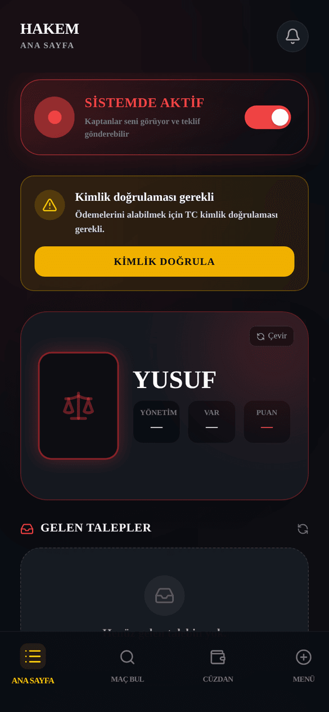
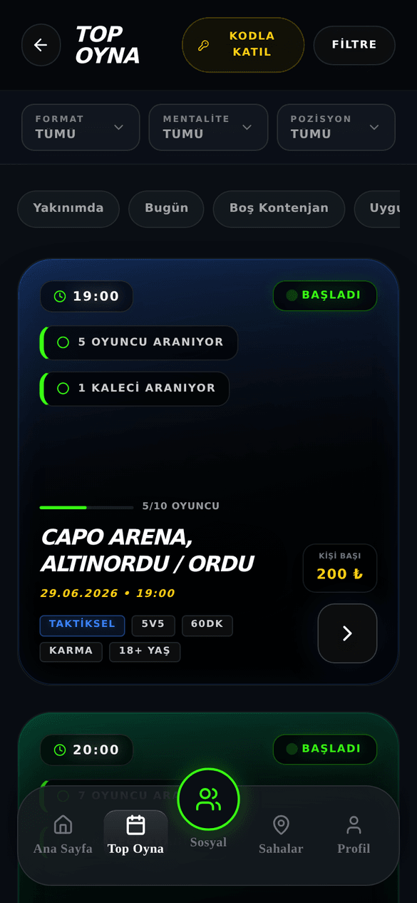
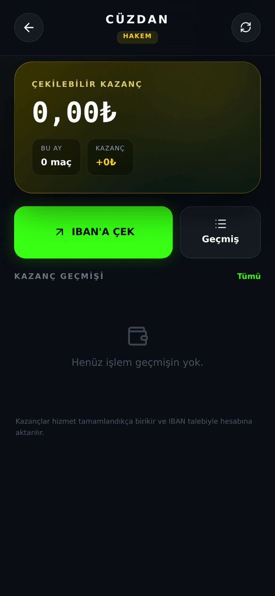

# OYNA Hakem Kılavuzu

_Son güncelleme: 26 Temmuz 2026 · Uygulama sürümü 3.0.0_

> Bu kılavuz, OYNA'da ücret karşılığı maç yönetmek isteyen hakemler içindir. Kaleci olarak hizmet vermek istiyorsan [Kaleci Kılavuzu](02-kaleci-kilavuzu.md)'na, oyuncu olarak maç arıyorsan [Oyuncu Kılavuzu](01-oyuncu-kilavuzu.md)'na, uygulamanın genel işleyişi için [Genel Kılavuz](00-genel-kilavuz.md)'a bak.

## 1. Giriş

OYNA'da hakemlik bir yan gelir kapısı: profilini açarsın, maç başı ücretini belirlersin, çevrendeki maçlara atanırsın. Maç kaptanları seni uygulama üzerinden bulur, kiralar ve ücretini uygulama içinden öder. Para elden dolaşmaz — kaptan ödemeyi baştan yapar, ücret emanette bekler, maç yönetilince sana geçer.

Hakem olarak sana özel bir yetkin var: **resmi skor girişi**. Maç bittiğinde skoru sen girersin ve maç senin girdiğin skorla resmen tamamlanır. Oyuncuların kendi aralarındaki skor onay turlarına gerek kalmaz; sahadaki son söz senindir.

Her maçta tek hakem olursun — kaleciden farklı olarak ev sahibi/deplasman ayrımı yok, iki takım aynı hakemi paylaşır. Panelin kırmızı temalıdır; başvurudan para çekmeye kadar her adımı bu kılavuzda sırasıyla bulacaksın.

### Bir bakışta: hangi bölüm ne işe yarar

| Bölüm/Sekme | Ne işe yarar |
|---|---|
| **Ana Sayfa** | Aktiflik durumun, hakem kimlik kartın, gelen teklif ve talepler, sıradaki maçların. |
| **Maç Bul** | Hakem arayan açık maçlara kendin başvurursun, bekleyen başvurularını yönetirsin. |
| **Cüzdan** | Kazancını görürsün, ödeme yöntemi eklersin, para çekme talebi verirsin. |
| **Menü** | Profilim, Ayarlar, Destek ve Çıkış Yap buradadır. |
| **Profilim** | Fotoğraf, tanıtım yazısı, ücret, hakemlik tarzı ve hizmet bölgelerini düzenlersin. |
| **Ayarlar** | Hesap güvenliği, gizlilik ve rol değiştirme (hakem ↔ oyuncu) buradadır. |

## 2. Başlarken

### 2.1 Hakem başvurusuna nereden girilir?

Üç giriş yolu var:

1. **İlk açılışta:** Rol seçim ekranındaki **HAKEM** kartına dokunursun ("HAKEM KİMLİĞİ") — doğrudan başvuru formu açılır.
2. **Zaten oyuncuysan:** **Ayarlar → Sahada Rolün** ekranından hakem başvurusu başlatırsın.
3. **Başvurun reddedildiyse:** Bekleme ekranındaki **Tekrar Başvur** ile formu yeniden doldurursun; red gerekçesi formda sana gösterilir.

### 2.2 Başvuru formu

_Şekil: Hakem başvuru formu — lisans seviyesi ve deneyim yılı hakemlere özeldir._

Adım adım:

1. **Ad Soyad** gir (en az 3 karakter).
2. **Telefon** numaranı gir (ülke kodu + 10 hane).
3. **Kimlik fotoğrafı**nın ön yüzünü yükle (zorunlu — onay ekibi bununla doğrular).
4. **Lisans Seviyesi**ni seç: **İl Hakemi**, **Bölgesel**, **Klasman** veya **FIFA Kokart**.
5. **Deneyim (Yıl)** alanına hakemlik deneyimini gir (0-60 arası tam sayı).
6. **Maç başı ücret**ini belirle (50₺ – 10.000₺ arası).
7. **Kısa Tanıtım** yaz (10-280 karakter) — kaptanların kartında göreceği metin.
8. **Niyet Mektubu** yaz (10-500 karakter) — onay ekibine kendini anlat.
9. Hakemlik **tarzını** seç: **Otoriter**, **Diyalogcu**, **Teknisyen** veya **Hızlı Karar**.
10. **Tercih ettiğin bölgeleri** seç (en az 1 ilçe; 81 ilde arama yapabilirsin).
11. **KVKK onayı** kutusunu işaretle ve gönder.

Lisans için belge yüklemen istenmez — yalnızca seviye seçimi ve kimlik fotoğrafı yeterlidir. Yanlış beyan hesabının kapatılmasına yol açabilir, seviyeni doğru seç.

### 2.3 Onay süreci

- Başvurun OYNA ekibi tarafından incelenir; ekranda "başvurun ekibimiz tarafından inceleniyor" mesajını görürsün. Onay genellikle **24 saat** içinde gelir.
- Bekleme ekranını açık tutmana gerek yok — sonuç geldiğinde uygulama seni otomatik yönlendirir ve bildirim alırsın.
- **Onaylanırsan:** doğrudan kırmızı temalı hakem paneline düşersin ve "Aktif" olarak işaretlenirsin.
- **Reddedilirsen:** red gerekçesini görürsün; **Tekrar Başvur** ile eksiği düzeltip yeniden gönderirsin.

### 2.4 Yaş şartı

18 yaşından küçüksen ve veli onayın yoksa başvuru formu kilitlenir; **Veli Onayına Git** butonuyla önce veli onayını tamamlaman gerekir (ayrıntısı için [Oyuncu Kılavuzu](01-oyuncu-kilavuzu.md)'na bak).

## 3. Hakem Panelini Tanıyalım

_Şekil: Hakem paneli Ana Sayfa — aktiflik, kimlik kartı, gelen teklif ve talepler._

Panelin altında 4 sekme var: **Ana Sayfa · Maç Bul · Cüzdan · Menü**.

**Ana Sayfa**'da yukarıdan aşağıya şunları görürsün:

- **Aktiflik anahtarı** — **SİSTEMDE AKTİF** / **ŞU AN MEŞGUL**. Meşgule alırsan kaptanların arama sonuçlarında görünmezsin; yeni iş almak istemediğin dönemlerde kapat.
- **Kimlik doğrulama kartı** — para çekebilmek için TC kimlik doğrulaması gerekir; buradan başlatırsın (bkz. bölüm 6.3).
- **Hakem kimlik kartın** — yönetim, VAR ve puan istatistiklerinle lisans seviyesi rozetin. Kart, kaptanların seni gördüğü vitrindir; henüz verin yoksa "—" görünür.
- **Gelen Teklifler** — kaptanların aynı anda birden fazla hakeme gönderdiği teklifler; ilk kabul eden işi alır.
- **Gelen Talepler** — kaptanın doğrudan sana gönderdiği kiralama talepleri (Yeni / Yaklaşan / Tamamlanan gruplarıyla).
- **Günlük Özet** — bugünkü kazancın ve sıradaki maçın.
- **Sıradaki Maçlarım** — atandığın maçlar geri sayımla; maç saati gelince skor girişini de buradan yaparsın.

**Menü** sekmesinde **Profilim**, **Ayarlar**, **Destek** ve **Çıkış Yap** bulunur.

## 4. İş Alma — Üç Yol

Hepsi aynı kurala bağlanır: maç başına **tek hakem** atanır. Slot dolduysa o maça artık atanamazsın.

### 4.1 Yol 1 — Kaptan seni doğrudan kiralar

1. Kaptan, vitrinden kartını beğenir ve kiralama talebi gönderir; ücretini uygulamaya baştan öder (para emanette bloke edilir).
2. Talep, panelinde **Gelen Talepler** altında belirir.
3. **Kabul Et** veya **Reddet** dersin — kabul için teminat yatırma ya da sözleşme onayı gibi bir ön şart **yoktur**; bu şartlar yalnızca kaleciler içindir.
4. Kabul edersen maça atanırsın; reddedersen para kaptana anında iade edilir, sana bir yaptırım uygulanmaz.

Talepler süresizce beklemez: maça 24 saatten fazla varsa 4 saat, daha az varsa 60 dakika içinde yanıt vermezsen talep kendiliğinden düşer ve para kaptana iade edilir. Bu yüzden bildirimleri takip et.

### 4.2 Yol 2 — Çoklu teklif: ilk kabul eden alır

1. Kaptan maç kurarken birden fazla hakeme aynı anda teklif gönderebilir.
2. Teklif, panelinde **Gelen Teklifler** altında görünür ve **24 saat** geçerlidir.
3. **Kabul Et** dersen ve slot hâlâ boşsa iş senindir; diğer hakemlerin teklifleri otomatik iptal olur.
4. Senden önce başka bir hakem kabul ettiyse "Bu rol başka bir sağlayıcı tarafından üstlenildi." mesajını görürsün — gecikme aleyhinedir, hızlı davran.

### 4.3 Yol 3 — Sen başvurursun (Maç Bul)

_Şekil: Maç Bul — hakem arayan açık maçlar ve bekleyen başvuruların._

1. **Maç Bul** sekmesini aç; **HAKEM ARAYAN MAÇLAR** listesinde çevrendeki açık maçları gör.
2. Uygun maçta **BAŞVUR**'a dokun. Başvurun **48 saat** geçerlidir ve maçın iki kaptanına da bildirim gider — hangisi önce kabul ederse maç senindir (iki takım tek hakemi paylaşır).
3. Başvuruların **BEKLEYEN BAŞVURULARIM** altında listelenir; fikrini değiştirirsen kaptan yanıt vermeden **Geri Çek** ile başvurunu iptal edersin.
4. Aynı maça ikinci kez başvuramazsın; kendi oynadığın maça hakem olarak başvuramazsın; çakışan saatte başka işin varsa sistem seni uyarır.

### 4.4 Ücretini belirle

- Ücretin **maç başı sabit ücrettir** (saatlik değil) ve pazarlık yoktur — kaptan, kartında yazan ücreti öder.
- Değiştirmek için Ana Sayfa'daki **STANDART FİYAT** kartını kullan (hazır 200₺ / 300₺ / 400₺ seçenekleri var) veya **Profilim**'deki ücret alanından serbest tutar gir.
- Sunucu sınırı: en az **50₺**, en fazla **10.000₺**.
- Her kazançtan **%10 platform komisyonu** kesilir; panelde "Eline geçecek" ve brüt tutar ayrı ayrı gösterilir, sürpriz yoktur.

## 5. Maç Günü ve Resmi Skor Girişi

### 5.1 Maç öncesi

Atandığın maç **Sıradaki Maçlarım**'da geri sayımla durur. Maç yeri, saati ve kaptan bilgisi karttadır. Tesise zamanında git — mazeretsiz gitmezsen no-show cezası uygulanır (bkz. bölüm 6.5).

### 5.2 Resmi skor girişi — senin özel yetkin

Maç bittiğinde skoru **sen** girersin ve maç senin girdiğin skorla **resmen tamamlanır**. Oyuncuların skor bildirme/onaylama turu hakemli maçlarda atlanır: hakemin skoru nihaidir. Adım adım:

1. Maç saati geldiğinde **Ana Sayfa → Sıradaki Maçlarım**'daki maç kartında **MAÇI BİTİR** butonuna dokun.
2. **MAÇ SONU RAPORU** ekranı açılır; üstte "Resmi Maç Skorunu Gir" yazar.
3. **Maç Skoru** alanına ev sahibi ve deplasman skorlarını gir (her biri 0-99 arası). Alanın altındaki uyarıyı gör: "Resmi hakem skoru — maç bu skorla tamamlanır".
4. **SKORU KAYDET VE BİTİR**'e dokun.
5. Başarılıysa "Maç skoru resmi olarak kaydedildi" onayını görürsün; maç bu andan itibaren uygulamada tamamlanmış sayılır ve skor herkese bu şekilde görünür.

Dikkat etmen gerekenler:

- Skoru girmeden önce iki kez kontrol et — kaydettikten sonra uygulama içinden düzeltme akışı yok.
- Kaydetme başarısız olursa ekranda dürüst bir hata mesajı görürsün; ekran kapanmaz, tekrar denersin.
- Skor girişi maçı resmen bitirir ama ödemeni tek başına serbest bırakmaz — ödeme için bir adım daha var (aşağıda).

### 5.3 Ödemenin serbest kalması: iki taraflı onay

Ücretin, maç sonunda iki tarafın da "maç yönetildi" demesiyle çekilebilir hale gelir:

1. Sen **Gelen Talepler**'deki ilgili iş kartında **Maçı Oynadım · Onayla** dersin. Onay verdiğinde kartta "Onayladın · Kaptan onayı bekleniyor" yazar.
2. Kaptan da kendi tarafından senin geldiğini onaylar.
3. İki onay tamamlanınca kazancın **Cüzdan**'da "Çekilebilir" durumuna geçer.

### 5.4 Maç sonunda seni puanlarlar

- Maça katılan oyuncular maç sonu değerlendirmesinde hakeme **1-10 arası puan** verebilir (vermek zorunda değiller, atlanabilir).
- Puanların ortalaması kimlik kartındaki puanın olur ve sıralamanı belirler: kaptanlara önerilen listelerde yüksek puanlı hakemler üstte çıkar.
- Kart sınıfın puanına göre değişir: ortalama 8 ve üzeri **A SINIF**, 6 ve üzeri **B**, daha düşük **C**, hiç puan yoksa **YENİ**.
- İstersen puanını kartında gizleyebilirsin (gizlilik ayarlarından) — ama gizlemek sıralamadaki etkisini kaldırmaz.

## 6. Para İşleri

### 6.1 Kazanç akışı özet

1. Kaptan ücretini öder → para **emanette** bloke edilir (kaptan vazgeçerse veya süre dolarsa ona iade edilir, senden bir şey çıkmaz).
2. Maç kesinleşir → ücret senin adına ayrılır, cüzdanında "Bekliyor" görünür.
3. Maç sonu iki taraflı onay tamamlanır → kazanç **Çekilebilir** olur.
4. Sen para çekme talebi verirsin → OYNA yönetimi onaylar → para hesabına geçer.

### 6.2 Cüzdan sekmesi

_Şekil: Cüzdan — toplam kazanç, çekilebilir bakiye ve işlem geçmişi._

- **Toplam Kazanç** en üsttedir; altında **Çekilebilir** ve **Çekim Bekleyen** ayrımı gösterilir.
- **Ödeme yöntemleri:** IBAN veya kart ekleyebilirsin; çekimler kayıtlı yöntemine yapılır.
- **İşlem geçmişi:** her kazanç, kesinti ve çekim satır satır listelenir ("Onaylandı" / "Bekliyor" durumlarıyla).

### 6.3 TC kimlik doğrulama (çekim şartı)

İlk para çekiminden önce TC kimlik doğrulaması yapman zorunludur:

1. Ana Sayfa'daki kimlik kartından veya Cüzdan'daki uyarıdan **Kimlik Doğrula**'ya dokun.
2. **11 haneli TC kimlik numaranı** gir ve gönder.
3. Talebin incelenir; onaylanınca kartında "Kimlik doğrulandı" rozeti görünür ve çekim açılır. Reddedilirse "Kimlik doğrulaması reddedildi" uyarısıyla yeniden başvurabilirsin.

### 6.4 Para çekme

1. **Cüzdan** sekmesinde ödeme yöntemini seç.
2. **PARAYI ÇEK**'e dokun; "TALEP ALINDI" onayını gör.
3. Talebin OYNA yönetimi tarafından onaylanınca para hesabına aktarılır.

Kurallar: aynı anda yalnızca **bir bekleyen çekim talebin** olabilir; asgari çekim tutarı yoktur; kimlik doğrulaması yoksa çekim başlatılamaz.

### 6.5 İptal, no-show ve 48 saat itiraz

| Durum | Ne olur |
|---|---|
| Talebi reddedersin | Para kaptana iade edilir, sana yaptırım yok. |
| Talep süresi dolar | Talep düşer, para kaptana iade edilir, iki tarafa bildirim gider. |
| Maç iptal olur | İş iptal edilir, bekleyen kazancın silinir, kaptana iadesi yapılır. |
| Kaptan "hakem gelmedi" bildirir | Bekleyen kazancın iptal olur, kaptana iadesi yapılır ve maçın hakem ücreti kadar **ceza** bakiyenden kaptana aktarılır. |

No-show bildirimi haksızsa itiraz hakkın var:

1. Ana Sayfa **Gelen Talepler**'de ilgili işte kırmızı **No-show Bildirimi** kartını görürsün.
2. **48 saat içinde** **İtiraz Et**'e dokun.
3. "İtirazın alındı" onayını görürsün; durum OYNA yönetiminin incelemesine girer ve karar bildirimle sana döner (haklı bulunursan ceza iade edilir, ücretin ödenir). 48 saati kaçırırsan ceza kesinleşir.

Önemli: kabul ettiğin bir işe gidemeyeceğini anlarsan şu an uygulama içinden işi bırakma imkânı yok — bu yüzden yalnızca gerçekten gidebileceğin işleri kabul et.

## 7. Profilin ve Ayarların

**Menü → Profilim**'den şunları düzenlersin:

- **Profil fotoğrafı** ve **tanıtım yazısı** (kaptanların gördüğü kart).
- **Maç başı ücretin** (50₺ – 10.000₺).
- **Hakemlik tarzın** (Otoriter / Diyalogcu / Teknisyen / Hızlı Karar).
- **Hizmet bölgen** — harita üzerinden merkez nokta ve 5-50 km yarıçap.

**Menü → Ayarlar**'da gizlilik, görünüm ve güvenlik ayarları ile **rol değiştirici** vardır — hakemliğe ara verip oyuncu moduna buradan geçersin; hakem profilin silinmez, döndüğünde kaldığın yerden devam edersin.

## Sık Sorulan Sorular

**Lisans belgemi yüklemem gerekiyor mu?**
Hayır. Başvuruda yalnızca lisans seviyeni seçersin (İl Hakemi / Bölgesel / Klasman / FIFA Kokart) ve kimlik fotoğrafı yüklersin; ayrıca belge istenmez.

**Başvurum ne kadar sürede onaylanır?**
Genellikle 24 saat içinde. Sonuç bildirimle gelir; reddedilirsen gerekçeyi görür ve **Tekrar Başvur** ile yeniden gönderirsin.

**Teminat yatırmam gerekiyor mu?**
Hayır. Teminat ve sözleşme onayı şartı yalnızca kaleciler içindir; hakem olarak talepleri ek şart olmadan kabul edersin.

**Ücretimi kim belirliyor, pazarlık var mı?**
Ücretini sen belirlersin (50₺ – 10.000₺ arası, maç başı sabit). Pazarlık yoktur; kaptan kartında yazan ücreti öder.

**Kazancımdan kesinti oluyor mu?**
Evet, her kazançtan %10 platform komisyonu kesilir. Panelde eline geçecek net tutar her zaman ayrıca gösterilir.

**Param ne zaman çekilebilir oluyor?**
Maç sonunda sen **Maçı Oynadım · Onayla** dedikten ve kaptan da onayladıktan sonra kazanç "Çekilebilir" olur; sonra **PARAYI ÇEK** ile talep verirsin.

**Skoru yanlış girersem düzeltebilir miyim?**
Hayır, şu an uygulama içinden girilen skoru düzeltme akışı yok — **SKORU KAYDET VE BİTİR** demeden önce iki kez kontrol et.

**Kabul ettiğim maça gidemeyeceğim, ne yapmalıyım?**
Uygulama içinden kabul edilmiş bir işi bırakma imkânı şu an yok; gidemezsen kaptan no-show bildirebilir ve maç ücreti kadar ceza uygulanır. Bu yüzden yalnızca kesin gidebileceğin işleri kabul et.

**Maç iptal olursa param ne olur?**
İş iptal edilir ve bekleyen kazancın silinir; kaptanın ödediği para kaptana iade edilir. Oynanmamış maçtan kazanç doğmaz.

**Kaptan gelmediğimi bildirdi ama ben oradaydım, ne yapabilirim?**
Panelindeki **No-show Bildirimi** kartından 48 saat içinde **İtiraz Et**'e dokun; itirazın OYNA yönetiminin incelemesine alınır. 48 saati geçirirsen ceza kesinleşir.

**Aynı saatte iki maç kabul edebilir miyim?**
Hayır — sistem çakışan saatlerdeki başvuru ve talepleri engeller.

**Hem hakem hem oyuncu olabilir miyim?**
Evet. **Ayarlar**'daki rol değiştiriciyle oyuncu moduna geçip maçlara oyuncu olarak katılabilir, istediğinde hakem paneline dönebilirsin. Yalnızca kendi oynadığın maça hakem olamazsın.

**Puanımı kim veriyor?**
Maça katılan oyuncular, maç sonunda hakeme 1-10 arası puan verebilir; ortalaması kartındaki puanın olur ve önerilen listelerdeki sıranı belirler.

**Çekim için asgari tutar var mı?**
Hayır, asgari tutar yok; ama TC kimlik doğrulaman tamamlanmış olmalı ve aynı anda tek bekleyen çekim talebin olabilir.

## Bilinen Sınırlamalar

- Ücret pazarlığı yoktur: teklif ekranında ücret sabittir ve salt-okunur gösterilir.
- Komisyon her kazançta **%10**'dur (bedele dahildir).
- Profilinde "hazır fotoğraf" seçeneği yoktur; avatar olarak yalnız kendi yüklediğin fotoğraf kullanılır.
- Maç detayında tesis özellikleri listesi ve mesafe bilgisi gösterilmez; yol tarifi sahanın konumuyla harita uygulamasında açılır.
- Profilindeki hizmet yarıçapı ayarı eşleştirmede henüz dikkate alınmıyor.
- Telefon (push) bildirimleri platform genelinde henüz açık değildir; bildirimler uygulama içinde görünür.
- Girilen resmi skoru sonradan düzeltmenin uygulama içinde bir yolu yok.
