# OYNA Hakem Kılavuzu

_Son güncelleme: 25 Ağustos 2026 · Panel sürümü 1.0.0_

> Bu kılavuz, OYNA üzerinden **ücret karşılığı hakemlik** yapanlar içindir.
> Her ekran görüntüsü ve açıklama, panelin **canlı sürümü sürülerek** doğrulanmıştır.
> Kaleci tarafı için: [Kaleci Kılavuzu](02-kaleci-kilavuzu.md).

## İçindekiler

1. [Panel ne işe yarar](#panel-ne-i̇şe-yarar)
2. [Panele nasıl girilir](#panele-nasıl-girilir)
3. [Kaleci mi, hakem mi — farklar](#kaleci-mi-hakem-mi--farklar)
4. [Ana Sayfa — kimliğin ve işlerin](#1-ana-sayfa--kimliğin-ve-işlerin)
5. [İş almanın 3 yolu](#2-iş-almanın-3-yolu)
6. [Maç günü ve skor](#4-maç-günü-ve-skor)
7. [Kazançlarım — para nasıl gelir](#5-kazançlarım--para-nasıl-gelir)
8. [Profilim — ücret, tarz, çalışma alanı](#6-profilim--ücret-tarz-çalışma-alanı)
9. [Menü ve Ayarlar](#7-menü-ve-ayarlar)
10. [Hakem paneli — aynı ekranlar, kırmızı tema](#8-hakem-paneli--aynı-ekranlar-kırmızı-tema)
11. [Sık yapılan hatalar](#sık-yapılan-hatalar)
12. [Sık sorulan sorular](#sık-sorulan-sorular)

---

## Panel ne işe yarar

Hakem paneli, ücret karşılığı sahaya çıkan görevlinin **iş defteridir**. Kaptanlar seni listede görür ve teklif gönderir; sen kabul edersin, maça gidersin, para maç sonrası hesabına geçer. İş beklemek zorunda değilsin — **Maç Bul**'dan kendin de başvurabilirsin.

| Sekme | Ne işe yarar |
|---|---|
| **Ana Sayfa** | Müsaitlik anahtarın, kimlik kartın, gelen teklif ve talepler, günün özeti. |
| **Maç Bul** | Bölgende seni arayan maçlar. Kendi ücretini yazıp başvurursun. |
| **Kazançlarım** | Toplam kazanç, ödenecek tutar, onay bekleyen ve işlem geçmişi. |
| **Menü** | Profilim (ücret, tarz, çalışma alanı), Ayarlar, Destek, Çıkış. |

---

## Panele nasıl girilir

Panel, başvurun **OYNA yönetimince onaylandıktan sonra** açılır:

1. **Başvur** — Oyuncu tarafında **Ayarlar → Sahada Rolün → Başvur**. Hakem seçip formu doldurursun.
2. **Onay bekle** — Başvurun incelenirken panel açılmaz. Reddedilirse gerekçe gösterilir ve yeniden başvurabilirsin.
3. **Profilini doldur** — Onaydan sonra ilk iş: **Menü → Profilim**'den ücret, tarz ve çalışma alanı. Boş profil az teklif alır.
4. **Aktif ol** — Ana sayfadaki anahtarı **SİSTEMDE AKTİF** konumunda tut; kapalıyken kaptanlar seni göremez.

---

## Kaleci mi, hakem mi — farklar

İki rol aynı paneli kullanır; iskelet ve iş akışı birebir aynıdır. Gerçek farklar:

| Özellik | Kaleci | Hakem |
|---|:---:|:---:|
| Panel sekmeleri (Ana Sayfa · Maç Bul · Kazançlarım · Menü) | ✅ | ✅ |
| Sistemde aktif / meşgul anahtarı | ✅ | ✅ |
| Gelen teklifleri kabul / reddetme | ✅ | ✅ |
| Maç Bul listesinden işe başvurma | ✅ | ✅ |
| Maç başı ücretini kendin belirleme | ✅ | ✅ |
| En fazla 2 tarz seçme (profilde) | ✅ | ✅ |
| Kabul öncesi sözleşme onayı ve 500₺ teminat şartı | ✅ | ❌ |
| Resmî maç skorunu girme | ❌ | ✅ |
| Seviye/lisans beyanı (UEFA B, MHK…) | ❌ | ✅ |
| Kazançlarım: toplam, ödenecek, onay bekleyen | ✅ | ✅ |
| Çalışma alanı yarıçapı ve konum | ✅ | ✅ |

> **Üç fark, tek cümlede:** Kaleci kabul ederken **sözleşme onaylar ve 500₺ teminat** bulundurur; hakem maç sonunda **resmî skoru girer** ve kartında **lisans seviyesini** beyan eder. Tema rengi de ayrıdır: kaleci yeşil, hakem kırmızı.

---

## 1. Ana Sayfa — kimliğin ve işlerin

Paneli açtığında ilk gördüğün ekran. En üstte **müsaitlik anahtarın**, altında kaptanların gördüğü **kimlik kartın**, sonra sırasıyla gelen teklifler, gelen talepler ve günün özeti gelir.

<a href="gorseller/saglayici/01-gk-ana-ust.webp">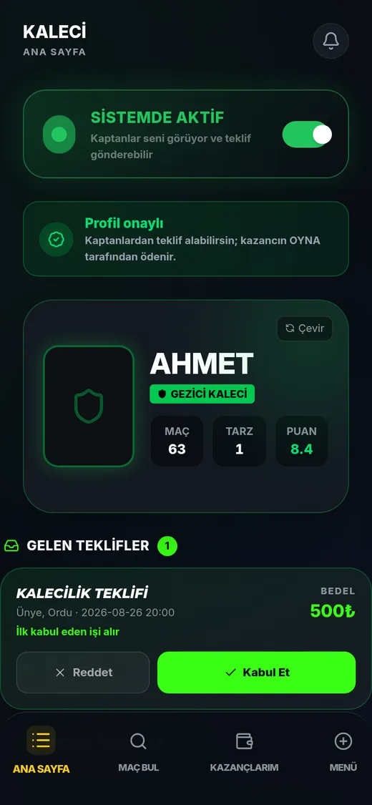</a>

_Ana sayfanın üstü — kaleci görünümü (yeşil tema)._

**1. SİSTEMDE AKTİF** — Müsaitlik anahtarın. Açıkken kaptanlar seni listede görür ve teklif gönderebilir. **Kapattığında yeni teklif gelmez** — kabul ettiğin işler etkilenmez.
**2. Profil onaylı** — OYNA yönetiminin başvurunu onayladığını gösterir. Onaysız hesap teklif alamaz.
**3. Kimlik kartın** — Kaptanın seni kiralarken gördüğü kart: adın, tarzın, maç sayın ve puanın. Tarzını Profilim ekranından değiştirirsin.
**4. MAÇ** — Tamamladığın maç sayısı. Kaptanlar için ilk güven işareti.
**5. PUAN** — Maç sonrası aldığın 1–10 puanların ortalaması. Yeni hesapta "—" görünür.
**6. KARİYER KARTI** — Genel reytingin ve sınıfın (A Sınıf gibi). Puanın yükseldikçe sınıf da yükselir.
**7. Ana Sayfa** — Bulunduğun sekme.
**8. Maç Bul** — Bölgende seni arayan maçlar — kendin başvurursun.
**9. Kazançlarım** — Toplam kazanç, ödenecek tutar ve işlem geçmişi.
**10. Menü** — Profilim, Ayarlar, Destek ve çıkış.

<a href="gorseller/saglayici/12-pasif.webp">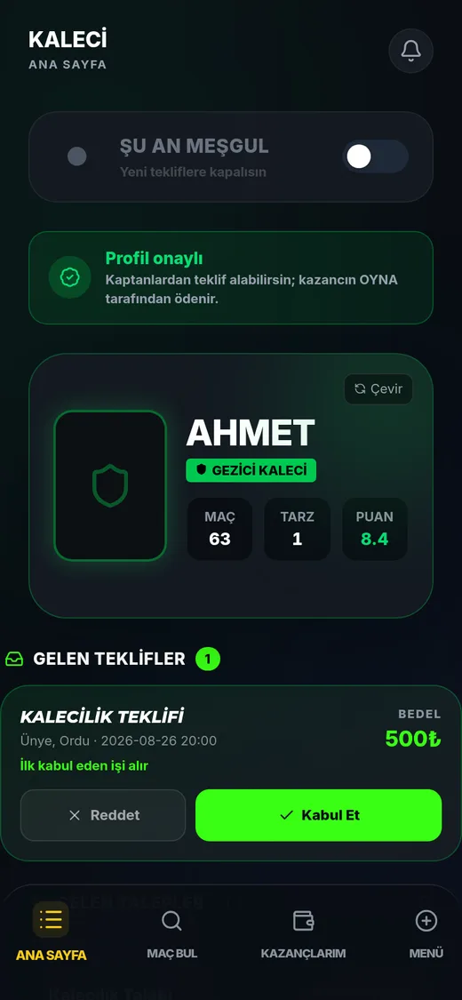</a>

_Anahtarı kapattığında: "ŞU AN MEŞGUL"._

- **Ne zaman kapatırsın** — Sakatlık, tatil, sınav haftası ya da o gün başka işin varken. Listeden düşersin, boşuna teklif gelmez.
- **Kabul ettiğin işler durur** — Meşgul moduna geçmek, daha önce kabul ettiğin maçları iptal etmez — onlara gitmek zorundasın.
- **Geri açmak** — Aynı anahtara tekrar dokunman yeterli; anında listeye dönersin.

<a href="gorseller/saglayici/13-ilk-giris.webp">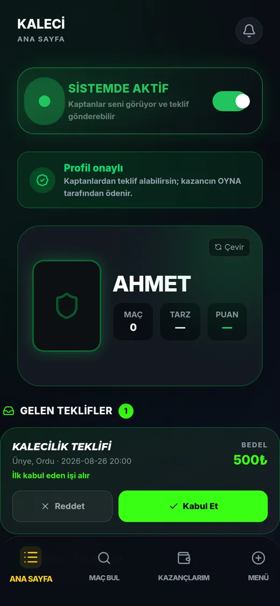</a>

_Yeni onaylanmış hesabın ilk hâli._

- **Kart boş görünür** — Maç 0, puan "—", sınıf "YENİ". Uydurma bir puan verilmez; ilk maçından sonra dolmaya başlar.
- **"Tarzını seç → Bilgilerim"** — İlk iş: Menü → Profilim'den tarzını ve ücretini gir. Tarzsız kart kaptanın gözünde eksik durur.

---

## 2. İş almanın 3 yolu

Panelde iş üç ayrı kanaldan gelir. İkisi sana gelir (teklif ve talep), üçüncüsünde sen gidersin (Maç Bul). Üçünün de ücreti sabittir — **pazarlık yoktur** ve %10 platform komisyonu bedelin içindedir.

<a href="gorseller/saglayici/02-gk-teklif.webp">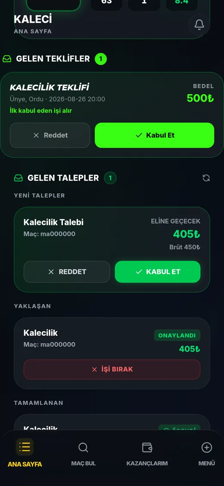</a>

_Yol 1 — Gelen Teklifler: aynı anda birkaç kişiye gider._

**1. GELEN TEKLİFLER** — Kaptanın birden fazla sağlayıcıya birden gönderdiği açık teklifler. Yanındaki sayı bekleyen teklif adedidir.
**2. Teklif türü** — Kalecilik / Hakemlik teklifi olduğunu söyler.
**3. Yer ve saat** — Maçın nerede ve ne zaman olduğu. **Kabul etmeden önce buraya bak** — yolun uzunluğunu burada görürsün.
**4. "İlk kabul eden işi alır"** — Bu teklif başkalarına da gitti. Geç kalırsan iş elinden gider; karar süresi kısadır.
**5. BEDEL** — Maç başı brüt ücret. Eline geçecek net tutar %10 komisyon düşülerek hesaplanır.
**6. Reddet** — Teklifi kapatır. Puanına zarar vermez, ama sık reddetmek daha az teklif almana yol açar.
**7. Kabul Et** — İşi alırsın. **Kalecide** önce sözleşme + teminat onayı ekranı açılır; hakemde doğrudan kabul edilir.

<a href="gorseller/saglayici/03-gk-talep.webp">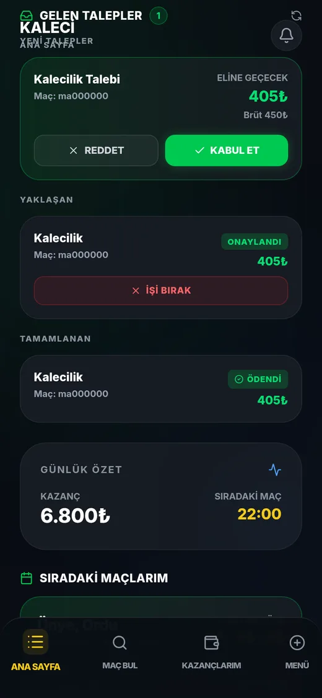</a>

_Yol 2 — Gelen Talepler: doğrudan sana yapılan kiralama._

**1. Talep başlığı** — Kaptanın **doğrudan seni** seçtiği kiralama isteği. Başkasıyla yarışmazsın.
**2. Maç kodu** — Panelin bu satırda maçın adını değil kod parçasını gösterdiğini unutma — yeri ve saati Maçlarım/detay ekranından teyit et.
**3. ELİNE GEÇECEK** — Komisyon düşüldükten sonra hesabına yazılacak **net** tutar.
**4. Net tutar** — Ödemeyi kaptandan değil OYNA'dan alırsın; para maç sonrası serbest bırakılır.
**5. Brüt ücret** — Kaptanın ödediği toplam. Net ile arasındaki fark %10 platform komisyonudur.
**6. REDDET** — Talebi geri çevirir.
**7. KABUL ET** — Kabul edersin; maç "Yaklaşan" listene düşer.
**8. ONAYLANDI rozeti** — Kabul ettiğin, henüz oynanmamış iş.
**9. İŞİ BIRAK** — Kabul ettiğin işten çekilirsin. **Dikkat:** maça yakın bırakmak ceza doğurabilir; ekran çekilmeden önce cezayı gösterir.
**10. ÖDENDİ rozeti** — Tamamlanmış ve parası hesabına geçmiş iş.
**11. GÜNLÜK ÖZET · KAZANÇ** — Hesabında biriken toplam.
**12. SIRADAKİ MAÇ** — En yakın maçının saati.

<a href="gorseller/saglayici/04-gk-mac-bul.webp">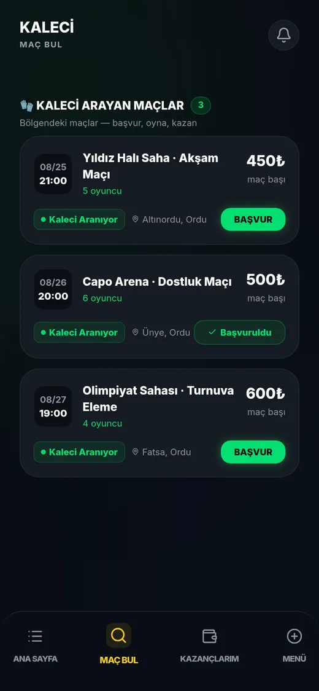</a>

_Yol 3 — Maç Bul: sen başvurursun._

**1. Seni arayan maçlar** — Bölgendeki, senin rolün boş olan maçlar. Sayı kaç ilan olduğunu gösterir.
**2. Tarih ve saat** — Maçın günü ve başlangıç saati.
**3. Ücret** — Maç başı ödenecek tutar. "Standart ücret" yazıyorsa kaptan fiyat belirtmemiştir.
**4. Aranan rol** — "Kaleci Aranıyor" / "Hakem Aranıyor" — o maçta senin rolün boş.
**5. BAŞVUR** — Kaptana kendi kartını ve ücret teklifini gönderirsin.
**6. Başvuruldu** — Zaten başvurduğun ilan. Kaptan onaylayana kadar bekler.

<a href="gorseller/saglayici/05-gk-is-detay.webp">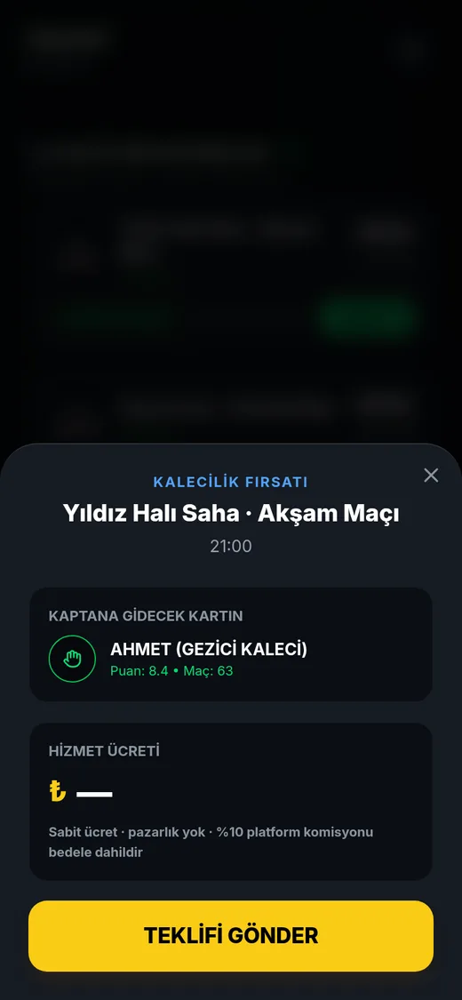</a>

_BAŞVUR'a dokununca açılan başvuru ekranı._

**1. Fırsat başlığı** — Başvurduğun maçın adı ve saati.
**2. KAPTANA GİDECEK KARTIN** — Kaptanın göreceği kart: adın, tarzın, puanın ve maç sayın. Kartı güçlendirmek istiyorsan Profilim'i doldur.
**3. HİZMET ÜCRETİ** — Bu maç için isteyeceğin tutar. Boş bırakırsan profilindeki standart ücret kullanılır.
**4. Komisyon notu** — "Sabit ücret · pazarlık yok · %10 platform komisyonu bedele dahildir." Yazdığın rakam **brüt**tür.
**5. TEKLİFİ GÖNDER** — Başvurun kaptana iletilir. Kaptan kabul ederse iş senindir.

---

## 4. Maç günü ve skor

Kabul ettiğin maç "Sıradaki Maçlarım" listesine düşer; geri sayım başlar. **Skor girme yetkisi yalnız hakemdedir.**

<a href="gorseller/saglayici/16-ref-skor-bekliyor.webp">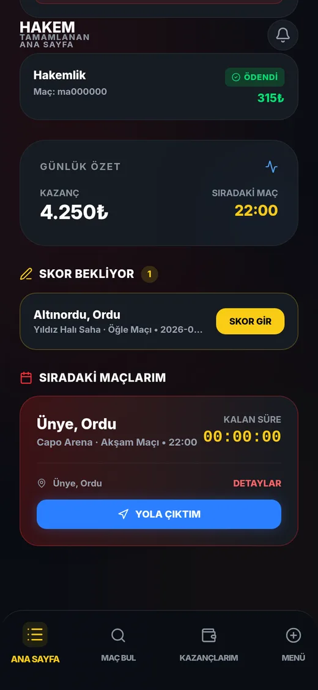</a>

_Hakem görünümü (kırmızı tema) — skor bekleyen maç ve sıradaki maçlar._

**1. SKOR BEKLİYOR** — Oynanmış ama skoru girilmemiş maçların. **Yalnız hakemde görünür.**
**2. SKOR GİR** — Resmî skor giriş ekranını açar.
**3. SIRADAKİ MAÇLARIM** — Kabul ettiğin, henüz oynanmamış maçlar.
**4. KALAN SÜRE** — Maça kalan geri sayım.
**5. YOLA ÇIKTIM** — Kaptana canlı durumunu bildirir — lobide "yolda" rozeti görünür. Geç kalma endişesini ortadan kaldırır.
**6. DETAYLAR** — Maçın sahası, saati ve kadro bilgisi.

<a href="gorseller/saglayici/17-ref-skor-gir.webp">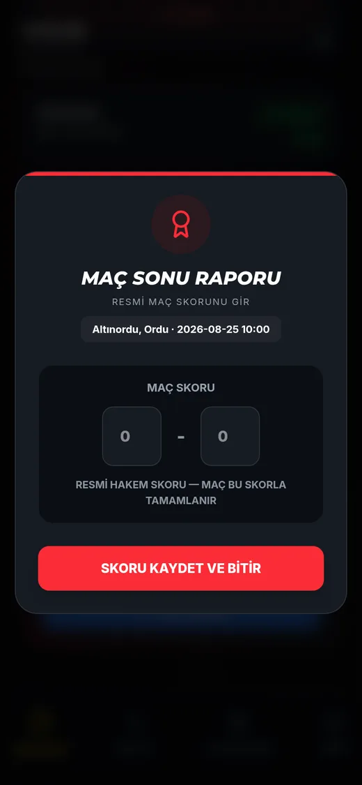</a>

_Maç Sonu Raporu — resmî skor girişi._

- **Resmî skor** — Hakemin girdiği skor maçın resmî sonucudur; maç bu skorla tamamlanır.
- **Geri alınamaz** — Kaydettikten sonra skor kilitlenir — yanlış girersen destekten düzeltme istemen gerekir.
- **Neden önemli** — Skor, oyuncuların istatistiklerine ve maç geçmişine işler. Girilmeyen skor maçı yarım bırakır.

---

## 5. Kazançlarım — para nasıl gelir

Ücretini kaptandan elden almazsın. Para **OYNA tarafından** tutulur ve maç tamamlandıktan sonra hesabına geçer.

<a href="gorseller/saglayici/07-kazanclarim.webp">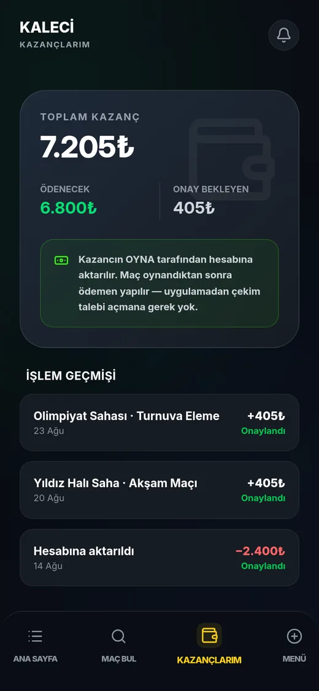</a>

_Kazançlarım sekmesi._

**1. TOPLAM KAZANÇ** — Bugüne kadar biriken tüm net kazancın.
**2. ÖDENECEK** — Hesabında duran, sana ait tutar.
**3. ONAY BEKLEYEN** — Kabul ettiğin ama henüz tamamlanmamış işlerin tutarı. Maç oynanınca "ödenecek"e geçer.
**4. Ödeme notu** — "Kazancın OYNA tarafından hesabına aktarılır. Maç oynandıktan sonra ödemen yapılır — **uygulamadan çekim talebi açmana gerek yok.**"
**5. İŞLEM GEÇMİŞİ** — Her maçın kazancı ve yapılan aktarımlar tek tek listelenir.

---

## 6. Profilim — ücret, tarz, çalışma alanı

Kaptanın gördüğü kartını burada yönetirsin: **Menü → Profilim**. Ücretin, tarzların ve çalışma yarıçapın kaç teklif aldığını doğrudan etkiler.

<a href="gorseller/saglayici/09-gk-profil.webp">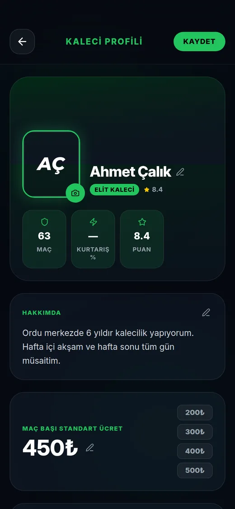</a>

_Kaleci profili._

**1. KAYDET** — Değişiklikleri yazar. Kaydetmeden çıkarsan eski değerler kalır.
**2. HAKKIMDA** — Kaptanın okuduğu kısa tanıtım. Tecrübeni ve müsait olduğun saatleri yazmak teklif sayısını artırır.
**3. MAÇ BAŞI STANDART ÜCRET** — Varsayılan ücretin. Hazır kısayollar (200/300/400/500₺) ya da elle giriş. Başvuruda ayrı ücret yazmazsan bu kullanılır.
**4. TARZIM** — Kalecide "Kaleci Tarzım", hakemde "Yönetim Tarzım". Listeden seçersin — sana özel bir etiket üretilmez.
**5. 2/2 sınırı** — **En fazla iki tarz** seçebilirsin. Seçtiklerin ana ekranındaki kartında ve kaptanın gördüğü profilde görünür.

<a href="gorseller/saglayici/10-gk-profil-tarz.webp">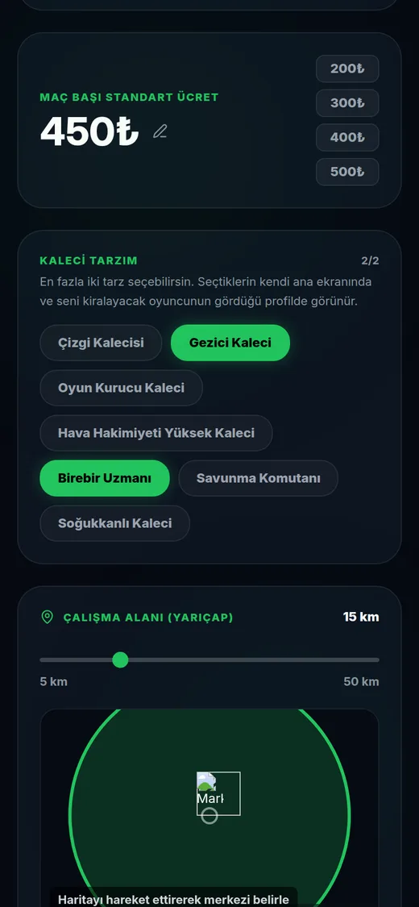</a>

_Profilin alt kısmı: tarz listesi ve çalışma alanı._

- **Tarz listesi** — Kaleci: Çizgi Kalecisi, Gezici Kaleci, Oyun Kurucu, Hava Hakimiyeti, Birebir Uzmanı, Savunma Komutanı, Soğukkanlı. Hakem: Disiplinci, Oyunu Akıtan, VAR Uzmanı, Kuralcı, İletişimci, Soğukkanlı.
- **ÇALIŞMA ALANI (YARIÇAP)** — 5–50 km arası. Yarıçapı büyütmek daha çok maç görmeni sağlar, ama yol da uzar.
- **Harita ve LOKASYONU KAYDET** — Haritayı hareket ettirip merkezini belirlersin. Yakınındaki maçlar bu merkeze göre listelenir.

<a href="gorseller/saglayici/20-ref-profil.webp">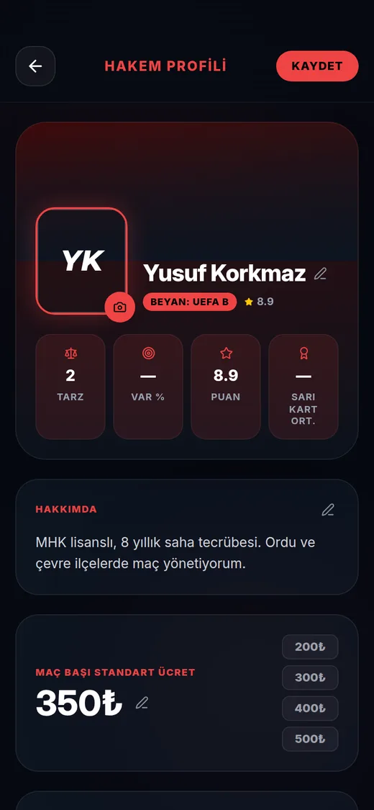</a>

_Hakem profili — aynı ekran, iki fark var._

- **Seviye beyanı** — Kartında "BEYAN: UEFA B" gibi lisans seviyen görünür. Bu **senin beyanındır**; belge doğrulaması OYNA yönetimindedir.
- **Yönetim tarzı** — Kaleci tarzları yerine hakem tarzları listelenir.
- **Teminat yok** — Hakemde 500₺ teminat şartı ve sözleşme onay ekranı yoktur.

---

## 7. Menü ve Ayarlar

Panelin dördüncü sekmesi. Sade tutulmuştur: profil, ayarlar, destek ve çıkış.

<a href="gorseller/saglayici/08-menu.webp">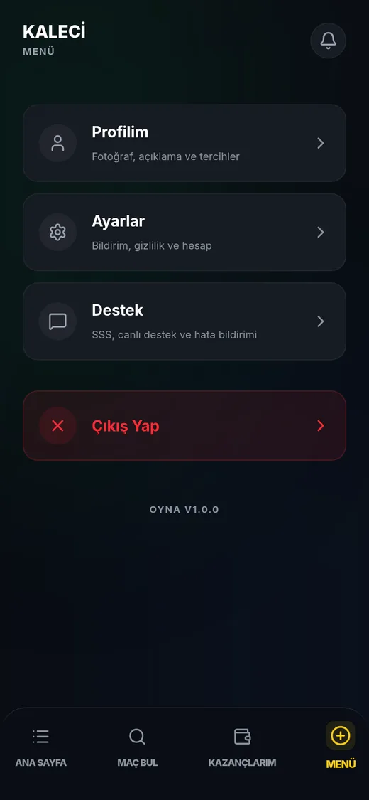</a>

_Menü sekmesi._

- **Profilim** — Fotoğraf, açıklama, ücret, tarz ve çalışma alanı.
- **Ayarlar** — Bildirim, gizlilik, görünüm ve hesap güvenliği.
- **Destek** — SSS, canlı destek ve hata bildirimi.
- **Çıkış Yap** — Oturumu kapatır.

<a href="gorseller/saglayici/11-ayarlar.webp">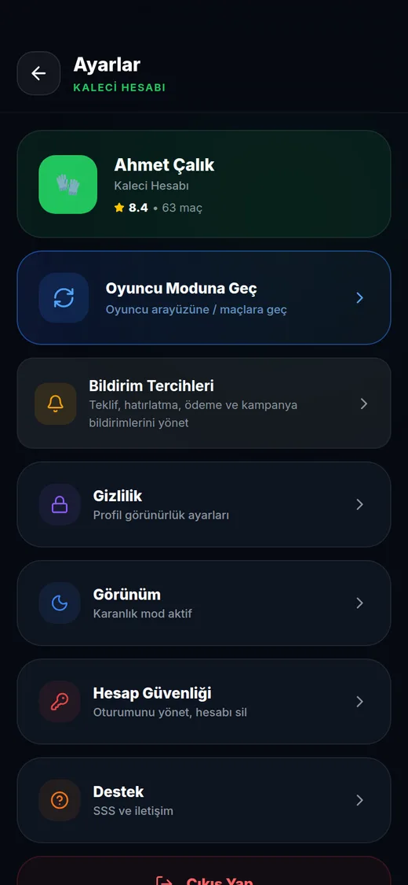</a>

_Ayarlar ekranı._

- **Oyuncu Moduna Geç** — Aynı hesapla oyuncu arayüzüne dönersin — kendi maçını kurmak ya da maça katılmak için.
- **Bildirim Tercihleri** — Teklif, hatırlatma, ödeme ve kampanya bildirimleri. **Teklif bildirimini kapatma** — "ilk kabul eden alır" tekliflerini kaçırırsın.
- **Gizlilik** — Profil görünürlük ayarları.
- **Hesap Güvenliği** — Oturum yönetimi ve hesap silme.

---

## 8. Hakem paneli — aynı ekranlar, kırmızı tema

Hakem panelinin iskeleti kaleciyle birebir aynıdır; tema rengi kırmızıdır ve rol adları değişir. Aşağıda hakem gözünden aynı ekranlar var.

<a href="gorseller/saglayici/14-ref-ana-ust.webp">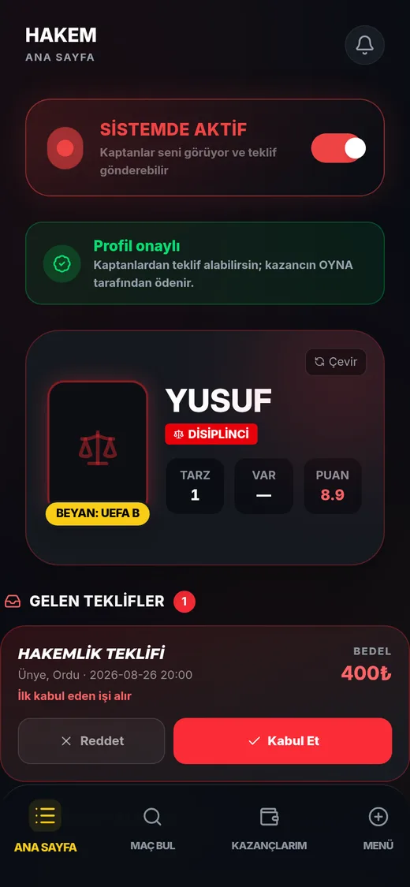</a>

_Hakem ana sayfası — kimlik kartında "BEYAN: UEFA B" seviyesi görünür._

- **Kariyer performansı** — Genel reyting, maç puanı ortalaması ve yönetim değeri.
- **Seviye beyanı** — Kartın üstündeki "BEYAN:" etiketi lisans seviyeni gösterir — belge doğrulaması yönetimdedir.

<a href="gorseller/saglayici/15-ref-ana-teklifler.webp">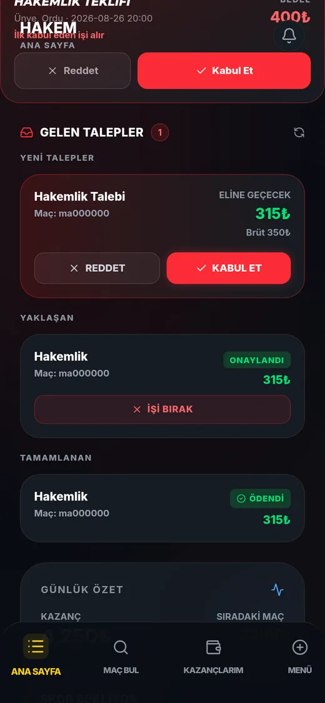</a>

_Hakemlik teklifi kartı — kalecideki akışın aynısı._

- **Fark yok** — Kabul/Reddet mantığı ve "ilk kabul eden alır" kuralı kalecidekiyle aynıdır; hakemde kabulde sözleşme ekranı açılmaz.

<a href="gorseller/saglayici/18-ref-mac-bul.webp">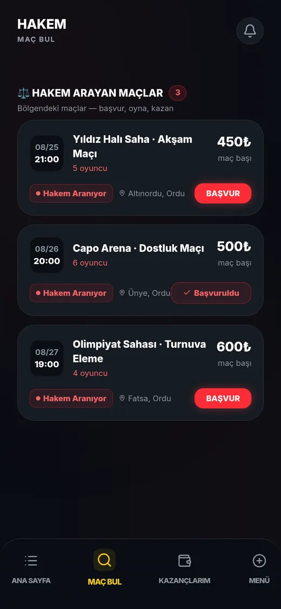</a>

_Maç Bul — "Hakem Aranıyor" ilanları._

- **Rol süzgeci** — Listede yalnız hakemi boş olan maçlar görünür.

<a href="gorseller/saglayici/19-ref-is-detay.webp">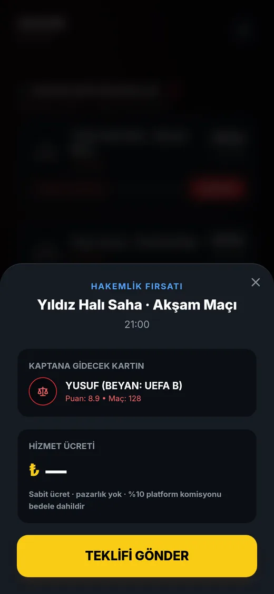</a>

_Hakemlik fırsatı — başvuru ekranı._

- **Kart ve ücret** — Kaptana giden kartında seviyen ve puanın yer alır; ücret alanı boş bırakılırsa profildeki standart ücret gider.

<a href="gorseller/saglayici/21-ref-kazanclarim.webp">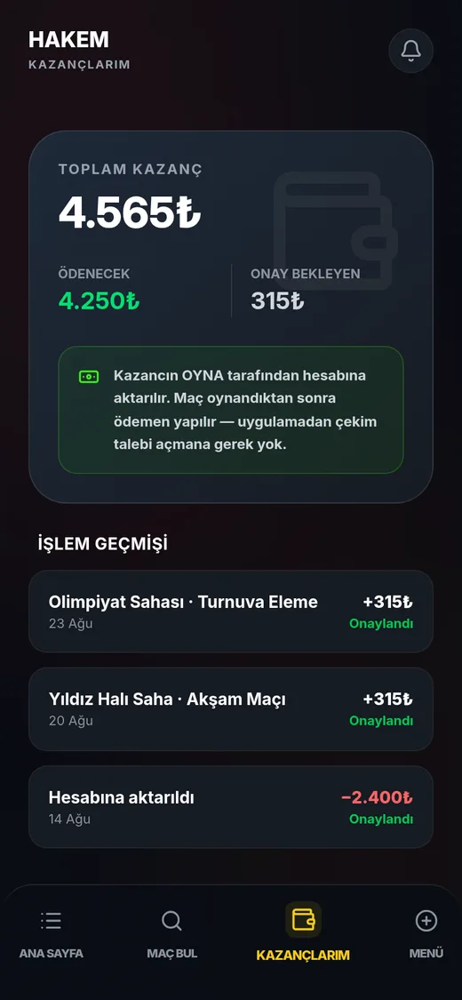</a>

_Kazançlarım — hakem görünümü._

- **Aynı kurallar** — Ödeme maç sonrası serbest bırakılır; çekim talebi gerekmez.

<a href="gorseller/saglayici/22-ref-menu.webp">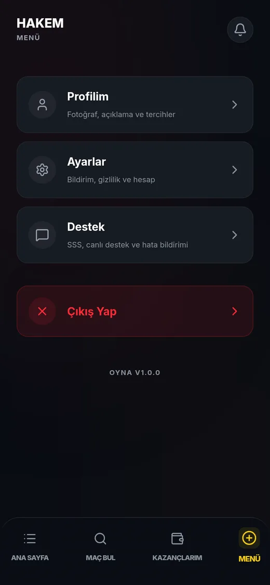</a>

_Menü — hakem görünümü._

- **Aynı dört satır** — Profilim, Ayarlar, Destek, Çıkış.

<a href="gorseller/saglayici/23-ref-ayarlar.webp">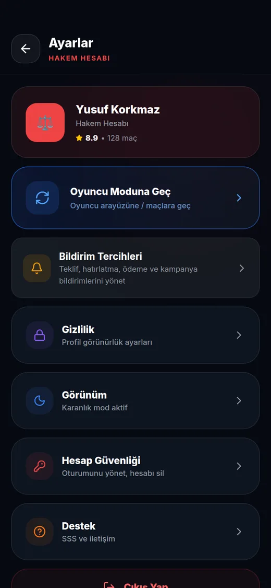</a>

_Ayarlar — "HAKEM HESABI" başlığıyla._

- **Oyuncu moduna geçiş** — Hakem de aynı hesapla oyuncu tarafına geçebilir.

---

## Sık yapılan hatalar

- **Teklif bildirimini kapatma** — "İlk kabul eden alır" teklifleri dakikalar içinde kapanır; bildirim kapalıysa haberin olmaz.
- **Kalecide 500₺ teminatı düşürme** — Bakiye 500₺'nin altına inerse yeni iş kabul edemezsin.
- **Gelen talepte maç yerini teyit et** — Talep kartı maçın adını değil kod parçasını gösterir; yeri ve saati kabul etmeden önce doğrula.
- **Meşgul modu işleri iptal etmez** — Anahtarı kapatmak yalnız yeni teklifleri durdurur; kabul ettiğin maça gitmek zorundasın.

---

## Sık sorulan sorular

**Kaleci ile hakem paneli arasındaki fark ne?**

İskelet aynı: 4 sekme, aynı iş akışı. Üç fark var — **kaleci** kabul ederken sözleşme onaylar ve hesabında 500₺ teminat bulundurur; **hakem** maç sonunda resmî skoru girer ve kartında lisans seviyesini beyan eder. Bir de tema rengi: kaleci yeşil, hakem kırmızı.

**"İlk kabul eden işi alır" ne demek?**

O teklif aynı anda birkaç kaleciye/hakeme gönderilmiştir. Kabul eden ilk kişi işi alır, diğerlerinin ekranından teklif düşer. Bildirimleri açık tutmak bu yüzden önemlidir.

**Ücretimi pazarlık edebilir miyim?**

Hayır. Ücret sabittir: ya profildeki standart ücretin ya da başvururken yazdığın tutar geçerlidir. %10 platform komisyonu bu bedelin içinden düşülür.

**Param ne zaman hesabıma geçer?**

Maç tamamlandıktan sonra. O ana kadar tutar "Onay Bekleyen" olarak görünür. Çekim talebi açmana gerek yoktur; aktarım OYNA tarafından yapılır.

**Kabul ettiğim işi bırakabilir miyim?**

Evet, "İŞİ BIRAK" ile. Ancak maça yakın bırakmak ceza doğurabilir — ekran çekilmeden önce uygulanacak cezayı gösterir. Kalecide ayrıca no-show cezası sözleşmeye bağlıdır.

**Teklif gelmiyor, ne yapmalıyım?**

Sırayla kontrol et: (1) "Sistemde aktif" anahtarı açık mı, (2) profilinde tarz ve ücret girili mi, (3) çalışma yarıçapın çok mu dar, (4) bildirim izinleri kapalı mı. Dördü de tamamsa Maç Bul'dan kendin başvur.

**Skoru yanlış girdim.**

Skor kaydedildikten sonra kilitlenir. Menü → Destek üzerinden düzeltme talebi açman gerekir.

**Profil onayım ne kadar sürer?**

Başvurun OYNA yönetimine gider; onaylanana kadar panel açılmaz. Reddedilirse ret gerekçesi gösterilir ve yeniden başvurabilirsin.

---

## Bu kılavuz nasıl hazırlandı

Ekran görüntüleri, panelin canlı sürümü telefon görünümünde (390×844) sürülerek alınmıştır. Arayüzde bir etiket, akış veya kural değiştiğinde ilgili bölüm aynı değişiklikte güncellenmelidir. Takıldığın yerde **Menü → Destek**'ten talep açabilirsin.
