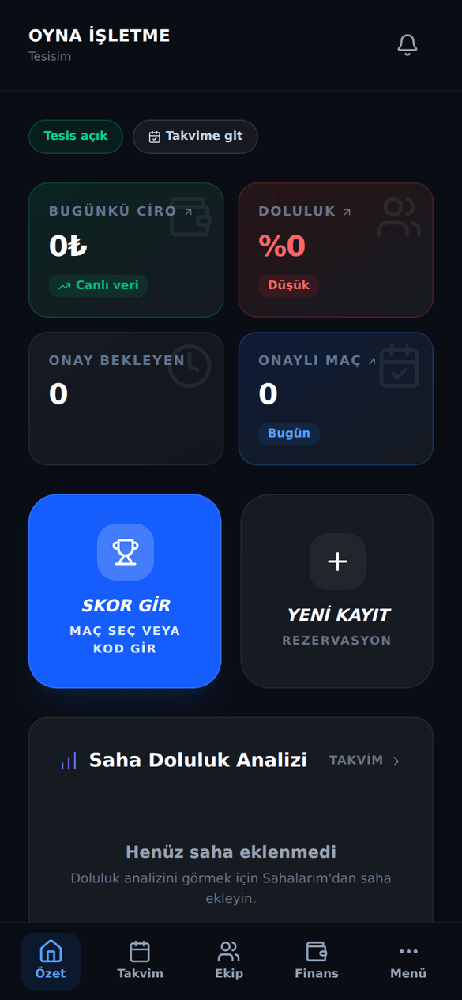
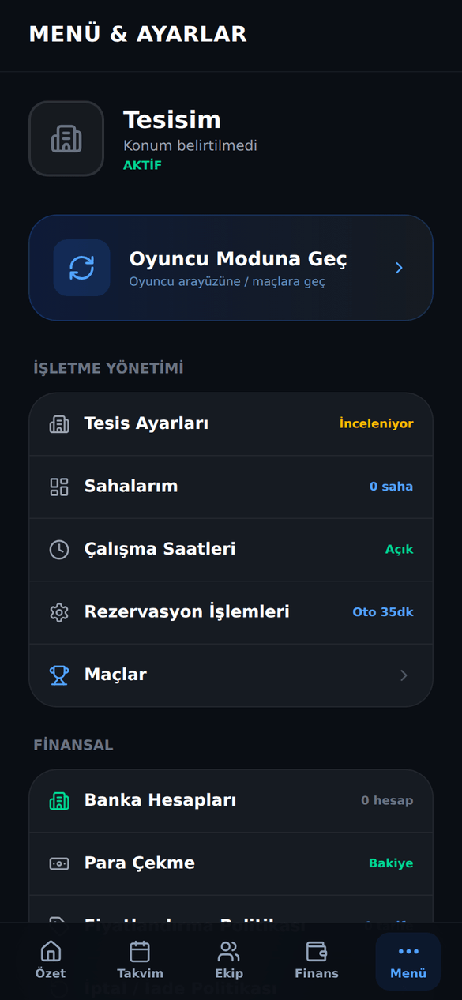
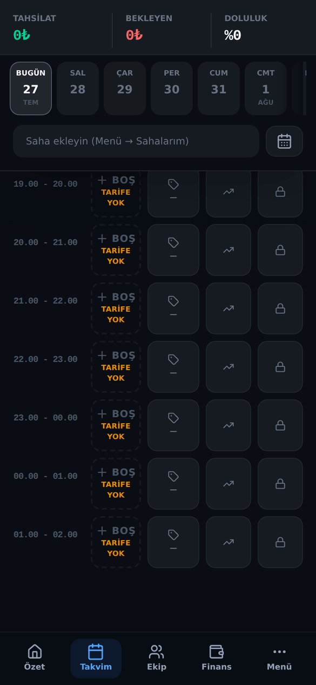
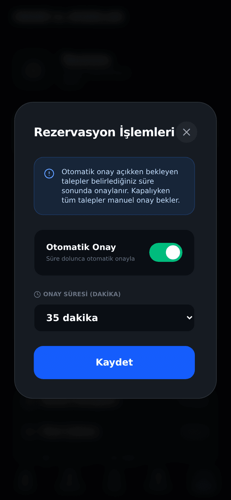
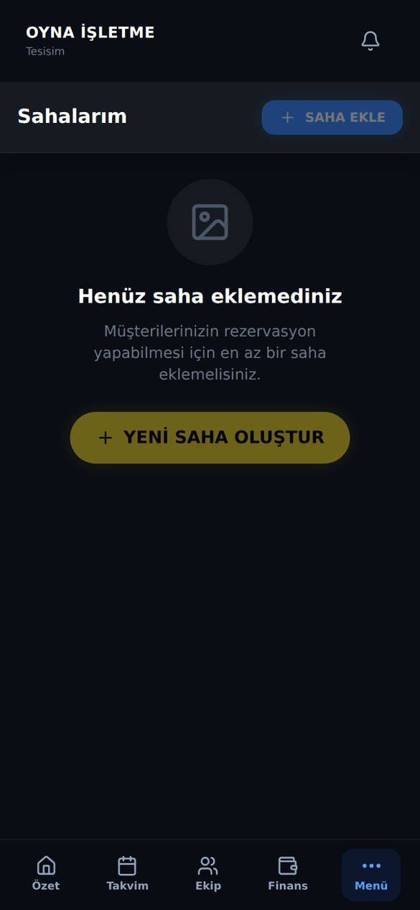
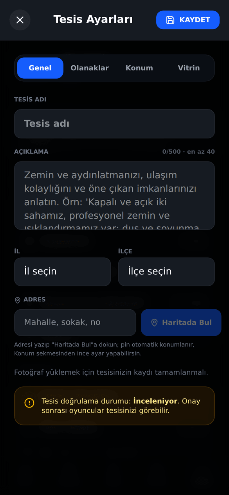
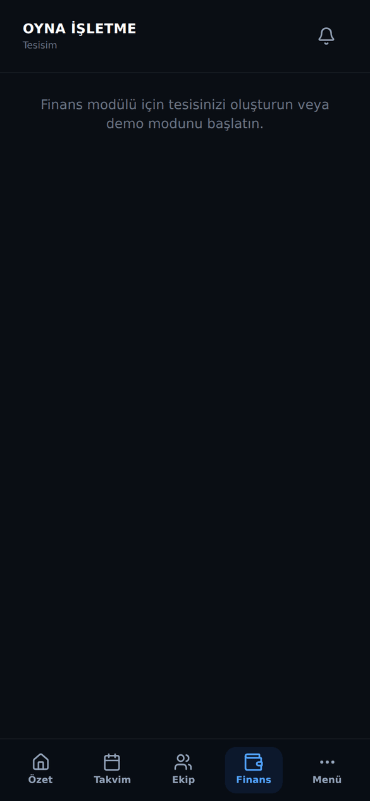
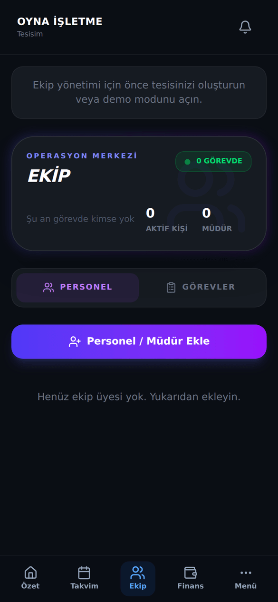
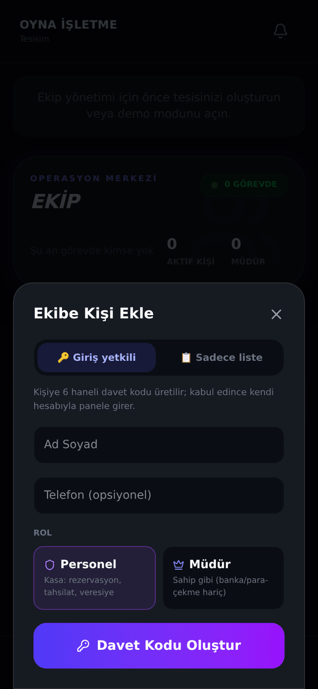
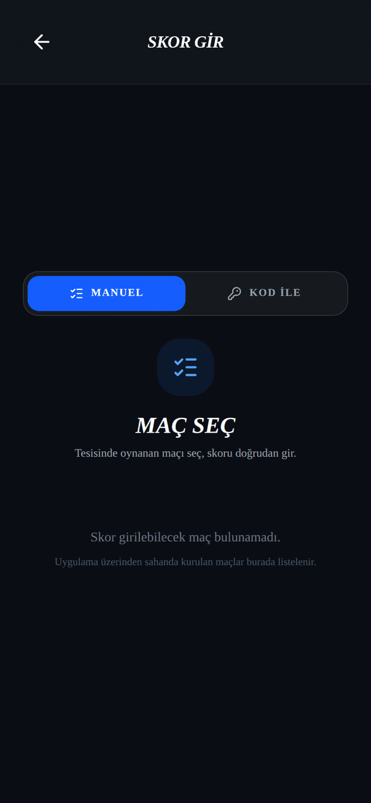

# OYNA Saha Sahibi (Tesis) Kılavuzu

_Son güncelleme: 26 Temmuz 2026 · Uygulama sürümü 3.0.0_

> Bu kılavuz, halı saha tesisini OYNA üzerinden yöneten **saha sahipleri** ile tesiste çalışan **müdür ve personel** içindir. Oyuncu tarafını merak ediyorsan [Oyuncu Kılavuzu](01-oyuncu-kilavuzu.md)'na, uygulamanın genel tanıtımı için [Genel Kılavuz](00-genel-kilavuz.md)'a bakabilirsin.

---

## 1. Giriş

OYNA Tesis Paneli, halı sahanı tek ekrandan yönetmen için tasarlandı. Rezervasyon defterini, kasa tahsilatlarını, veresiye takibini, abonman müşterilerini ve ekibini aynı yerden idare edersin. Uygulamadan gelen rezervasyon taleplerini onaylar, telefonla arayan müşterin için iki dokunuşla manuel kayıt açarsın.

Tesisin OYNA vitrininde yayına girdiğinde, çevrendeki oyuncular sahanı görür, boş saatlerini inceler ve uygulamadan rezervasyon talebi gönderir. Sen talebi onaylarsın (istersen otomatik onay da açabilirsin), maç oynanır, kazancın panelinde birikir.

Panel sadece sahibe özel değil: tesiste çalışan müdürünü ve kasadaki personelini de davet kodu ile panele ekleyebilirsin. Herkes kendi yetkisi kadarını görür — personel kasayı işletir ama finans rakamlarını göremez. Detaylar bu kılavuzun "Ekibin: Roller ve Yetkiler" bölümünde.

### Bir bakışta: hangi bölüm ne işe yarar

| Bölüm/Sekme | Ne işe yarar |
|---|---|
| **Özet** | Günün fotoğrafı: ciro, doluluk, bekleyen talepler ve hızlı işlemler. |
| **Takvim** | Rezervasyon defteri: kayıt aç, tahsilat al, slot kapat, abonman yönet. |
| **Ekip** | Personel/müdür davet et, nöbet takibi yap, görev dağıt. |
| **Finans** | Dönem bakiyesi, OYNA kazançları, veresiye defteri, giderler, CSV raporu. |
| **Menü** | Tesis ayarları, sahalar, fiyat politikası, banka, vitrin ve destek. |
| Onay Bekleyen Talepler | Uygulamadan gelen rezervasyon taleplerini onayla/reddet, otomatik onayı ayarla. |
| Sahalarım | Kortlarını ekle, düzenle, fotoğraf yükle. |
| **SKOR GİR** | Tesisinde oynanan maçların skorunu kaydet. |

---

## 2. Başlarken

### 2.1 Tesisini OYNA'ya ekle (3 adımlı kayıt)

Adım adım:

1. OYNA'ya kendi hesabınla giriş yap ve rol seçim ekranında **TESİS** kartını seç.
2. Açılan tesis panelinde **TESİS KAYDI BAŞLAT** butonuna dokun.
3. **Adım 1:** Tesisinin adını yaz, il/ilçe seç ve açık adresini gir.
4. **Adım 2:** Standart **Saatlik Ücret (TL)** belirle (sana bölgene uygun bir öneri gösterilir, örneğin 1800 TL).
5. **Adım 3:** **IBAN** bilgini gir. IBAN zorunludur; OYNA üzerinden kazandığın paranın sana aktarılacağı hesaptır.
6. Kaydı tamamla. Başvurun OYNA yönetimine iletilir.

Kayıt tamamlanınca sistem senin için otomatik olarak şunları hazırlar:

- **"Saha 1"** adında bir kort (sonradan düzenlersin).
- 3 hazır fiyat tarifesi: **Gündüz** (standart ücretin %80'i, kapora %20) · **Akşam** (standart ücret, kapora %30) · **Hafta Sonu** (standart ücretin %120'si, kapora %40).

### 2.2 Onay bekleme ve yayına çıkma

- Başvurun onaylanana kadar tesisin oyuncu vitrininde **görünmez**; panelinde "Tesisiniz onay bekliyor" bandı durur. Bu sürede paneli gezebilir, kort ve fiyat bilgilerini hazırlayabilirsin.
- Başvurun reddedilirse panelde ret bandı ve gerekçe görürsün.
- Tesisin yayına çıkabilmesi için iki şart vardır: **OYNA yönetiminin onayı** + **en az bir aktif fiyat tarifesi**. İkisi de tamamsa **Menü → Tesis Ayarları → Vitrin** sekmesindeki **Vitrinde Göster** anahtarıyla yayına alırsın.

### 2.3 Kurulum Sihirbazı (5 adım)

İlk girişte **Özet** sekmesinde Kurulum Sihirbazı kartını görürsün. Eksik adımların tek dokunuşla ilgili ekranı açar:

1. Saha ekle
2. Konumu işaretle (haritada pin — yayına çıkmadan önce zorunlu)
3. Fotoğraf yükle
4. Fiyat tarifesi
5. Çalışma saatleri

Tüm adımlar tamamlanınca kart kaybolur.

---

## 3. Paneli Tanı: 5 Sekme

Panelin altındaki menüde 5 sekme vardır: **Özet · Takvim · Ekip · Finans · Menü**. Birden fazla tesisin varsa üstteki tesis seçiciden aralarında geçiş yaparsın.

### 3.1 Özet

_Şekil: Özet sekmesi — KPI kartları, hızlı işlemler ve bekleyen talepler._

- **KPI kartları:** Bugünkü Ciro · Doluluk % · Onay Bekleyen · Onaylı Maç.
- **Hızlı işlemler:** **SKOR GİR** (skor girme ekranını açar) ve **YENİ KAYIT** (Takvim'e götürür).
- **Doluluk analizi:** saat × kort ısı haritası; hangi saatlerin dolu olduğunu bir bakışta görürsün.
- **Onay bekleyen talepler:** ilk 3 talep geri sayımla listelenir; buradan doğrudan Onayla/Reddet yapabilirsin.
- Özet kartlarını **Menü → Özet Widgetları** ekranından kişiselleştirebilirsin.

### 3.2 Takvim

Rezervasyon defterin. Detaylar 4. bölümde.

### 3.3 Ekip

Personel/müdür yönetimi ve görevler. Detaylar 9. bölümde. Bu sekmeyi yalnız **Saha Sahibi** ve **Müdür** görür.

### 3.4 Finans

Para akışın. Detaylar 8. bölümde. Bu sekmeyi yalnız **Saha Sahibi** ve **Müdür** görür.

### 3.5 Menü

_Şekil: Menü sekmesi — işletme yönetimi, finansal ayarlar ve uygulama tercihleri._

| Grup | Öğeler | Kim görür |
|---|---|---|
| İşletme Yönetimi | **Tesis Ayarları** · **Sahalarım** · **Çalışma Saatleri** (tesisi geçici aç/kapa dahil) · **Rezervasyon İşlemleri** (otomatik onay) · **Maçlar** | Sahip + Müdür |
| Finansal | **Banka Hesapları** · **Para Çekme** | Yalnız Sahip |
| | **Fiyatlandırma Politikası** · **İptal / İade Politikası** | Sahip + Müdür |
| Uygulama | **Özet Widgetları** · **Bildirimler** · **Güvenlik & Şifre** · **Destek Merkezi** · **Güvenli Çıkış** · **Oyuncu Moduna Geç** | Herkes |

---

## 4. Takvim ve Rezervasyon Yönetimi

_Şekil: Takvim — gün şeridi, kort seçici ve saat ızgarası._

Takvimde üstte gün şeridi ve kort seçici, altta saat ızgarası bulunur. Aylık yoğunluk görünümüne geçebilir, geç saatleri görmek için tüm saatleri açabilirsin.

### 4.1 Uygulama taleplerini onayla / reddet

_Şekil: Onay bekleyen rezervasyon talepleri ve Otomatik Onay anahtarı._

Uygulamadan gelen her rezervasyon talebi "Onay Bekleyen Talepler" listesine anında düşer.

Adım adım:

1. Özet'teki bekleyen talep sayacına veya Menü'deki **Onay Bekleyen Talepler**'e dokun.
2. Talebin saatini, kortunu ve müşteri bilgisini incele.
3. **Onayla** veya **Reddet**'e dokun. Ret için onay istenir ve **geri alınamaz**.

**Otomatik Onay:** Bu ekrandaki **Otomatik Onay** anahtarını açarsan, belirlediğin süre içinde elle yanıtlamadığın talepler kendiliğinden onaylanır. Varsayılan süre **35 dakikadır**; süreyi değiştirebilirsin. Aynı ayara **Menü → Rezervasyon İşlemleri**'nden de ulaşırsın.

### 4.2 Hızlı manuel rezervasyon (telefonla arayan müşteri)

Adım adım:

1. Takvim'de boş bir saat hücresine dokun.
2. Müşteri adını ve telefonunu gir.
3. Ödeme durumunu seç: **ÖDENDİ** · **KISMİ** · **BEKLİYOR**.
4. Kaydet. Rezervasyon anında takvime işlenir.

### 4.3 Tahsilat alma

Adım adım:

1. Takvimde rezervasyon bloğuna dokunup detayını aç.
2. **Tahsilat Al**'a dokun.
3. Tutarı gir ve yöntemi seç: **Nakit** · **Kart** · **Havale**.
4. Onayla. Tutar kalan borcu aşamaz; sistem fazla tahsilata izin vermez.

Tahsilatı kimin aldığı otomatik kaydedilir. Yanlış girilen bir ödeme kaydını yalnız Sahip veya Müdür düzeltebilir/silebilir.

### 4.4 Onaylı rezervasyonu iptal etme ve iade

1. Rezervasyon detayını aç ve **İptal Et**'e dokun.
2. İptal nedenini yaz (zorunlu) ve onayla.
3. Müşteri uygulamadan ödeme yaptıysa iade, tesisin iptal/iade politikasına göre otomatik hesaplanır (bkz. bölüm 6.2).

Onaylanmış bir rezervasyonu yalnız **Sahip** ve **Müdür** iptal edebilir; personel edemez.

### 4.5 Abonman (düzenli müşteri) yönetimi

Takvimin abonman bölümünden:

- Yeni abonman aç: müşteri adı, telefon ve süre seç.
- Mevcut abonmanda: **Otomatik yenilemeyi aç/kapa**, **Duraklat/Devam ettir**, **İptal et**.

### 4.6 Flash indirim, özel fiyat, slot kapatma

- **Flash deal:** Boş kalan bir saate anlık indirim tanımla; oyuncu vitrininde indirimli görünür. Flash fiyat, standart fiyatın **altında** olmak zorundadır.
- **Özel Fiyat:** Yoğun (prime time) saatlere standart tarifenin üzerinde özel fiyat tanımla.
- **Slot Kapat:** Bir saati bakım, özel etkinlik vb. nedenle rezervasyona kapat; istersen **tüm günü** tek seferde kapat. Neden girilmesi gerekir.

---

## 5. Sahalarım (Kort Yönetimi)

_Şekil: Sahalarım — kort listesi ve düzenleme._

**Menü → Sahalarım**'dan kortlarını yönetirsin:

- Kort ekle, düzenle, sil; kapattığın (pasif) kortu sonradan geri açabilirsin.
- Her kort için: kapasite (5v5'ten 11v11'e), boyut, zemin tipi, özellikler ve kort fotoğrafları.
- Standart planda en fazla **5 kort** ekleyebilirsin.
- Kortların **kalite notunu** (yıldız/derece) sen belirleyemezsin; kalite notlarını yalnız OYNA yönetimi onaylar. Bu, vitrindeki notların adil kalması içindir.

---

## 6. Fiyat ve Politika

### 6.1 Tarifeler ve kapora

**Menü → Fiyatlandırma Politikası**'ndan tarifelerini yönetirsin. Kayıtta gelen 3 hazır tarifeyi (Gündüz · Akşam · Hafta Sonu) düzenleyebilir, yenilerini ekleyebilirsin.

- Her tarifede saat aralığı, fiyat ve **kapora oranı** vardır.
- Kapora oranı **%10 ile %50 arasında** olmak zorundadır; sistem bu aralığın dışına izin vermez.
- Tesisin vitrinde kalması için en az bir aktif tarifen olmalıdır.

### 6.2 İptal / iade politikası

**Menü → İptal / İade Politikası**'ndan kendi kurallarını belirlersin. Kendi politikanı tanımlamazsan **OYNA varsayılanı** geçerlidir:

| Maça kalan süre | İade |
|---|---|
| 24 saat ve üzeri | %100 iade |
| 6–24 saat | %50 iade |
| 6 saatten az | İade yok |

Bu kurallar hem oyuncunun kendi iptalinde hem de senin onaylı rezervasyonu iptal etmenle tetiklenen iadelerde uygulanır.

---

## 7. Vitrin (Oyunculara Görünüşün)

_Şekil: Tesis Ayarları — Genel, Olanaklar, Konum ve Vitrin sekmeleri._

**Menü → Tesis Ayarları** ekranında dört sekme vardır: Genel · Olanaklar · Konum · **Vitrin**.

- **Vitrinde Göster** anahtarı: tesisini oyuncu vitrininde yayına alır/yayından kaldırır. Yayın için tesisin onaylı olması, en az bir aktif tarifesi ve haritada konum pini olması gerekir.
- **Vitrin Skoru:** profil doluluğunu ölçer; foto, olanak, tarife ve saat bilgilerin tamamlandıkça yükselir. Skoru yüksek tesisler vitrinde daha iyi görünür.
- **Vitrinde Önizle:** tesisini oyuncunun gözünden görürsün — vitrinde tam olarak nasıl göründüğünü kontrol etmenin en hızlı yolu.
- **Dikkat:** Onaylanmış bir tesiste **ad** veya **konum** değişikliği yaparsan bu değişiklik önce OYNA yönetiminin onayına gider; onaylanana kadar vitrinde eski bilgi görünür.

---

## 8. Finans

_Şekil: Finans — dönem bakiyesi, OYNA kazançları ve sekmeler._

Finans sekmesini yalnız **Saha Sahibi** ve **Müdür** görür. Üstteki ay seçiciyle dönemi değiştirir, sağ üstten **CSV** indirirsin (tahsilat + gider + bekleyen + veresiye tek dosyada).

- **Dönem Bakiyesi:** seçili aydaki Tahsilat − Gider farkı ve önceki döneme göre büyüme.
- **OYNA Kazançların:** uygulama üzerinden yapılan ödemelerden doğan kazancın. Üç kalem görürsün: **çekilebilir** tutar, **güvence beklemesindeki** tutar (her kazanç 2 hafta güvence süresinden sonra çekilebilir olur) ve rezerve tutar. Brüt tutar, OYNA komisyonu ve sana kalan net ayrı ayrı gösterilir. **ÇEKİM TALEBİ** butonu buradadır (bkz. bölüm 11).
- **Özet sekmesi:** dönem özeti + istediğin tarih aralığı için serbest rapor.
- **Tahsilat sekmesi:** bekleyen tahsilatlar (dokun → tahsil et veya veresiyeye yaz) ve **veresiye defteri** — borçlu kişi ekle, kısmi tahsilat al, bakiyeyi takip et.
- **Gider sekmesi:** gider ekle; sık kullandığın giderler için hazır şablonlar.

---

## 9. Ekibin: Roller ve Yetkiler

_Şekil: Ekip sekmesi — Personel ve Görevler alt sekmeleri._

Ekip sekmesinde iki alt sekme vardır: **Personel** ve **Görevler**.

### 9.1 Kim kimdir?

| Rol | Kısaca |
|---|---|
| **Saha Sahibi** | Tesisin sahibi. Her şeyi yapar; banka, para çekme ve ekip yönetimi yalnız ondadır. |
| **Müdür** | Sahip gibi tesisi yönetir — ama banka hesaplarına, para çekmeye ve ekip yönetimine (davet/rol/erişim) dokunamaz. |
| **Personel** | Kasadaki kişi. Rezervasyon açar, talepleri onaylar/reddeder, tahsilat alır, veresiye işler, görev tamamlar — finans, ekip ve ayarları göremez. |

### 9.2 Yetki tablosu (sadeleştirilmiş)

| Ne yapabilir? | Saha Sahibi | Müdür | Personel |
|---|:-:|:-:|:-:|
| Özet ve Takvim'i görme | ✅ | ✅ | ✅ |
| Manuel rezervasyon açma | ✅ | ✅ | ✅ |
| Bekleyen talebi onaylama/reddetme | ✅ | ✅ | ✅ |
| Tahsilat alma, veresiye işleme | ✅ | ✅ | ✅ |
| Görev tamamlama | ✅ | ✅ | ✅ |
| Onaylı rezervasyonu iptal etme (iade tetikler) | ✅ | ✅ | ❌ |
| Ödeme kaydını düzeltme/silme | ✅ | ✅ | ❌ |
| Finans sekmesi, giderler, raporlar | ✅ | ✅ | ❌ |
| Ekip, Sahalarım, tesis ayarları, tarifeler, vitrin | ✅ | ✅ | ❌ |
| Slot kapatma, flash indirim, abonman, iptal politikası | ✅ | ✅ | ❌ |
| Maç skoru girme | ✅ | ✅ | ❌ |
| Görev oluşturma ve atama, nöbet durumu | ✅ | ✅ | ❌ |
| Banka hesapları ve para çekme | ✅ | ❌ | ❌ |
| Personel/müdür davet etme, rol değiştirme, erişim kaldırma | ✅ | ❌ | ❌ |
| Tesis sahipliğini devretme | ✅ | ❌ | ❌ |

Personel ekip listesini görebilir ama davet kodlarını göremez. Tüm para işlemlerinde işlemi kimin yaptığı sunucuda otomatik kaydedilir.

### 9.3 Personel / müdür davet etme (adım adım)

_Şekil: Davet akışı — 6 haneli kod ve paylaşım seçenekleri._

**Senin tarafın (Saha Sahibi):**

1. **Ekip → Personel** sekmesinde **Personel / Müdür Ekle**'ye dokun.
2. Mod seç: **🔑 Giriş yetkili** (kişi panele girecek) veya **📋 Sadece liste** (bkz. 9.4).
3. Giriş yetkili seçtiysen rolü belirle: **Müdür** veya **Personel**.
4. Sistem **6 haneli** bir davet kodu üretir. Kod **72 saat** geçerlidir.
5. Kodu **WhatsApp** ile gönder, **Kopyala** veya **Paylaş** seçeneklerini kullan.

**Personelin tarafı:**

1. Kişi kendi OYNA hesabıyla (yoksa önce ücretsiz kayıt olur) uygulamaya girer.
2. **Ayarlar → İşletme → Tesise Katıl**'a dokunur.
3. 6 haneli kodu 72 saat içinde girer.
4. Katılım tamamlanır; artık **Ayarlar → İşletme** altında tesis adına dokunarak tesis panelini açar.

**Sonrasında (yalnız Saha Sahibi):** Ekipteki kişinin kartından **Yeni Kod Üret** (eski kod geçersiz olur), **Rol Değiştir** (Personel ↔ Müdür) veya **Erişimi Kaldır** yapabilirsin. Erişimi kaldırılan kişi panele giremez.

Kurallar: kendi tesisine davet koduyla katılamazsın; aynı kişi aynı tesise iki kez eklenemez; bir tesiste en fazla 50 aktif ekip kaydı olabilir.

### 9.4 "Sadece liste" modu (nöbet kartı)

Panele girmesine gerek olmayan çalışanlar (örneğin temizlik, büfe) için **📋 Sadece liste** modunu seç: kişi ekip listesinde bir kart olarak görünür, uygulamaya giriş yapmaz. Kart üzerinde **Nöbet durumu** tutabilirsin: Nöbette · Nöbet dışı · İzinli. Liste kartını istediğin an **Listeden Sil** ile kaldırırsın.

### 9.5 Görevler sekmesi

**Ekip → Görevler**'den günlük işleri dağıtırsın:

1. Görev başlığını yaz.
2. Atanacak kişiyi ve saati seç.
3. Öncelik belirle: **Düşük** · **Orta** · **Yüksek**.

Görev oluşturmayı Sahip ve Müdür yapar; tamamlandı işaretini görevi yapan herkes (personel dahil) koyabilir.

---

## 10. Maç Skoru Girme

_Şekil: SKOR GİR ekranı — manuel liste veya maç koduyla skor girişi._

Tesisinde oynanan OYNA maçlarının skorunu sen kaydedersin:

1. **Özet** sekmesindeki **SKOR GİR** butonuna dokun (veya **Menü → Maçlar** listesinden maçı seçip **SKOR GİR**'e bas).
2. İki yol var: **MANUEL** — tesisinin maç listesinden maçı seç; veya **KOD ile** — kaptanın sana söylediği maç kodunu elle gir.
3. Skoru yaz ve gönder.

Skor girmeyi yalnız **Saha Sahibi** ve **Müdür** yapabilir; personel maç listesini görür ama skor giremez. Rezervasyon detayındaki "QR Check-in" butonu da seni aynı skor ekranına götürür — girişte QR okutma diye bir işlem yoktur (bkz. Bilinen Sınırlamalar).

---

## 11. Para Çekme (Yalnız Saha Sahibi)

- **Menü → Banka Hesapları**'ndan IBAN'larını yönetirsin; kayıttaki IBAN'ın burada durur, yeni hesap ekleyebilirsin.
- OYNA üzerinden kazandığın para, **2 haftalık güvence süresi** dolunca "çekilebilir" bakiyene geçer.
- Çekim talebini **Finans → ÇEKİM TALEBİ** butonundan veya **Menü → Para Çekme**'den verirsin. Aynı anda tek bekleyen talebin olabilir ve alt limitin üzerinde olmalıdır.
- **Önemli — dürüst uyarı:** Para çekme şu anda tüm tesisler için henüz açık değil; ekranda **"Çekim Yakında Açılacak"** ibaresini görürsün. Kazancın panelinde birikmeye ve görünmeye devam eder; çekim açıldığında talep verebileceksin. Bu sırada sahada nakit/kart aldığın tahsilatlar zaten doğrudan senin kasandadır — bekleme yalnız uygulama içi ödemelerdeki OYNA kazancın içindir.
- Banka hesapları ve para çekme ekranlarını Müdür ve Personel hiç görmez.

---

## 12. Ayarlar ve Destek

- **Özet Widgetları:** Özet sekmesindeki kartları aç/kapa, sırala.
- **Bildirimler:** hangi olaylarda bildirim alacağını seç.
- **Güvenlik & Şifre:** şifre değiştir; istersen tüm cihazlardaki oturumları tek seferde kapat.
- **Destek Merkezi:** OYNA ekibine e-posta veya WhatsApp üzerinden ulaşırsın.
- **Güvenli Çıkış:** hesabından çıkar.
- **Oyuncu Moduna Geç:** aynı hesapla oyuncu tarafına geçersin; maç yapmak istediğinde tekrar tesis moduna dönebilirsin.
- **Çalışma Saatleri** ekranından tesisini geçici olarak tümden kapatıp açabilirsin (tadilat, tatil vb.).

---

## Sık Sorulan Sorular

**1. Tesisim neden oyunculara görünmüyor?**
Üç şartı kontrol et: başvurun OYNA yönetimince onaylanmış mı, en az bir aktif tarifen var mı, **Vitrinde Göster** anahtarı açık mı? Ayrıca haritada konum pinin yerleşmiş olmalı.

**2. Uygulamadan gelen talebi onaylamazsam ne olur?**
Talep bekleyende kalır. **Otomatik Onay** açıksa, belirlediğin süre (varsayılan 35 dakika) dolunca talep kendiliğinden onaylanır; kapalıysa sen yanıtlayana kadar bekler.

**3. Onaylı bir rezervasyonu iptal edersem müşterinin parası ne olur?**
Uygulamadan ödeme alındıysa iade, iptal/iade politikana göre otomatik hesaplanır ve müşteriye döner. İptal için neden yazman zorunludur ve işlem geri alınamaz.

**4. İptal/iade politikamı hiç ayarlamadım; hangi kural geçerli?**
OYNA varsayılanı: maça 24 saatten fazla varsa %100 iade, 6–24 saat arası %50, 6 saatten az kaldıysa iade yok.

**5. Kapora oranını istediğim gibi belirleyebilir miyim?**
%10 ile %50 arasında serbestsin; bu aralığın dışına sistem izin vermez.

**6. Kazandığım parayı ne zaman çekebilirim?**
Her kazanç 2 haftalık güvence süresinden sonra çekilebilir bakiyene geçer. Ancak çekim özelliği şu anda "Yakında Açılacak" durumundadır; açıldığında Finans'taki **ÇEKİM TALEBİ** butonuyla talep verebileceksin.

**7. Personelim ciromu ve kazancımı görebilir mi?**
Hayır. Personel Finans sekmesini hiç görmez; sadece kasadaki günlük işleri (rezervasyon, tahsilat, veresiye) yapar. Müdür finansı görür ama banka ve para çekmeye erişemez.

**8. Müdür ile Personel arasındaki fark tam olarak ne?**
Müdür tesisin işletmesini senin gibi yönetir (ayarlar, fiyatlar, iptaller, skorlar dahil) ama banka/para çekme ve ekip yönetimi yapamaz. Personel yalnız kasa işlerini yürütür.

**9. Davet kodu çalışmıyor, ne yapmalıyım?**
Kodlar 72 saat geçerlidir; süresi dolduysa kişinin kartından **Yeni Kod Üret**'e dokunup yeni kodu gönder. Kişinin kodu kendi hesabıyla **Ayarlar → İşletme → Tesise Katıl**'dan girmesi gerekir.

**10. Maç skorunu personelim girebilir mi?**
Hayır; skor girmeyi yalnız Saha Sahibi ve Müdür yapabilir. Personel maçları görüntüleyebilir.

**11. Tesisin adını değiştirdim, vitrinde neden hâlâ eski ad var?**
Onaylı tesislerde ad ve konum değişiklikleri önce OYNA yönetiminin onayına gider; onaylanınca vitrine yansır.

**12. Müşteri sahada nakit ödedi ama parası yetmedi; nasıl takip ederim?**
Tahsilat sırasında kalan tutarı veresiyeye yazabilirsin. **Finans → Tahsilat** sekmesindeki veresiye defterinden borçluyu görür, kısmi tahsilat alır, bakiyeyi kapatırsın.

**13. Abonmanlı müşterim iki hafta tatile gidiyor; ne yapayım?**
Takvim'in abonman bölümünden ilgili abonmanı **Duraklat**; döndüğünde **Devam** ettir. İstersen otomatik yenilemeyi de kapatabilirsin.

**14. Aynı hesapla hem oyuncu hem tesis yönetebilir miyim?**
Evet. **Menü → Oyuncu Moduna Geç** ile oyuncu tarafına geçer, dilediğinde tesis moduna dönersin.

---

## Bilinen Sınırlamalar

- Para çekme şu anda kapalıdır; ekranda "Çekim Yakında Açılacak" görürsün ve verilen talepler işleme alınmaz.
- Girişte turnikede/kapıda QR kod okutma yoktur; rezervasyondaki "QR Check-in" butonu seni skor girme ekranına götürür. Oyuncunun bileti, tesiste gösterilen bir rezervasyon kartıdır.
- Bildirim tercihlerinde yalnız "Yeni Rezervasyon" ve "İptal" vardır; yeni rezervasyon bildirimi kritik olduğu için uygulama içinde her zaman gösterilir. Telefon (push) bildirimi platform genelinde henüz açık değildir.
- Maç kaptanına panel üzerinden mesaj gönderme henüz aktif değildir; "yakında" uyarısı görürsün.
- Uygulama dili değiştirilemez; dil menüsü şimdilik kapalıdır.
- Panelden **Destek Merkezi** ile talep açıp yanıtları uygulama içinde takip edebilirsin; e-posta kanalı da açıktır (WhatsApp hattı yoktur).
- Kortlarının kalite notunu kendin belirleyemezsin; notları yalnız OYNA yönetimi onaylar.
- Uygulama içi online ödeme sağlayıcısı ayarlarını panelden kendin yapılandıramazsın.
- Standart planda en fazla 5 kort ekleyebilirsin.
