# OYNA Tesis Paneli — Saha Sahibi, Müdür ve Personel Kılavuzu

_Son güncelleme: 25 Ağustos 2026 · Panel sürümü 1.0.0_

> Bu kılavuz **halı saha tesisini OYNA üzerinden yöneten sahipler, müdürler ve personel** içindir.
> Buradaki her ekran görüntüsü ve her açıklama, panelin **canlı sürümü sürülerek** doğrulanmıştır.
> Ekran görüntülerinin üzerindeki numaralar, altlarındaki açıklamalarla eşleşir.

## İçindekiler

1. [Panel ne işe yarar](#panel-ne-işe-yarar)
2. [Kim neyi görür — yetki matrisi](#kim-neyi-görür--yetki-matrisi)
3. [İlk kurulum: tesisini yayına hazırla](#1-ilk-kurulum-tesisini-yayına-hazırla)
4. [Özet — günün fotoğrafı](#2-özet--günün-fotoğrafı)
5. [Takvim — rezervasyon defteri](#3-takvim--rezervasyon-defteri)
6. [Ekip — müdür ve personel](#4-ekip--müdür-ve-personel)
7. [Finans — para nerede](#5-finans--para-nerede)
8. [Menü — tüm ayarlar](#6-menü--tüm-ayarlar)
9. [Maçlar ve skor girme](#7-maçlar-ve-skor-girme)
10. [Müdür ve personel: giriş ve farklar](#8-müdür-ve-personel-giriş-ve-farklar)
11. [Sık yapılan hatalar](#sık-yapılan-hatalar)
12. [Sık sorulan sorular](#sık-sorulan-sorular)

---

## Panel ne işe yarar

Tesis Paneli, halı sahanın **rezervasyon defteri, kasası ve ekip çizelgesidir**. Telefonla arayan müşteri için elle kayıt açarsın; OYNA uygulamasından gelen rezervasyonlar aynı deftere düşer. Parayı sahada tahsil eder, gün sonunda kimin borcu kaldığını tek ekranda görürsün.

| Sekme | Ne işe yarar |
|---|---|
| **Özet** | Günün cirosu, doluluğu ve iki hızlı işlem: skor gir, yeni kayıt. |
| **Takvim** | Rezervasyon defteri. Kayıt açma, tahsilat, slot kapatma, indirim. |
| **Ekip** | Müdür ve personel daveti, nöbet ve günlük görevler. |
| **Finans** | Aylık tahsilat, gider, veresiye ve CSV raporu. |
| **Menü** | Tesis, saha, fiyat, politika, banka ve uygulama ayarları. |

---

## Kim neyi görür — yetki matrisi

Panelde üç yetki seviyesi vardır. Herkes aynı uygulamaya **kendi hesabıyla** girer; ne göreceğini rolü belirler. Kapalı olan bir şey menüde bile görünmez.

| Yetki | Sahip | Müdür | Personel |
|---|:---:|:---:|:---:|
| Özet sekmesi | ✅ | ✅ | ✅ |
| Takvim: rezervasyon açma, tahsilat, slot kapatma | ✅ | ✅ | ✅ |
| Skor girme | ✅ | ✅ | ❌ |
| Ekip sekmesi (personel/görev yönetimi) | ✅ | ✅ | ❌ |
| Finans sekmesi (ciro, gider, veresiye) | ✅ | ✅ | ❌ |
| Tesis Ayarları · Sahalarım · Maçlar | ✅ | ✅ | ❌ |
| İptal/iade politikası | ✅ | ✅ | ❌ |
| Personel/müdür daveti, rol değiştirme | ✅ | ❌ | ❌ |
| Banka hesapları · Para çekme · OYNA Anlaşması | ✅ | ❌ | ❌ |
| Ödeme modu · Uygulamada listeleme saati | ✅ | ❌ | ❌ |
| Bildirimler · Güvenlik · Destek · Çıkış | ✅ | ✅ | ✅ |

> **Kural:** Personel kasayı işletir, rakamları görmez. Müdür tesisi yönetir, **paraya dokunamaz** (banka, para çekme, anlaşma). Sahip her şeyi yapar.

---

## 1. İlk kurulum: tesisini yayına hazırla

**Kim görür:** ✅ Saha Sahibi · ✅ Müdür · ❌ Personel

Tesis kaydı tamamlandığında panel açılır ama tesis henüz oyunculara görünmez. Özet sekmesinin en üstündeki **kurulum kartı** eksik adımları sırayla söyler; hepsi bitince kart kendiliğinden kaybolur.

<a href="gorseller/saha-sahibi/03-kurulum-sihirbazi.webp">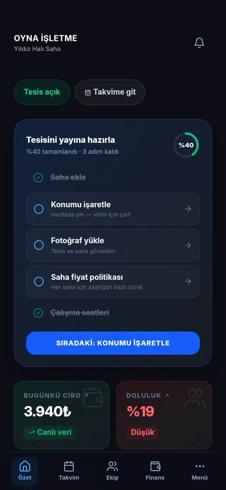</a>

_Kurulum kartı — 5 adımın 2'si tamam, 3 adım kaldı._

- **Saha ekle** — Tesiste kaç kort varsa her biri ayrı "saha" olarak eklenir. Fiyat, kapasite ve fotoğraf saha başına tanımlanır.
- **Konumu işaretle** — Haritadaki pin, oyuncunun gördüğü "1,2 km" mesafesini üretir. Pin yanlışsa yakındaki oyuncular tesisi bulamaz — **yayına çıkmadan zorunludur**.
- **Fotoğraf yükle** — Fotoğrafsız saha oyuncu tarafındaki listede **hiç gösterilmez**. İlk fotoğraf kapak görselidir.
- **Saha fiyat politikası** — Her saha kendi tarifesini ister. Tarifesi olmayan saha yayına alınamaz ve uygulamadan rezervasyon kabul etmez.
- **Çalışma saatleri** — Takvim ızgarası bu saatlere göre çizilir. Kapalı işaretlenen güne rezervasyon açılmaz.

> 💡 SIRADAKİ butonu seni doğrudan eksik adımın ekranına götürür — menüde aramana gerek yok.

---

## 2. Özet — günün fotoğrafı

**Kim görür:** ✅ Saha Sahibi · ✅ Müdür · ✅ Personel

Paneli açtığında ilk gördüğün ekran. Bugünün parası, doluluğu ve iki hızlı işlem burada.

<a href="gorseller/saha-sahibi/01-ozet.webp">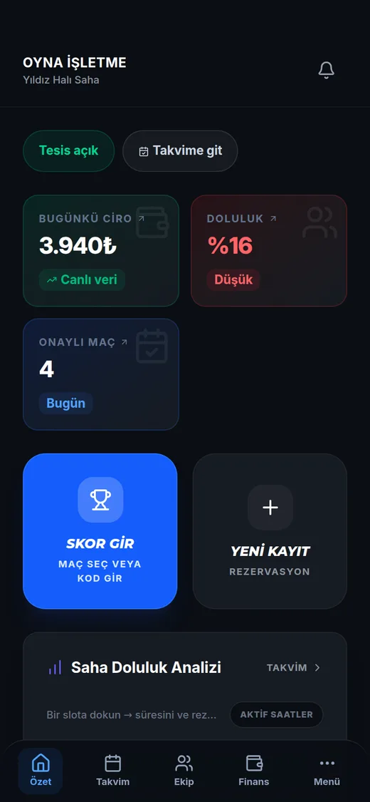</a>

_Özet sekmesi, tesis sahibi görünümü._

**1. Tesis açık / kapalı** — Anlık durum anahtarı. Kapattığında uygulamada yeni rezervasyon alınmaz; **mevcut rezervasyonlar iptal olmaz**. Kar, arıza, elektrik kesintisi için.
**2. Takvime git** — Doğrudan bugünün rezervasyon defterine atlar.
**3. Bugünkü ciro** — Bugün **tahsil edilmiş** tutar — beklenen değil, kasaya giren. Tahsilat girdikçe anlık artar.
**4. Doluluk** — Bugünün dolu saat oranı. Çalışma saatlerine göre hesaplanır; "Düşük" uyarısı boş saatlere indirim düşünmen için.
**5. SKOR GİR** — Tesiste oynanan maçın skorunu kaydeder. Maçı listeden seçebilir ya da oyuncunun gösterdiği kodu girebilirsin.
**6. YENİ KAYIT** — Telefonla arayan müşteri için elle rezervasyon açar — seni Takvim'e götürür.
**7. Bildirimler** — Yeni rezervasyon, iptal ve ödeme bildirimleri.
**8. Özet** — Bulunduğun sekme.
**9. Takvim** — Rezervasyon defteri — günlük işin çoğu burada.
**10. Ekip** — Personel ve görevler. **Personelde bu sekme yoktur.**
**11. Finans** — Ciro, gider, veresiye. **Personelde bu sekme yoktur.**
**12. Menü** — Tüm ayarlar.

<a href="gorseller/saha-sahibi/02-ozet-doluluk.webp">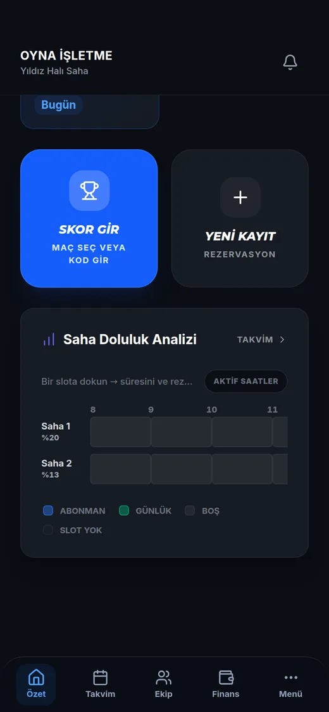</a>

_Aynı ekranın alt kısmı: saha doluluk analizi._

**1. Saha doluluk analizi** — Saat × saha ısı haritası. Koyu kutu dolu, boş kutu boş saat demektir; bir kutuya dokununca o slotun kimde olduğunu gösterir.
**2. AKTİF SAATLER / TÜM SAATLER** — Şeridi çalışma saatleriyle sınırlar ya da günün 24 saatini açar.
**3. ABONMAN** — Yalnız abonman (haftası sabit) kayıtlarını gösterir.
**4. GÜNLÜK** — Tek seferlik rezervasyonları gösterir.
**5. Saha satırı** — Her sahanın kendi doluluk yüzdesi. Hangi kortun boş kaldığını buradan görürsün.

---

## 3. Takvim — rezervasyon defteri

**Kim görür:** ✅ Saha Sahibi · ✅ Müdür · ✅ Personel

Günlük işin merkezi. Üstte gün şeridi ve saha seçici, altta saat ızgarası. **Personel de bu ekranı tam kullanır** — kayıt açar, tahsilat alır, slot kapatır.

<a href="gorseller/saha-sahibi/04-takvim.webp">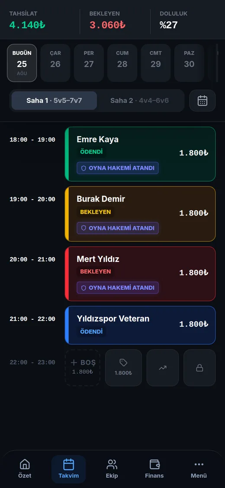</a>

_Takvim, Saha 1 için bugünün defteri._

**1. TAHSİLAT** — Bugün kasaya giren tutar.
**2. BEKLEYEN** — Bugün için **henüz tahsil edilmemiş** tutar. Gün sonunda bu rakamın sıfır olması hedeftir.
**3. DOLULUK** — Seçili sahanın bugünkü doluluk oranı.
**4. Gün şeridi** — İleri kaydırarak sonraki günlerin defterini açarsın. Geçmiş günler de görüntülenebilir.
**5. Saha seçici** — Birden fazla kortun varsa defter saha saha ayrıdır. Yanındaki takvim ikonu aylık/haftalık görünümü açar.
**6. Rezervasyon kartı** — Dokununca detay açılır. **Renk = ödeme durumu:** yeşil tamamı ödendi, sarı kapora alındı, kırmızı hiç ödenmedi, mavi abonman.
**7. + BOŞ** — Boş saate dokunarak elle rezervasyon açarsın. Altındaki rakam o saatin tarifedeki ücretidir.
**8. Takvim** — Bulunduğun sekme.

- **Yeşil — ÖDENDİ** — Tutarın tamamı tahsil edilmiş.
- **Sarı — BEKLEYEN** — Kapora alınmış, kalan tahsil edilecek.
- **Kırmızı — BEKLEYEN** — Hiç ödeme alınmamış. Gün sonu takibin burada.
- **Mavi** — Abonman kaydı (haftası sabit müşteri).

<a href="gorseller/saha-sahibi/06-rezervasyon-odenmemis.webp">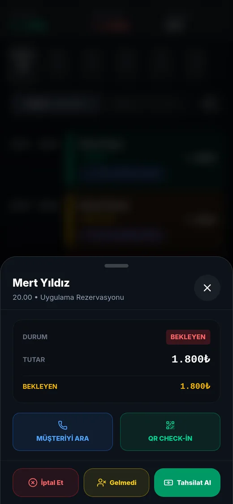</a>

_Rezervasyon kartına dokununca açılan detay._

**1. Durum ve tutar** — Toplam ücret, tahsil edilen ve kalan bakiye.
**2. MÜŞTERİYİ ARA** — Kayıttaki numarayı doğrudan arar. Gelmeyen müşteriyi aramanın en hızlı yolu.
**3. QR CHECK-İN** — Müşteri geldiğinde uygulamasındaki kodu okutup girişi işaretlersin.
**4. İptal Et** — Rezervasyonu iptal eder. Uygulamadan gelen ve ödenmiş rezervasyonlarda iade, tesisin iptal politikasına göre işler.
**5. Gelmedi** — Müşteri gelmediyse işaretle. Kayıt "no-show" olarak işlenir ve oyuncunun güven puanına yansır.
**6. Tahsilat Al** — Nakit/kart/havale tahsilatını kaydeder. **Günlük işin en sık kullandığın butonu.**

<a href="gorseller/saha-sahibi/07-tahsilat.webp">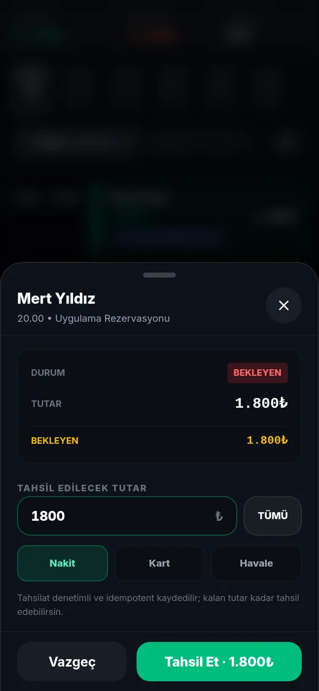</a>

_Tahsilat Al — tutar ve yöntem._

- **TÜMÜ** — Kalan bakiyenin tamamını tek dokunuşla yazar. Parçalı tahsilat için tutarı elle değiştirebilirsin.
- **Nakit / Kart / Havale** — Tahsilat yöntemi. Bu seçim Finans → Tahsilat ekranındaki "ödeme yöntemi" dağılımını besler; ay sonu kasa mutabakatı buradan çıkar.
- **Tahsil Et** — Kaydı yazar. İşlem çift kayda karşı korumalıdır — aynı tahsilatı iki kez yazamazsın.

<a href="gorseller/saha-sahibi/08-yeni-kayit.webp">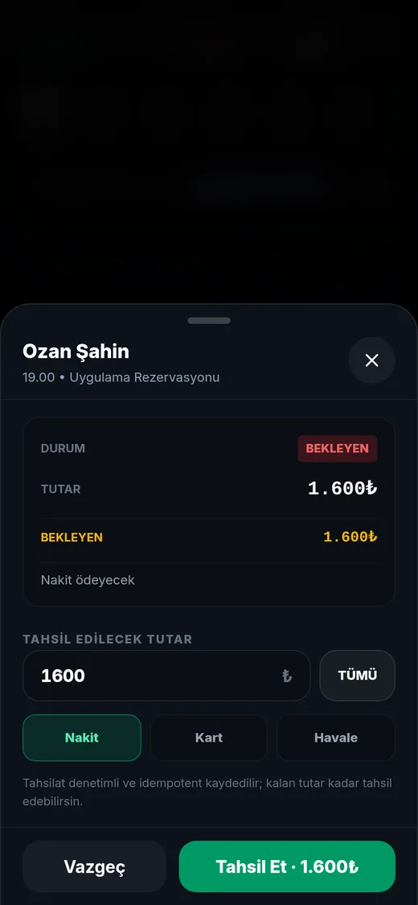</a>

_Boş saate dokununca açılan elle rezervasyon formu._

- **Müşteri adı ve telefonu** — Telefon, "Müşteriyi Ara" ve hatırlatma için kullanılır. Aynı müşteri tekrar geldiğinde kayıt kolaylaşır.
- **Ödeme durumu (Ödendi / Kapora / Bekliyor)** — Kaydı açarken parayı aldıysan işaretle; almadıysan "bekliyor" bırak — takvimde kırmızı görünür ve unutulmaz.
- **Kapora tutarı** — "Kapora" seçtiysen alınan tutarı yaz; kalan bakiye otomatik hesaplanır.
- **Süre** — Bir saatten uzun kiralamalarda bitiş saatini uzat; ızgarada tek kart olarak görünür.

<a href="gorseller/saha-sahibi/09-flash-deal.webp">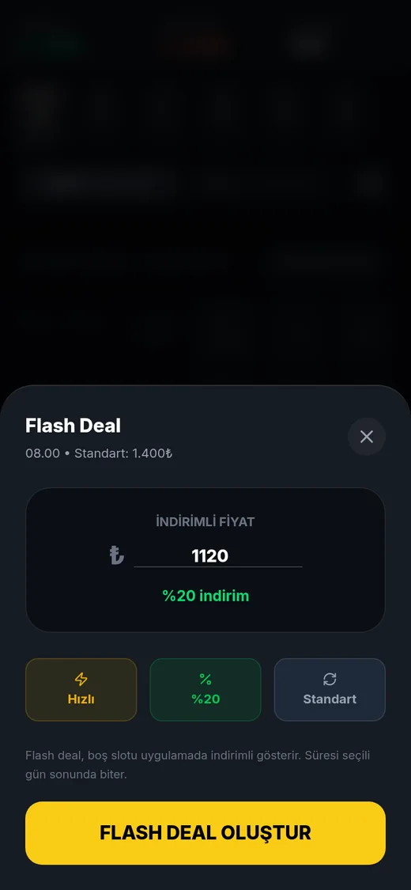</a>

_Boş slottaki 🏷 etiket ikonu → Flash Deal._

- **Ne işe yarar** — Boş kalacağını düşündüğün saati uygulamada **indirimli** gösterir. Son dakika doluluk için.
- **İndirim oranı** — Hazır %20 kısayolu ya da elle fiyat. Kampanya seçili günün sonunda kendiliğinden biter.
- **Dikkat** — Yalnız uygulamadaki görünen fiyatı değiştirir; elle açtığın kayıtları etkilemez.

<a href="gorseller/saha-sahibi/10-ozel-fiyat.webp">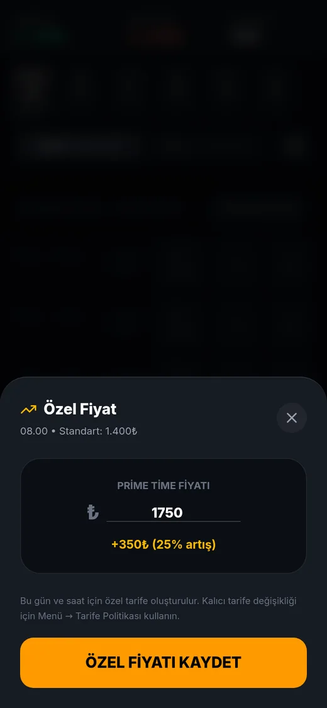</a>

_Boş slottaki 📈 trend ikonu → Özel Fiyat._

- **Ne işe yarar** — Tek bir gün ve saat için **ücreti yükseltir** (derbi akşamı, bayram, turnuva).
- **Kalıcı değildir** — Sadece o tarihe işler. Kalıcı fiyat değişikliği için Sahalarım → ilgili saha → fiyat politikası kullanılır.
- **Kapora** — Kapora oranı o saatin standart tarifesinden devralınır; ödeme akışı bozulmaz.

<a href="gorseller/saha-sahibi/11-slot-kapat.webp">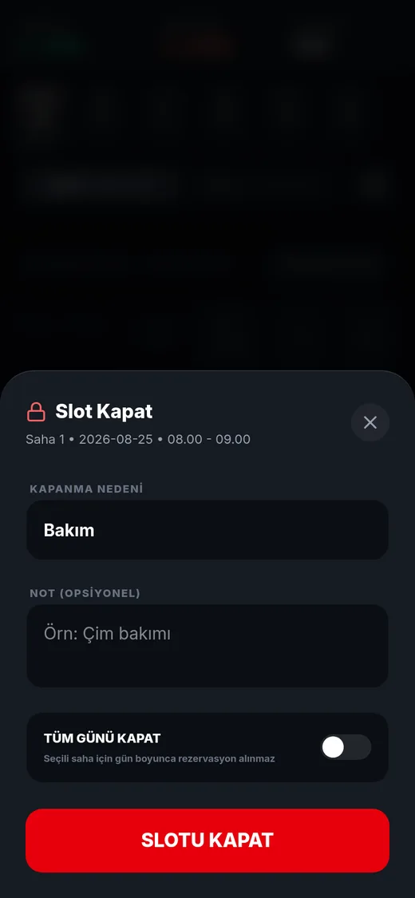</a>

_Boş slottaki 🔒 kilit ikonu → Slot Kapat._

- **Ne işe yarar** — O saati rezervasyona kapatır. Bakım, özel etkinlik, tatil, acil durum ya da "diğer" nedeniyle.
- **TÜM GÜNÜ KAPAT** — Tek dokunuşla seçili sahanın o gününü tamamen kapatır.
- **Not alanı** — Neden kapattığını yazarsan ekipteki diğer kişiler de görür.

---

## 4. Ekip — müdür ve personel

**Kim görür:** ✅ Saha Sahibi · ✅ Müdür · ❌ Personel

Tesiste çalışanları panele davet ettiğin yer. **Personel bu sekmeyi göremez.** İki tür kayıt vardır: **giriş yetkili** kişi (kendi telefonuyla panele girer) ve **sadece liste** kaydı (nöbet çizelgesinde görünür, girişi yoktur).

<a href="gorseller/saha-sahibi/12-ekip.webp">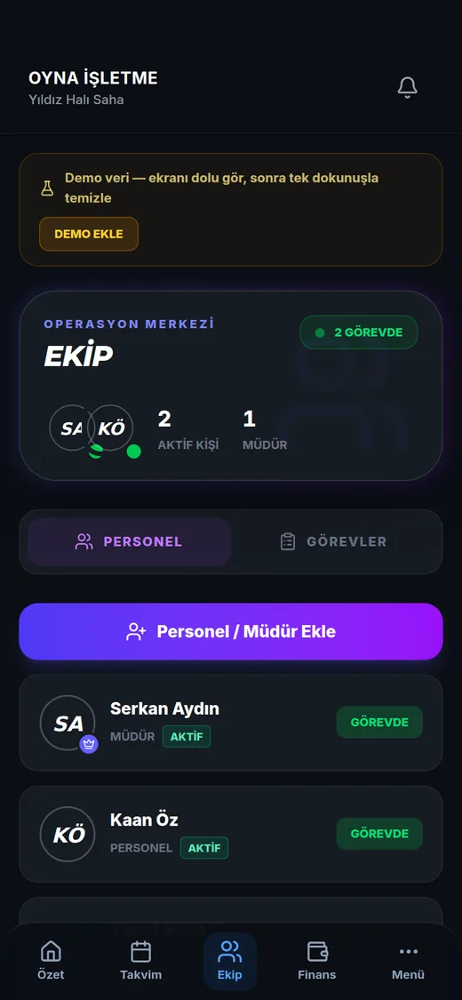</a>

_Ekip sekmesi — personel listesi._

**1. Görevde sayacı** — Şu an nöbette görünen kişi sayısı.
**2. PERSONEL** — Kişi listesi.
**3. GÖREVLER** — Günlük iş listesi (file kontrolü, temizlik, bakım randevusu…).
**4. Personel / Müdür Ekle** — Yeni kişi ekleme ekranını açar. **Yalnız tesis sahibi giriş yetkisi verebilir.**
**5. Kişi kartı** — Dokununca nöbet durumu, yetki değişimi ve erişim kaldırma seçenekleri açılır. Taçlı rozet müdürü işaretler.
**6. Davet kodu** — Henüz kabul etmemiş kişinin 6 haneli kodu ve kalan süresi. Kod süresi dolarsa yenisini üretirsin.

<a href="gorseller/saha-sahibi/13-personel-ekle.webp">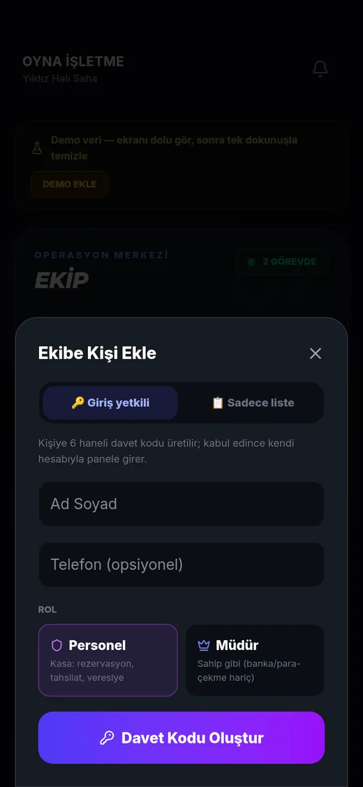</a>

_Ekibe kişi ekleme._

**1. 🔑 Giriş yetkili** — Kişiye 6 haneli davet kodu üretilir; kodu kabul edince **kendi hesabıyla** panele girer.
**2. 📋 Sadece liste** — Giriş yetkisi verilmez. Yalnız nöbet çizelgesinde ve görev dağılımında görünür.
**3. Personel** — Kasa yetkisi: rezervasyon açma, tahsilat, veresiye. Finans ve Ekip sekmelerini göremez.
**4. Müdür** — Sahip gibi çalışır — **banka hesapları, para çekme ve OYNA anlaşması hariç.**
**5. Davet Kodu Oluştur** — Kodu üretir. Kodu kişiye ilet; uygulamada girerek tesise bağlanır.

<a href="gorseller/saha-sahibi/15-davet-kodu.webp">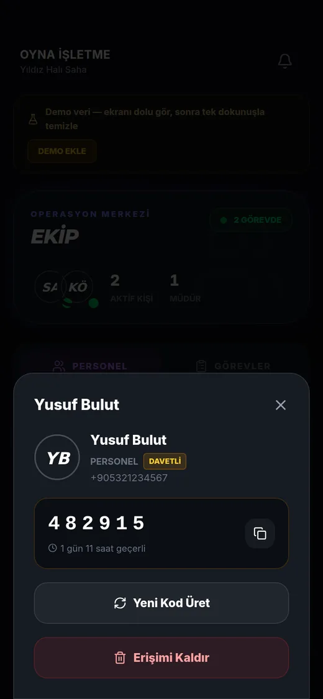</a>

_Davetli kişinin kartı: kod ve kalan süre._

- **6 haneli kod** — Kişi bunu uygulamaya girerek tesise bağlanır. Süresi sınırlıdır (yaklaşık 36 saat).
- **Yeni Kod Üret** — Süresi dolan ya da yanlış kişiye gitmiş kodu geçersiz kılıp yenisini üretir.
- **Erişimi Kaldır** — Kişinin panele girişini kapatır. İşten ayrılan personel için ilk yapılacak iş budur.

<a href="gorseller/saha-sahibi/14-uye-detay.webp">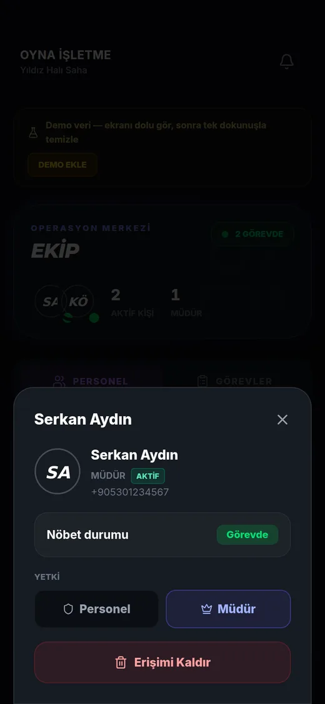</a>

_Aktif kişinin kartı: nöbet ve yetki._

- **Nöbet durumu** — Görevde / İzinli işaretlemesi. Ekip başlığındaki "görevde" sayacı buradan beslenir.
- **YETKİ · Personel / Müdür** — Kişiyi personelden müdüre (ya da tersine) çevirir. **Yalnız tesis sahibi değiştirebilir.**
- **Erişimi Kaldır** — Geri alınamaz; kişi panele giremez. Kaydı listede tutmak istersen önce rolünü düşür.

<a href="gorseller/saha-sahibi/16-gorevler.webp">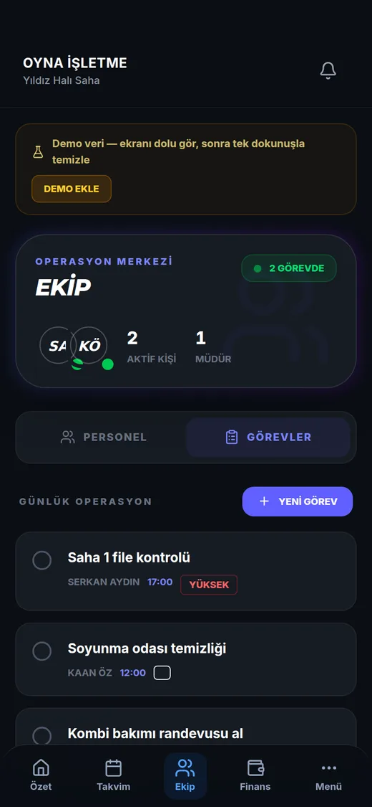</a>

_Görevler sekmesi — günlük operasyon listesi._

- **YENİ GÖREV** — Başlık, sorumlu kişi, öncelik ve saat vererek görev açarsın.
- **Öncelik rozetleri** — YÜKSEK / DÜŞÜK etiketi listeyi sıralar; acil işler üstte kalır.
- **Tamamlama** — Göreve dokunarak bittiğini işaretlersin — üstü çizilir, ekip görür.

---

## 5. Finans — para nerede

**Kim görür:** ✅ Saha Sahibi · ✅ Müdür · ❌ Personel

Dönem bazlı para tablosu. **Personel bu sekmeyi göremez.** Üç alt sekmesi vardır: Özet, Tahsilat, Gider.

<a href="gorseller/saha-sahibi/17-finans-ozet.webp">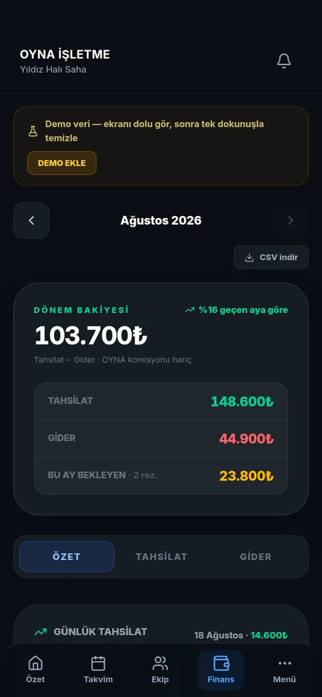</a>

_Finans → Özet._

**1. Dönem seçici** — Rakamların hangi aya ait olduğu. Geçmiş aylara dönebilirsin.
**2. CSV indir** — Dönemin tüm hareketlerini tabloya aktarır — muhasebeye göndermek için.
**3. DÖNEM BAKİYESİ** — Tahsilat − Gider. **OYNA komisyonu bu rakama dahil değildir.** Yanındaki yüzde geçen ayla kıyaslar.
**4. TAHSİLAT** — Ay boyunca kasaya giren toplam.
**5. GİDER** — Ay boyunca girdiğin giderlerin toplamı.
**6. BU AY BEKLEYEN** — Henüz tahsil edilmemiş tutar ve kaç rezervasyondan geldiği. Takibi gereken para budur.

<a href="gorseller/saha-sahibi/18-finans-tahsilat.webp">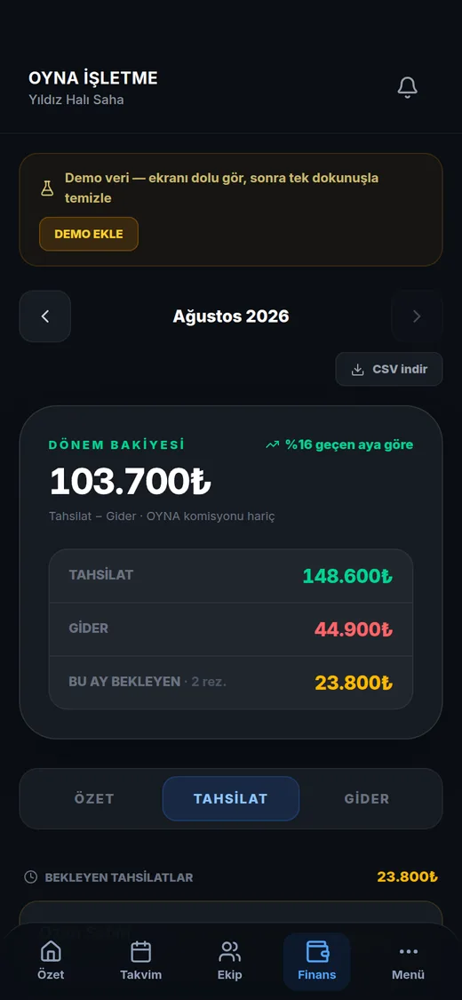</a>

_Finans → Tahsilat._

- **BEKLEYEN TAHSİLATLAR** — Kim, ne kadar, hangi saat için borçlu. Satıra dokunup tahsilatı buradan da alabilirsin.
- **VERESİYE** — Defterdeki açık hesaplar. "Ekle" ile yeni veresiye kişisi ve açılış borcu tanımlarsın; kısmi ödeme kabul eder.
- **SON ÖDEMELER** — En son giren tahsilatlar, yöntemiyle birlikte. Kasa mutabakatında ilk bakılacak yer.

<a href="gorseller/saha-sahibi/19-finans-gider.webp">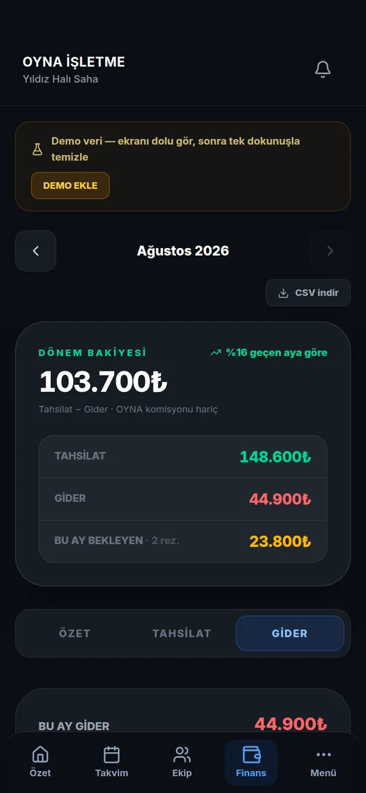</a>

_Finans → Gider._

- **Kategori dağılımı** — Fatura, Personel, Bakım, Kira, Malzeme, Diğer. Dönem bakiyesi bu toplamı düşer.
- **GİDER KAYITLARI** — Tek tek girilen giderler. Dokunarak düzenler ya da silersin.
- **Sabit gider şablonu** — Her ay tekrar eden gideri (kira, maaş) şablon yapıp tek dokunuşla eklersin; aynı ay iki kez eklenmesini sistem engeller.

---

## 6. Menü — tüm ayarlar

**Kim görür:** ✅ Saha Sahibi · ✅ Müdür · ✅ Personel

Ayarların tamamı burada, üç grupta. **Gördüğün grup rolüne göre değişir:** personel yalnız "Uygulama" grubunu görür, müdür "Finansal" grubun bir kısmını görür.

<a href="gorseller/saha-sahibi/20-menu.webp">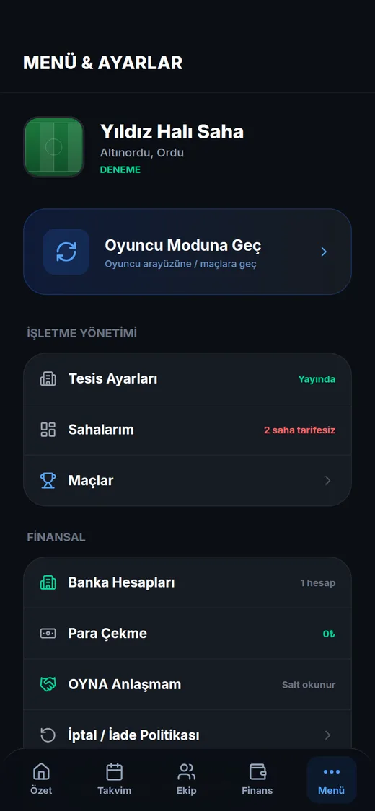</a>

_Menü, tesis sahibi görünümü._

**1. Oyuncu Moduna Geç** — Aynı hesapla oyuncu arayüzüne geçer — kendi maçını kurmak için.
**2. İŞLETME YÖNETİMİ** — Tesis Ayarları, Sahalarım, Maçlar. Sahip ve müdür görür.
**3. FİNANSAL** — Banka, para çekme, anlaşma, iptal politikası, listeleme saati, ödeme modu.
**4. UYGULAMA** — Widget, bildirim, güvenlik, dil, destek, çıkış. **Herkes görür.**
**5. Tesis Ayarları** — Ad, adres, açıklama, olanaklar, konum pini ve vitrin ayarları.
**6. Sahalarım** — Kortları ekle, düzenle, fotoğraf yükle, fiyat politikası gir.

<a href="gorseller/saha-sahibi/21-tesis-genel.webp">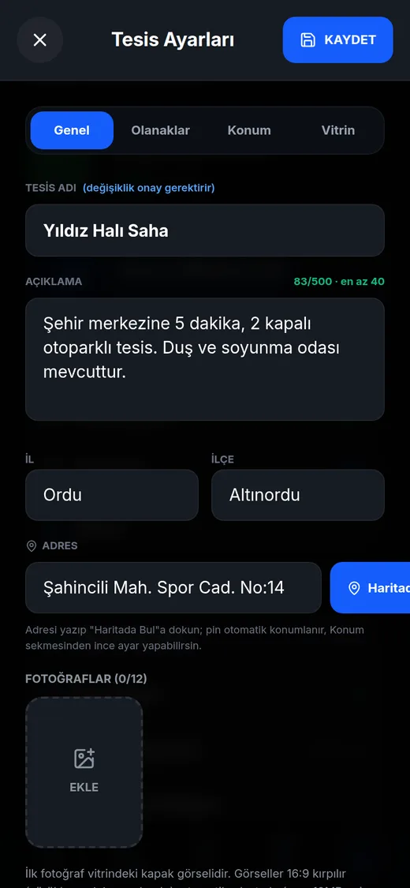</a>

_Tesis Ayarları → Genel._

- **Tesis adı** — Değiştirmek onay gerektirir — vitrindeki isim OYNA ekibi onayından sonra güncellenir.
- **Açıklama** — En az 40 karakter. Vitrin skorunu +15 artırır; oyuncunun tesisi seçmesinde etkilidir.
- **İl / İlçe / Adres** — "Haritada Bul" ile adresi yazıp pini otomatik konumlandırırsın.
- **Fotoğraflar (0/12)** — İlk fotoğraf kapak görselidir. 16:9 kırpılır, otomatik sıkıştırılır.

<a href="gorseller/saha-sahibi/22-tesis-olanaklar.webp">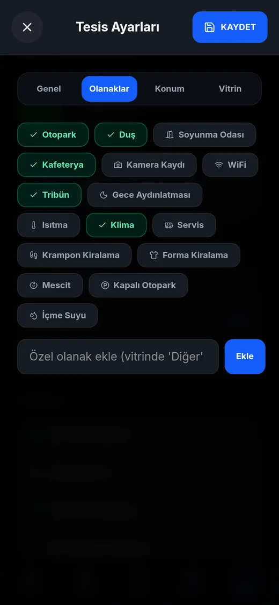</a>

_Tesis Ayarları → Olanaklar._

- **Olanak işaretleri** — Otopark, duş, kafeterya, tribün, klima… Oyuncu vitrinde bunlara göre filtreler.
- **Neden önemli** — En az 3 olanak işaretlemek vitrin skorunu +10 artırır.

<a href="gorseller/saha-sahibi/23-tesis-konum.webp">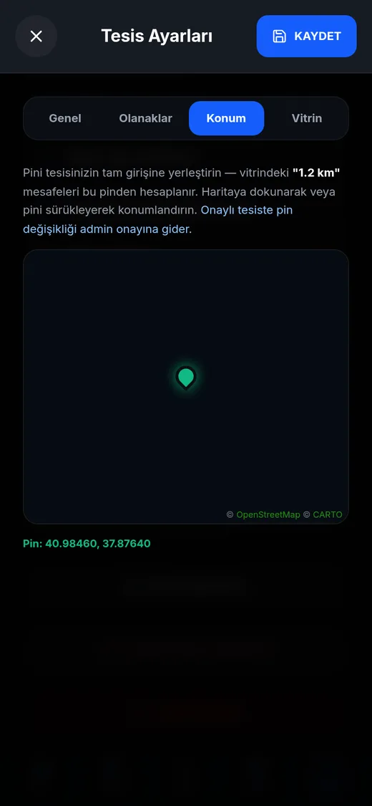</a>

_Tesis Ayarları → Konum._

- **Harita pini** — Tesisin **tam girişine** koy. Vitrindeki mesafe bu noktadan hesaplanır.
- **Onaylı tesiste değişiklik** — Pin değişikliği OYNA yönetiminin onayına gider.

<a href="gorseller/saha-sahibi/24-tesis-vitrin.webp">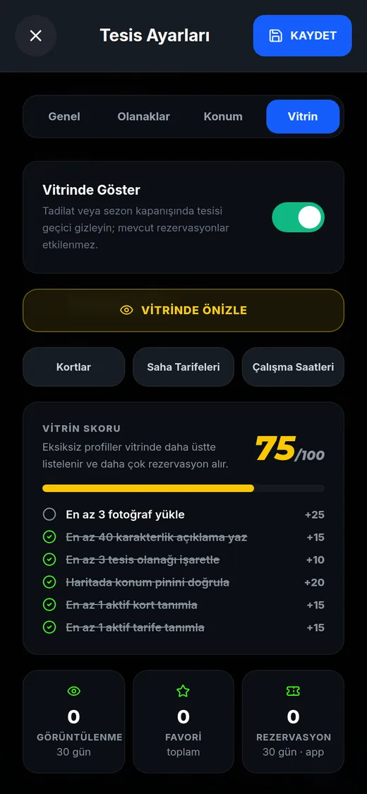</a>

_Tesis Ayarları → Vitrin._

- **Vitrinde göster** — Tesisi oyuncu tarafında yayına alır/gizler. Tadilat ya da sezon kapanışında gizlersin; **mevcut rezervasyonlar etkilenmez.**
- **VİTRİNDE ÖNİZLE** — Tesisini oyuncunun gördüğü gibi açar.
- **VİTRİN SKORU** — Eksiksiz profiller vitrinde üstte listelenir. Eksik maddeler ve kaç puan getirdikleri tek tek yazılıdır.
- **Kısayollar** — Kortlar · Saha Tarifeleri · Çalışma Saatleri — ilgili ekrana atlar.

<a href="gorseller/saha-sahibi/25-calisma-saatleri.webp">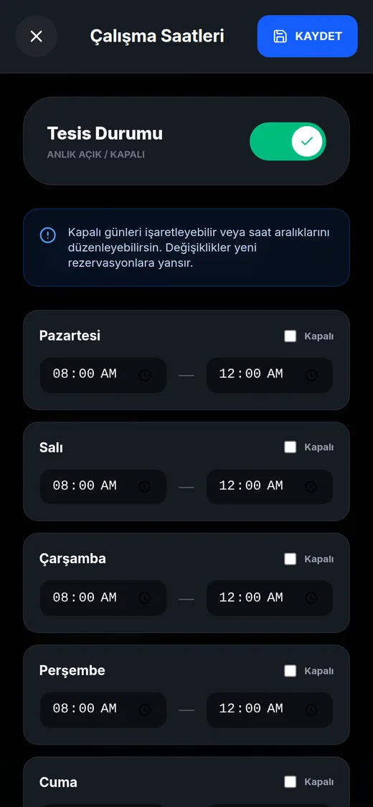</a>

_Çalışma Saatleri._

- **Tesis Durumu anahtarı** — Anlık açık/kapalı. Özet ekranındaki "Tesis açık" ile aynı anahtardır.
- **Gün satırları** — Her gün için açılış-kapanış. Gece yarısını aşan saatler (02:00 gibi) desteklenir.
- **Kapalı kutusu** — İşaretlenen güne rezervasyon açılmaz ve takvim ızgarası o gün boş çizilir.
- **KAYDET** — Değişiklik yalnız **yeni** rezervasyonlara yansır; mevcut kayıtlar durur.

<a href="gorseller/saha-sahibi/26-sahalarim.webp">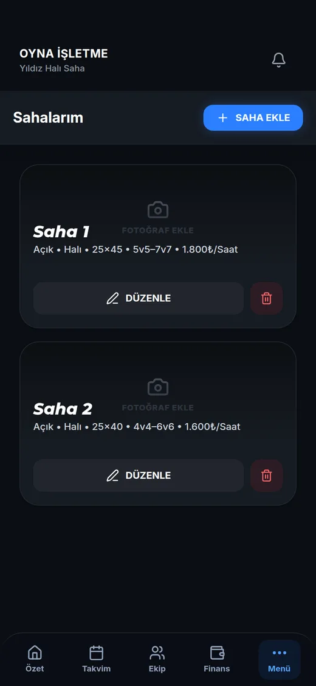</a>

_Sahalarım — kort listesi._

- **SAHA EKLE** — Yeni kort tanımlar. Ad, tip (açık/kapalı), ölçü, kapasite ve ücret istenir.
- **FOTOĞRAF EKLE** — Sahaya özel görsel. Fotoğrafsız saha vitrinde görünmez.
- **DÜZENLE** — Kort bilgilerini, yayın anahtarını ve fiyat politikasını açar.
- **Uyarı bandı** — Tarifesi olmayan sahada "fiyat politikası girilmedi" bandı çıkar — o saha uygulamadan rezervasyon alamaz.

<a href="gorseller/saha-sahibi/27-saha-duzenle.webp">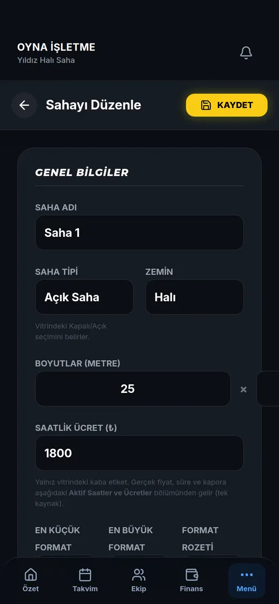</a>

_Saha düzenleme._

- **Kalite notları (A+/A/B)** — Işıklandırma, zemin ve soyunma odası notları. **OYNA ekibi yerinde değerlendirir**, panelden değiştirilemez.
- **Kapasite ve ölçü** — 5v5 / 7v7 gibi maç formatını belirler; oyuncu bu bilgiye göre saha arar.
- **Yayın anahtarı** — Sahayı vitrinde açar/kapatır. Tarifesi yoksa açılmaz.

<a href="gorseller/saha-sahibi/28-banka-hesaplari.webp">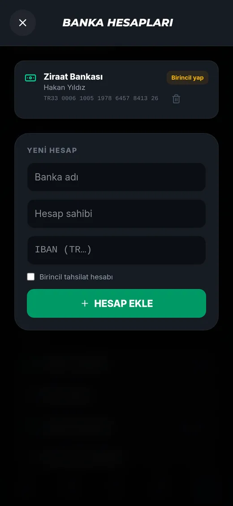</a>

_Banka Hesapları — yalnız tesis sahibi._

- **IBAN kaydı** — OYNA üzerinden kazandığın paranın aktarılacağı hesap.
- **Birincil hesap** — Birden çok hesap varsa ödemeler birincil olana gider.
- **Yetki** — Müdür ve personel bu ekranı **göremez**.

<a href="gorseller/saha-sahibi/29-para-cekme.webp">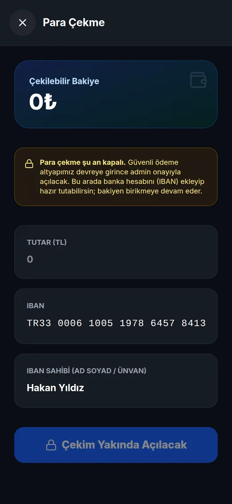</a>

_Para Çekme — yalnız tesis sahibi._

- **Çekilebilir bakiye** — OYNA üzerinden biriken, çekilebilir tutar.
- **Şu anki durum** — Para çekme, güvenli ödeme altyapısı devreye girene kadar **kapalıdır**. Ekran bunu açıkça yazar.

<a href="gorseller/saha-sahibi/30-oyna-anlasmam.webp">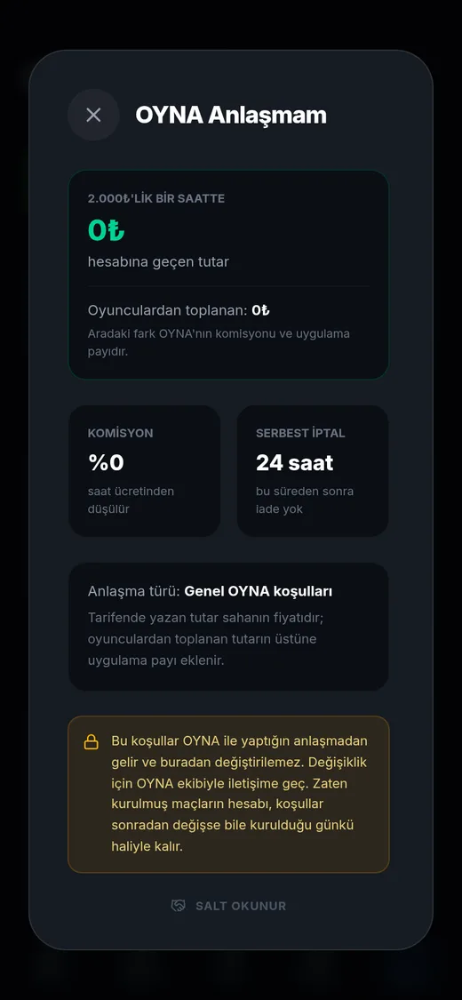</a>

_OYNA Anlaşmam — komisyon ve hakediş._

- **Örnek hesap** — 2.000₺'lik bir saatte oyunculardan toplanan tutar ve sana geçen tutar tek tek gösterilir.
- **Salt okunur** — Anlaşma şartları panelden değiştirilemez; değişiklik talebi destek üzerinden yürür.

<a href="gorseller/saha-sahibi/31-iptal-iade.webp">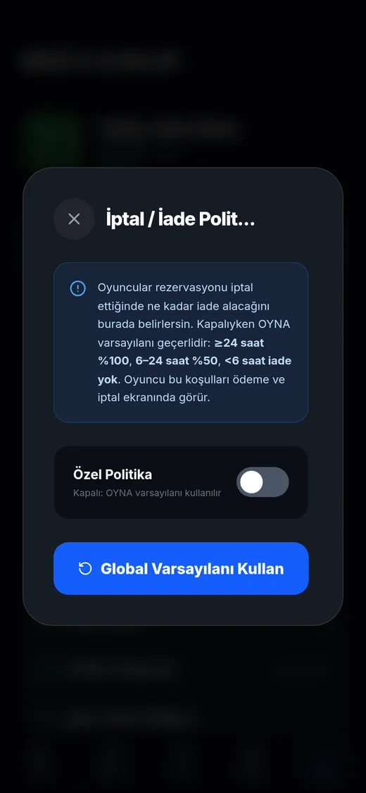</a>

_İptal / İade Politikası._

- **Zaman dilimleri** — Maça 24 saatten fazla varken tam iade, 12 saat kalanda yarım iade gibi kademeler tanımlarsın.
- **Kime uygulanır** — Oyuncu uygulamadan iptal ettiğinde bu kurallar otomatik işler — tek tek karar vermek zorunda kalmazsın.

<a href="gorseller/saha-sahibi/32-listeleme-saati.webp">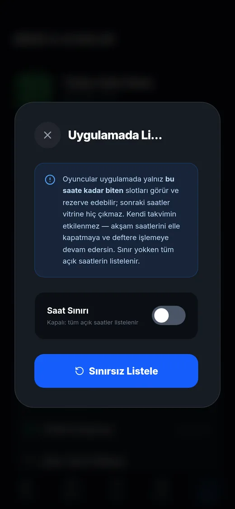</a>

_Uygulamada Listeleme Saati._

- **Ne yapar** — Oyuncular uygulamada yalnız bu saate kadar biten slotları görür.
- **Ne zaman kullanılır** — Geç saatleri uygulamaya açmak istemiyorsan (gürültü şikâyeti, personel mesaisi) sınırı buradan koyarsın.

<a href="gorseller/saha-sahibi/33-odeme-modu.webp">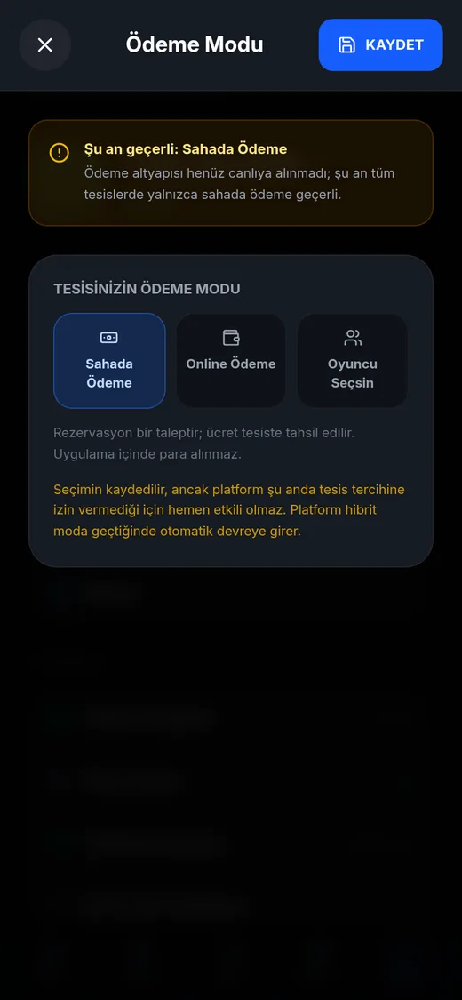</a>

_Ödeme Modu._

- **Şu an geçerli: Sahada Ödeme** — Ödeme altyapısı henüz canlıya alınmadığı için tahsilat sahada yapılır.
- **Online ödeme** — Altyapı açıldığında oyuncunun uygulamadan ödemesine izin verirsin.

<a href="gorseller/saha-sahibi/34-widgetlar.webp">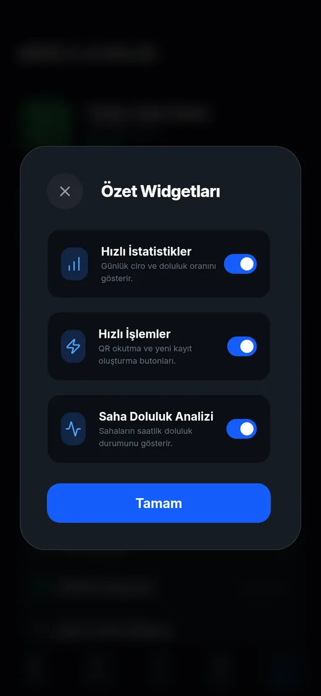</a>

_Özet Widgetları._

- **Widget anahtarları** — Özet ekranında hangi kartların görüneceğini seçersin (hızlı istatistikler, hızlı işlemler, doluluk analizi…).
- **Kime özel** — Ayar kişiseldir; ekipteki herkes kendi görünümünü ayarlar.

<a href="gorseller/saha-sahibi/35-bildirimler.webp">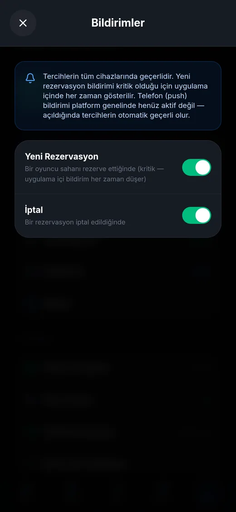</a>

_Bildirimler._

- **Tercihler** — Yeni rezervasyon, iptal ve ödeme bildirimlerini ayrı ayrı aç/kapat.
- **Cihazlar arası** — Tercih tüm cihazlarında geçerlidir. Yeni rezervasyon bildirimi kritik olduğu için kapatılması önerilmez.

<a href="gorseller/saha-sahibi/36-guvenlik.webp">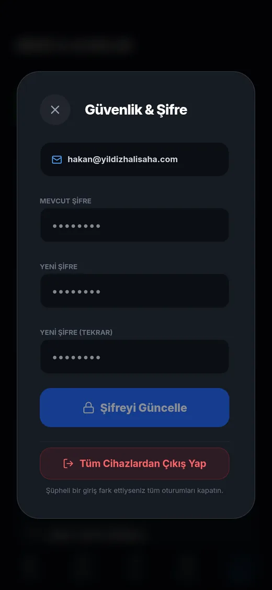</a>

_Güvenlik & Şifre._

- **Şifre değiştirme** — Mevcut şifre + yeni şifre. Personel değişiminde ilk yapılacak işlerden biri.
- **Hesap e-postası** — Panele bağlı e-posta burada görünür.

<a href="gorseller/saha-sahibi/37-destek.webp">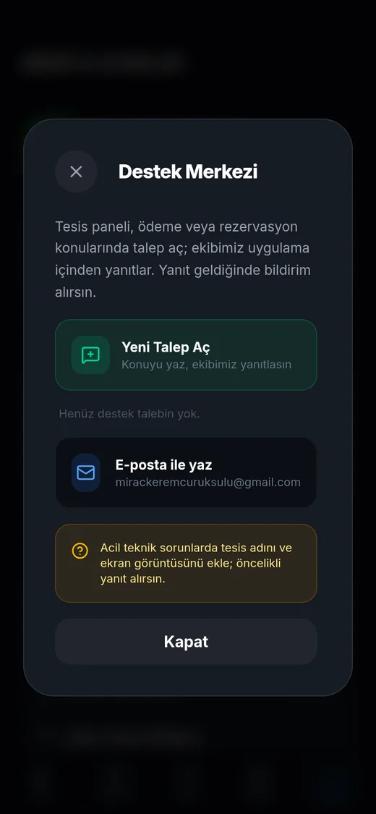</a>

_Destek Merkezi._

- **Talep aç** — Panel, ödeme veya rezervasyon konularında OYNA ekibine talep gönderirsin.
- **Ne zaman** — Kalite notu itirazı, tesis adı değişikliği ve anlaşma konuları yalnız buradan yürür.

---

## 7. Maçlar ve skor girme

**Kim görür:** ✅ Saha Sahibi · ✅ Müdür · ❌ Personel

Tesiste oynanan maçların listesi ve resmî skor girişi. **Personel skor giremez** — liste salt okunur açılır.

<a href="gorseller/saha-sahibi/38-maclar.webp">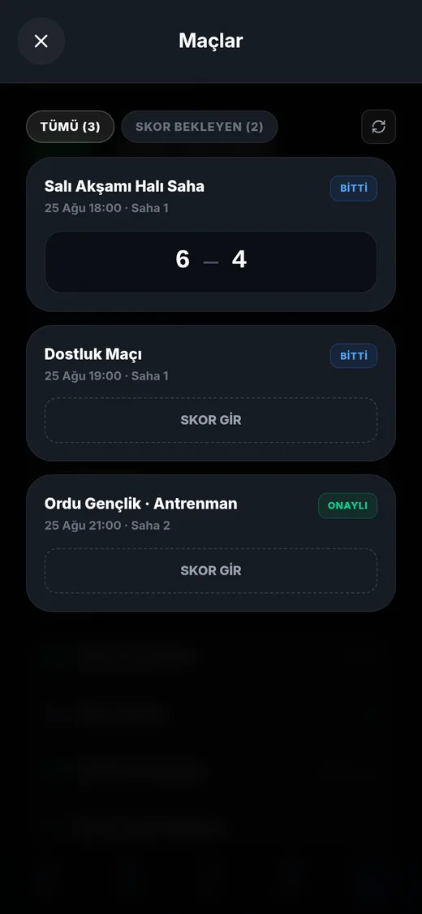</a>

_Menü → Maçlar._

- **TÜMÜ / SKOR BEKLEYEN** — Skoru girilmemiş maçları süzer — gün sonunda bu listeyi boşaltmak hedeftir.
- **Skor rozeti** — Girilmiş skor kartta görünür (6 — 4). Girilmemişse "SKOR GİR" butonu çıkar.
- **Durum** — BİTTİ / ONAYLI etiketi maçın hangi aşamada olduğunu gösterir.

<a href="gorseller/saha-sahibi/39-skor-gir.webp">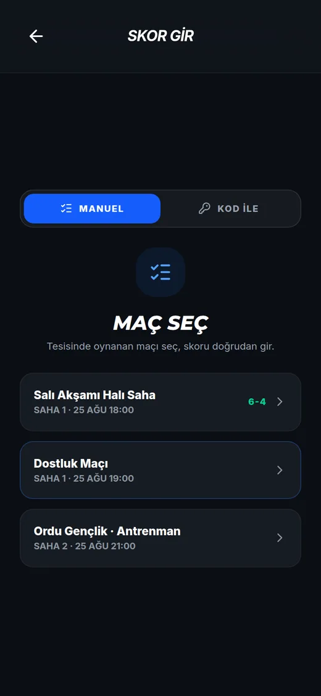</a>

_Özet → SKOR GİR._

- **MANUEL** — Tesiste oynanan maçı listeden seçip skoru doğrudan girersin.
- **KOD İLE** — Oyuncunun uygulamasındaki maç kodunu girerek o maça bağlanırsın.
- **Neden önemli** — Skor, oyuncuların istatistiklerine ve maç geçmişine işler; girilmeyen skor maçı yarım bırakır.

---

## 8. Müdür ve personel: giriş ve farklar

**Kim görür:** ✅ Saha Sahibi · ✅ Müdür · ✅ Personel

Davet edilen kişi **kendi telefonuyla, kendi hesabından** girer — sahibin şifresini kimseyle paylaşman gerekmez. Panele giriş oyuncu tarafındaki Ayarlar ekranından yapılır.

<a href="gorseller/saha-sahibi/43-personel-giris.webp">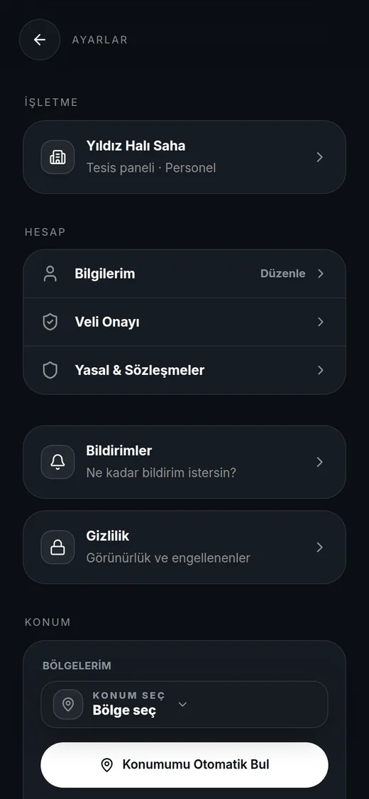</a>

_Personelin girişi: Profil → Ayarlar → İŞLETME._

- **İŞLETME kartı** — Davet kabul edildikten sonra Ayarlar ekranının en üstünde tesis kartı çıkar: tesis adı ve rolü ("Tesis paneli · Personel").
- **Dokunmak yeterli** — Karta dokununca tesis paneli açılır. Oyuncu moduna dönmek için Menü → Oyuncu Moduna Geç.
- **Kod nasıl kabul edilir** — Sahip 6 haneli kodu verir; kişi uygulamada kodu girerek tesise bağlanır.

<a href="gorseller/saha-sahibi/40-personel-ozet.webp">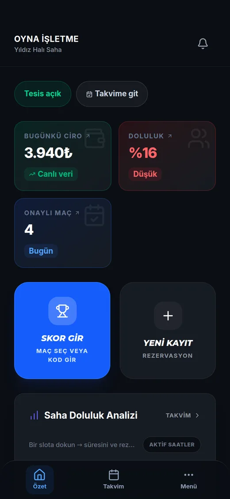</a>

_Personel görünümü — alt barda 3 sekme var._

- **Özet · Takvim · Menü** — Personelin alt barında **Ekip ve Finans yoktur.** Kasa işlerini yapar, rakamları görmez.
- **Yapabildikleri** — Rezervasyon açma, tahsilat alma, slot kapatma, müşteriyi arama, QR check-in.
- **Yapamadıkları** — Skor girme, personel yönetimi, finans, tesis ve fiyat ayarları.

<a href="gorseller/saha-sahibi/41-personel-menu.webp">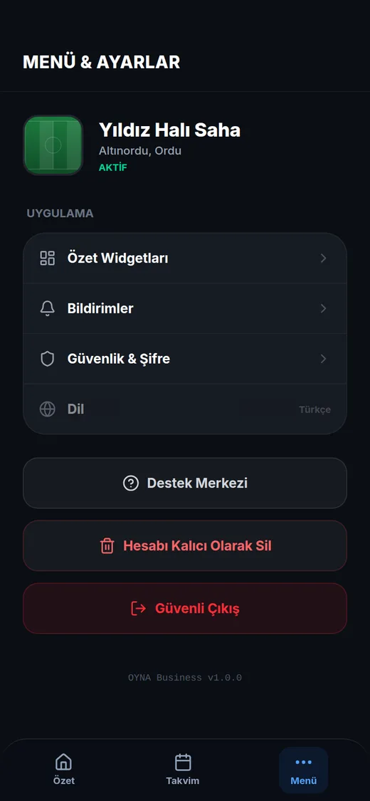</a>

_Personelin menüsü._

- **Yalnız UYGULAMA grubu** — Widget, bildirim, güvenlik, dil, destek ve çıkış. İşletme ve finansal ayarlar hiç görünmez.

<a href="gorseller/saha-sahibi/42-mudur-menu.webp">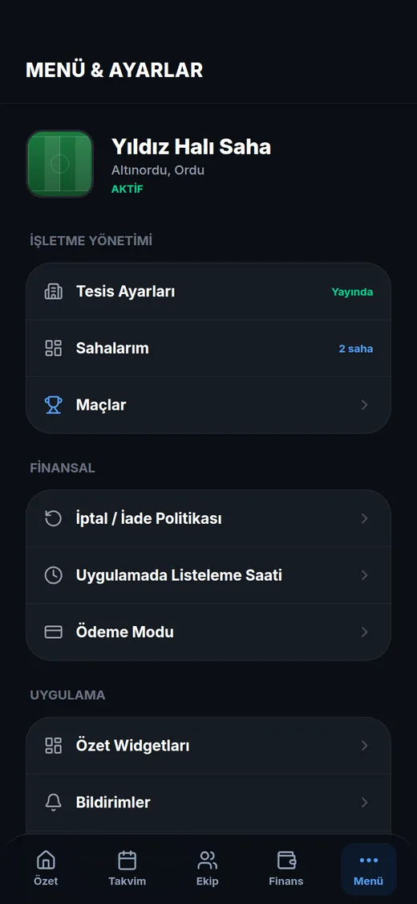</a>

_Müdürün menüsü._

- **İşletme yönetimi açık** — Tesis Ayarları, Sahalarım ve Maçlar müdüre açıktır.
- **Banka ve para çekme yok** — Müdürün menüsünde Banka Hesapları, Para Çekme ve OYNA Anlaşmam **hiç görünmez**.
- **Alt bar sahiple aynı** — Müdür Ekip ve Finans sekmelerini de görür.

---

## Sık yapılan hatalar

- **Fotoğrafsız saha vitrinde görünmez** — Kort düzeyinde en az bir fotoğraf şart. Fotoğrafı eklediğin anda saha listeye geri döner.
- **Tarifesiz saha rezervasyon alamaz** — Her saha **kendi** fiyat politikasını ister; tesis geneli tarife yayın kapısını açmaz.
- **Erişim kaldırma geri alınamaz** — Personelin girişini kapatırsan yeniden davet kodu üretmen gerekir.
- **Çalışma saati değişikliği geçmişe işlemez** — Yeni saatler yalnız yeni rezervasyonlara uygulanır; mevcut kayıtlar durur.

---

## Sık sorulan sorular

**Uygulamadan gelen rezervasyonu onaylamam gerekiyor mu?**

Hayır. Uygulamadan gelen rezervasyon doğrudan takvime düşer ve onaylı sayılır. Senin işin tahsilatı takip etmek: kart kırmızıysa henüz para alınmamıştır.

**Takvimdeki renkler ne anlama geliyor?**

Renk **ödeme** durumudur: yeşil tamamı ödendi, sarı kapora alındı, kırmızı hiç ödenmedi, mavi abonman. Rezervasyonun iptal olup olmadığını göstermez.

**Boş slottaki üç küçük ikon ne yapıyor?**

Soldan sağa: 🏷 **Flash Deal** (indirimli göster), 📈 **Özel Fiyat** (o güne özel zam), 🔒 **Slot Kapat** (rezervasyona kapat).

**Personelim ciroyu görebiliyor mu?**

Özet ekranındaki "Bugünkü Ciro" kartını görür, ancak Finans sekmesi ve aylık rakamlar personele kapalıdır. Ciro kartını gizlemek istersen Menü → Özet Widgetları'ndan kapatabilirsin.

**İşten ayrılan personelin erişimini nasıl keserim?**

Ekip → kişi kartı → **Erişimi Kaldır**. İşlem geri alınamaz; kişi panele giremez.

**Tesisim vitrinde neden görünmüyor?**

Üç şartın hepsi gerekir: OYNA onayı, en az bir **fotoğrafı** ve **tarifesi** olan aktif saha, ve Tesis Ayarları → Vitrin'de "Vitrinde göster" açık olmalı. Konum pini işaretlenmemişse de yayına çıkmaz.

**Bir saatin fiyatını kalıcı değiştirmek istiyorum.**

Sahalarım → ilgili saha → fiyat politikası. Slottaki "Özel Fiyat" yalnız o güne işler, kalıcı değildir.

**Para çekemiyorum.**

Para çekme, güvenli ödeme altyapısı devreye girene kadar kapalıdır. Bu süreçte tahsilat sahada yapılır ve kasan sende kalır.

---

## Bu kılavuz nasıl hazırlandı

Ekran görüntüleri, panelin canlı sürümü telefon görünümünde (390×844) sürülerek alınmıştır. Arayüzde bir etiket, akış veya kural değiştiğinde ilgili bölüm aynı değişiklikte güncellenmelidir. Panelle ilgili takıldığın yerde **Menü → Destek Merkezi**'nden talep açabilirsin.
