# OYNA Admin Paneli Kullanım Kılavuzu

_Son güncelleme: 26 Temmuz 2026 · Uygulama sürümü 3.0.0_

> Bu kılavuz, OYNA yönetim ekibi içindir: kurucu ve panel erişimi verilen tüm admin alt rolleri (Süper Admin, Admin, Moderatör, Finans, Destek). Kökteki eski `admin_panel_kullanim_kilavuzu.md` belgesinin yerini alır.

## 1. Giriş

Admin paneli ("OYNA OS"), platformdaki her şeyin tek merkezden yönetildiği ayrı bir web uygulamasıdır: kullanıcılar, sahalar, maçlar, başvurular, para akışı, bildirimler ve sistem ayarları. Temel ilke şudur: **her problem panelden çözülür** — sahadan gelen bir şikâyet, takılan bir ödeme, yanlış girilmiş bir skor için koda veya veritabanına inmek gerekmez.

Panel, oyuncu uygulamasından tamamen ayrıdır; kendi adresi ve kendi girişi vardır. Yaptığın her kritik işlem **Denetim Günlüğü**'ne değiştirilemez biçimde kaydedilir — Süper Admin dahil kimse kendi izini silemez.

### Bir bakışta: hangi modül ne işe yarar

| Modül | Ne işe yarar |
|---|---|
| **Genel Bakış** | Günün fotoğrafı: gelir, maç sayıları, bekleyen işler, son maçlar. |
| **Komuta Merkezi** | Tüm bekleyen kuyruklar tek ekranda + kullanıcı gözüyle inceleme (Ghost). |
| **Sahalar** | Tesis envanteri, vitrin bayrakları ve 9 sekmeli Kurulum Merkezi. |
| **Kullanıcılar / Kaleciler / Hakemler** | Arama, 360° inceleme, ban, doğrulama, premium kart, silme. |
| **Doğrulama Merkezi** | Kaleci-hakem başvuruları, TC kimlik doğrulamaları, tesis onayları. |
| **Silme Kuyruğu** | KVKK hesap silme talepleri (anonimleştir / kalıcı sil). |
| **Veli Onayları** | 18 yaş altı kullanıcıların veli muvafakat durumları. |
| **Maçlar** | Maç listesi + Maç Kontrol Kokpiti (kadro, skor, ödeme müdahalesi). |
| **Takımlar** | Takım listesi ve yönetimi. |
| **Bölge Kapsama** | OYNA'nın hizmet verdiği il/ilçe listesi ve harita sınırları. |
| **Kampanyalar** | Segmentli toplu bildirim gönderimi. |
| **Bildirim Şablonları** | Uygulamadaki bildirim metinlerini düzenleme. |
| **İndirim Kodları** | Promosyon kodları (modül anahtarı açıksa görünür). |
| **Finans** | 8 sekmelik para merkezi: ledger, ödemeler, müdahale, çekim talepleri, raporlar. |
| **Skor İhtilafları / Hizmet İtirazları** | Maç skoru ve kaleci-hakem ödeme anlaşmazlıkları. |
| **Komisyon** | Komisyon oranları (global, saha, hizmet, maç bazında). |
| **SaaS Hesapları** | Saha sahibi plan/yetki yönetimi (modül anahtarı açıksa). |
| **Denetim Günlüğü** | Tüm admin işlemlerinin değiştirilemez kaydı + zincir doğrulama. |
| **CMS Metinler** | Uygulama içi başlık ve metinleri düzenleme. |
| **Ayarlar** | Temel platform ayarları + MASTER BAKIM MODU. |
| **Sistem Parametreleri** | Tüm işletme kuralları (`app_config`) + Modül Anahtarları. |
| **Ekipler & Yetkiler** | Admin rollerini atama ve kaldırma. |

---

## 2. Panele Giriş

<a href="gorseller/admin/01-giris.png">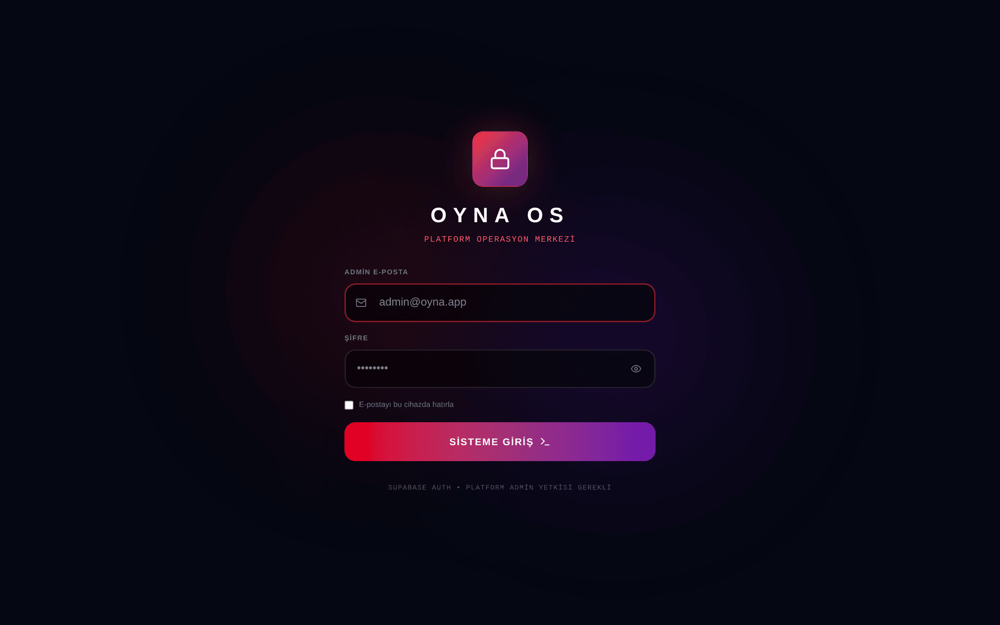</a>

_Şekil: Admin paneli giriş ekranı._

- **Adres:** Panel ayrı bir sayfadadır: canlıda `/admin.html`, yerel geliştirmede `http://localhost:4005/admin.html` (`npm run dev:admin`).
- **Adım 1 — E-posta + şifre:** Normal OYNA hesabınla girersin; hesap admin yetkili değilse "Bu hesap platform admini değil" uyarısıyla oturum kapatılır.
- **Adım 2 — İki adımlı doğrulama (2FA/TOTP):** Sistem Parametreleri'nde `admin_mfa_required` açıksa zorunludur. Telefonundaki doğrulama uygulamasıyla (Google Authenticator vb.) kurulum yaparsın: ekrandaki QR kodu okut, 6 haneli kodu gir. Sonraki girişlerde yalnız kodu girersin. Kurulum tamamlanmadan panel açılmaz.
- **Oturum güvenliği:** Hareketsizlikte (varsayılan **10 dakika**) ve toplamda **8 saatte** oturum otomatik kapanır; sekmeyi yenilemek süreyi sıfırlamaz.
- "E-postayı bu cihazda hatırla" seçeneği yalnız e-postayı hatırlar, şifreyi değil.

> **Önemli:** 2FA'yı zorunlu kılmadan önce telefon kaybı senaryosunu planla — iki adımlı doğrulama kurulumunda **kurtarma kodları** üretilir ve tek sefer gösterilir — cihaz kaybında bu kodlarla girip yeniden kurulum yaparsın; kodun da yoksa bir SUPER_ADMIN hesabının doğrulamasını sıfırlayabilir.

---

## 3. Admin Rolleri: kim neyi görür?

Panelde beş rol vardır. Menünde bir modül görünmüyorsa, rolünün o modüle yetkisi yok demektir (yetkisiz grup başlıkları tamamen gizlenir).

| Rol | Kısaca | Görebildiği alanlar |
|---|---|---|
| **Süper Admin** | Sınırsız | Her şey |
| **Admin** | Sınırsız | Her şey |
| **Moderatör** | Operasyon | Komuta Merkezi, Sahalar, Kullanıcılar, Doğrulama ailesi, Tesis Onayları, Silme Kuyruğu, Maçlar, Takımlar, itirazlar, Denetim Günlüğü |
| **Finans** | Para | Genel Bakış, Finans, SaaS Hesapları, Komisyon dışı finans ekranları, itirazlar, Denetim Günlüğü |
| **Destek** | Kullanıcı yardımı | Genel Bakış, Komuta Merkezi, Kullanıcılar, Doğrulama ailesi, Maçlar, Skor İhtilafları, Denetim Günlüğü |

- Bildirim/Kampanya, CMS, Ayarlar, Sistem Parametreleri ve **Ekipler & Yetkiler** yalnız Süper Admin ve Admin'e açıktır.
- Yetkiler yalnız menüyü gizlemekle kalmaz; kritik işlemler sunucu tarafında da rol kontrolünden geçer.

**Rol atama:** **Ekipler & Yetkiler** modülünde kullanıcıyı ara → rolü seç → **Ekle/Güncelle**. Yetki kaldırma aynı ekrandan yapılır; **kendi yetkini kaldıramazsın**.

---

## 4. Bölge Komutası

### 4.1 Genel Bakış

<a href="gorseller/admin/02-genel-bakis.png">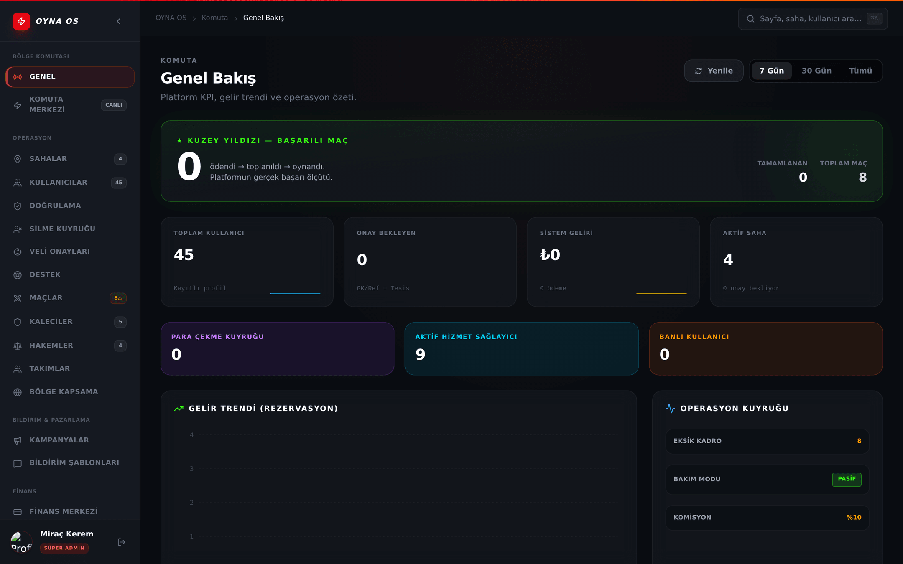</a>

_Şekil: Günün özeti — KPI kartları, gelir trendi ve bekleyen işler._

Güne buradan başlarsın: gelir trendi grafiği, tamamlanan/toplam maç, aktif kaleci-hakem sayısı, banlı kullanıcı sayısı, **Operasyon Kuyruğu** özeti ve son maçlar listesi. Bakım modu açıksa üstte rozet görürsün. Son maçlardan birine tıklayınca doğrudan o maçın kokpiti açılır.

### 4.2 Komuta Merkezi

<a href="gorseller/admin/03-komuta-merkezi.png">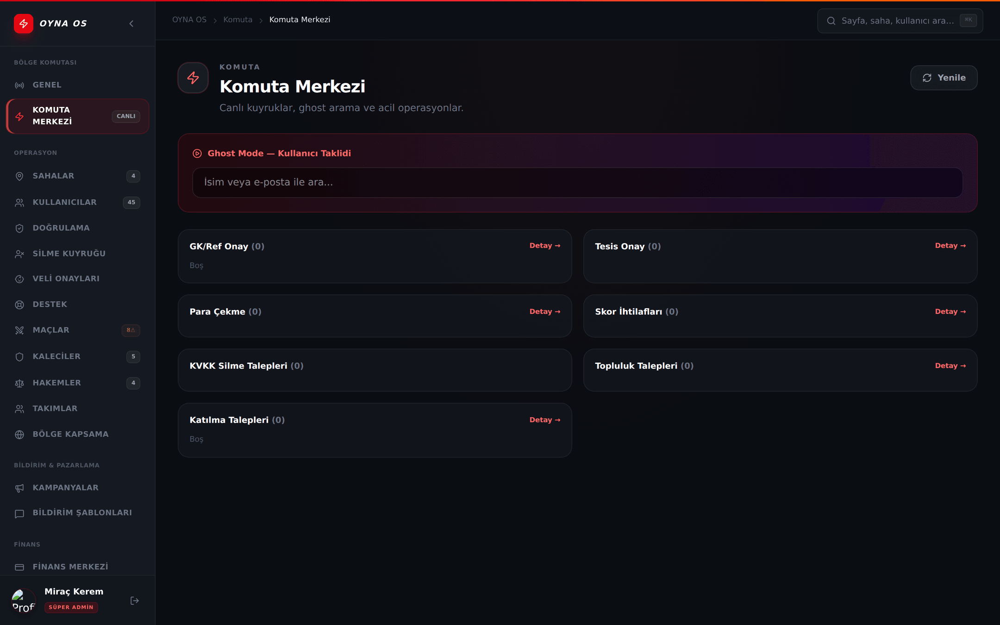</a>

_Şekil: Bekleyen kuyruklar tek ekranda._

Bütün bekleyen işlerin canlı toplandığı ekran (yarım dakikada bir kendini yeniler, yeni kayıtlar anlık düşer):

- **Kaleci/Hakem Onay** ve **Tesis Onay** bekleyenleri
- **Para Çekme** talepleri
- **Skor İhtilafları**
- **KVKK Silme Talepleri**
- Topluluk/katılma talepleri (modül açıksa)

**Ghost Mode (kullanıcı gözüyle bakma):** Bir kullanıcıyı arayıp uygulamayı onun gözünden incelersin. Sebep yazmak zorunludur (en az 5 karakter), oturum **30 dakika** ile sınırlıdır ve işlem Denetim Günlüğü'ne yazılır. Amaç sorun teşhisidir; kullanıcı adına işlem yapmak değil.

---

## 5. Operasyon

### 5.1 Sahalar ve Kurulum Merkezi

<a href="gorseller/admin/06-sahalar.png">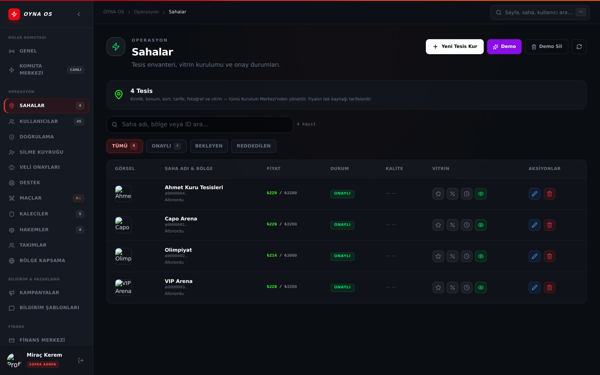</a>

_Şekil: Tesis envanteri ve vitrin bayrakları._

Tesis envanterini görür, durum filtreleriyle daraltırsın. Her tesis için dört **vitrin bayrağı** vardır: **Öne Çıkan ⭐ · Flash indirim · Müsaitlik · Yayında 👁**.

**Kurulum Merkezi'nde düzenle** dediğinde 9 sekmeli tesis stüdyosu açılır: **Kimlik & Konum · Olanaklar · Çalışma Saatleri · Kortlar · Tarifeler & Fiyat · Takvim & Doluluk · Finans · Fotoğraflar · Vitrin & Yayın**. Saha sahibinin panelinden yapabildiği her şeyi (ve fazlasını) buradan sen de yapabilirsin. Yeni tesis oluşturma ve tesise sahip atama da buradan yapılır.

### 5.2 Kullanıcılar / Kaleciler / Hakemler

<a href="gorseller/admin/04-kullanicilar.png">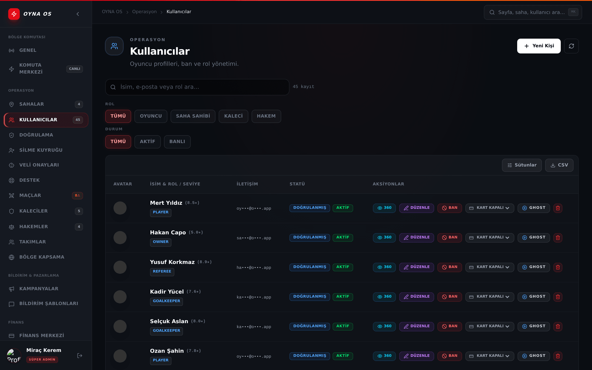</a>

_Şekil: Kullanıcı listesi ve işlem menüsü._

Sunucu taraflı arama; **rol** (Oyuncu / Saha Sahibi / Kaleci / Hakem) ve **durum** (Aktif / Banlı) filtreleri; 50'şerlik sayfalama. Listede e-postalar maskeli görünür (KVKK) ve CSV çıktısında da maskeli kalır.

Satır işlemleri:
- **360° Görünüm:** kullanıcının profili, cüzdan bakiyesi (salt-okunur), hareketleri ve onunla ilgili denetim kayıtları.
- **Düzenle:** profil alanlarında derin düzenleme.
- **BAN / UNBAN:** hesabı kapat/aç.
- **DOĞRULA:** doğrulama rozetini yönet.
- **Premium kart:** oyuncu kartı katmanı (kapalı / bronze / silver / gold) — oyuncu kartları yalnız admin kontrolündedir.
- **GHOST:** bu kullanıcı gözüyle incele (sebep + 30 dk + kayıt).
- **Sil:** onay kutusuna **SİL** yazarak kalıcı silme.

**Kaleciler** ve **Hakemler** sayfaları aynı ekranın rol filtreli halidir; ek olarak sağlayıcı detay paneli (ücret, puan, istatistik düzenleme) ve panelden sağlayıcı hesabı açma vardır.

### 5.3 Doğrulama Merkezi

<a href="gorseller/admin/05-dogrulama-merkezi.png">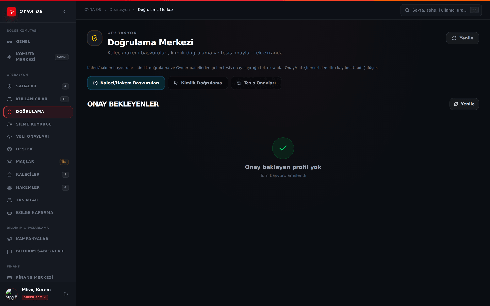</a>

_Şekil: Başvurular, kimlik doğrulamaları ve tesis onayları tek ekranda._

Üç segment tek ekranda; rozetteki sayı toplam bekleyendir:

1. **Kaleci/Hakem Başvuruları:** Başvuru kartında ad, rol, ücret, tanıtım, niyet mektubu, telefon, (hakemse) lisans seviyesi ve **kimlik fotoğrafı** bulunur. Kimlik fotoğrafı güvenlik gereği yalnız **120 saniye** geçerli özel bağlantıyla açılır. **Onayla** → kullanıcı anında o role geçer ve bildirim alır. **Reddet** → kısa not yazarsın; kullanıcı notu görüp yeniden başvurabilir. Hedef yanıt süresi (SLA) 48 saattir; süresi aşan başvurular kırmızı rozetle işaretlenir.
2. **Kimlik Doğrulama:** Para çekmek isteyen kaleci-hakemlerin TC kimlik beyanlarını **VERIFIED / REJECTED** yaparsın. Çekim, kimlik doğrulanmadan açılmaz.
3. **Tesis Onayları:** Yeni tesis başvuruları. Vitrin hazırlık kontrol listesi (foto, tarife, konum…) eksikse **Onayla butonu kilitlidir** — önce eksikleri tamamlatırsın. Reddederken en az 5 karakterlik gerekçe zorunludur ve sahibe iletilir. Onaylı tesislerin **ad/konum değişiklik talepleri** de burada onaylanır.

### 5.4 Silme Kuyruğu ve Veli Onayları

- **Silme Kuyruğu:** KVKK hesap silme talepleri, bekleme süresi dolduğunda buraya düşer. **Anonimleştir** (istatistikler korunur, kimlik silinir) veya **Kalıcı sil**. Aktif rezervasyonu/ödemesi olan hesaplar sunucu tarafından korunur.
- **Veli Onayları:** 18 yaş altı kullanıcılar ve veli muvafakat durumları (yok / bekliyor / aktif) burada izlenir.

### 5.5 Maçlar ve Maç Kontrol Kokpiti

<a href="gorseller/admin/07-maclar.png">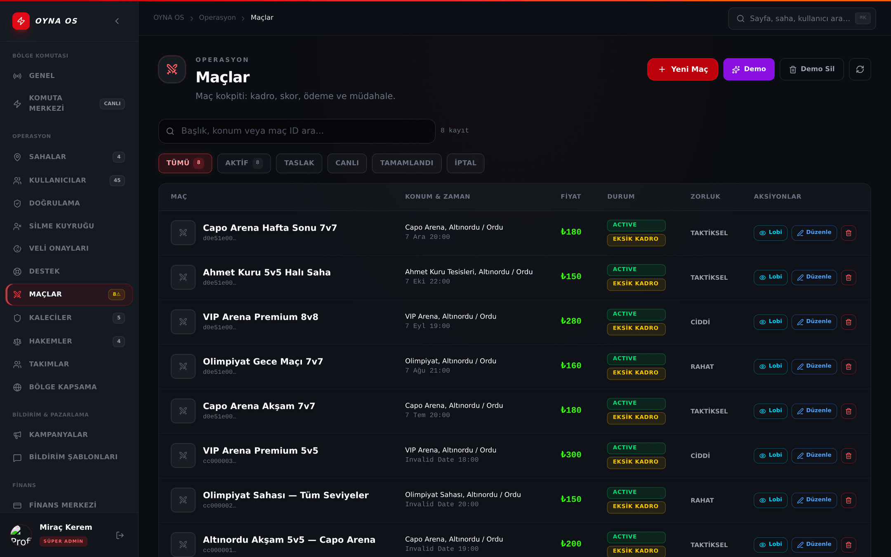</a>

_Şekil: Maç listesi ve kontrol kokpiti._

Maç listesinden bir maça tıklayınca **Maç Kontrol Kokpiti** açılır — sorunlu bir maçta ihtiyacın olan her şey tek çekmecede:

- **Kadro & Slot:** oyuncu çıkar, slota ata, yer değiştir.
- **Sonuç & Hakem:** maça hakem/kaleci ata; **skor düzeltme** (resmî skoru ez).
- **Ödeme:** maçın tüm tahsilatları — kapora ve katılım ödemelerinde **Tahsil / Boşalt / İade**; kaleci-hakem taleplerinin durumu.
- **Bildirim:** tüm kadroya tek seferde duyuru gönder.
- **Sohbet:** maç yazışmalarını salt-okunur incele.
- **Kayıt:** bu maça özel denetim zaman çizelgesi.

Maçı **iptal + iade** tek akışta yapılır: sebep yazarsın, ödemeler otomatik iade edilir.

### 5.6 Takımlar ve Bölge Kapsama

- **Takımlar:** takım listesi, kaptan bilgisi, oluşturma/silme.
- **Bölge Kapsama:** OYNA'nın aktif hizmet verdiği il/ilçeler. Bu liste hem keşif haritasının sınırlarını hem de yeni tesis kaydındaki il/ilçe seçeneklerini besler — yeni şehir açılışı buradan yapılır.

---

## 6. Bildirim & Pazarlama

- **Kampanyalar:** Toplu bildirim gönderimi. Segment seç (**Tüm Kullanıcılar · Saha Sahipleri · Son 30 Gün · Kaleciler · Hakemler**) → mesajı yaz → **Önizle** kaç kişiye gideceğini gösterir → onayla → gönder. Geçmiş gönderimler listelenir.
- **Bildirim Şablonları:** Uygulamanın otomatik bildirim metinlerini düzenlersin; `{{degisken}}` alanları canlı önizlemeyle görünür.
- **İndirim Kodları:** Yüzde veya tutar bazlı kod üret, kullanım limiti ve segment belirle, aç/kapat. Bu modül **Modül Anahtarları**'nda `module_promo_codes` açık değilse menüde görünmez.

---

## 7. Finans

<a href="gorseller/admin/08-finans.png">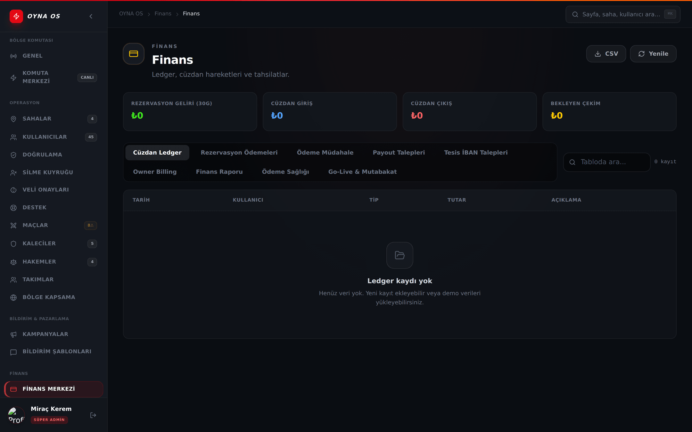</a>

_Şekil: Finans merkezi — 8 sekme._

Finans modülü **8 sekmeden** oluşur:

| Sekme | Ne işe yarar |
|---|---|
| **Cüzdan Ledger** | Tüm cüzdan hareketlerinin ham defteri (CSV alınabilir). |
| **Rezervasyon Ödemeleri** | Saha rezervasyonu tahsilatları (CSV alınabilir). |
| **Ödeme Müdahale** | Tekil ödeme kaydına müdahale: **Tahsil et · Boşalt (void) · İade et · Chargeback işaretle**. Her işlem onay kutusuna **ONAYLA** yazmanı ister ve denetime yazılır. Chargeback, ilgili saha/hizmet kazancını dondurur/geri alır. |
| **Payout Talepleri** | Para çekme talepleri — aşağıda ayrıntılı. |
| **Owner Billing** | Saha sahibi SaaS faturalandırması. |
| **Finans Raporu** | Serbest tarih aralığında gün kırılımlı gelir raporu. |
| **Ödeme Sağlığı** | Takılı/başarısız ödemelerin sağlık görünümü. |
| **Go-Live & Mutabakat** | Gerçek ödeme sağlayıcısına geçiş ön-uçuş kontrolleri. |

### 7.1 Payout (para çekme) talebi işleme

Talepler dört tipte gelir: **Saha Sahibi (2 haftalık) · Kaleci/Hakem (anında) · Cüzdan Çekimi · Manuel**.

1. Satırdaki **Kimlik Kontrol** sütununa bak: "İsim ✓ / TC ✓" yeşilse hesap sahibi ile IBAN sahibi eşleşiyor demektir; "⚠ İsim farklı" varsa işlemi durdurup incele.
2. Tutarı doğrula — cüzdan çekimlerinde bankaya gidecek **NET** tutar ayrıca vurgulanır.
3. Bankadan havaleyi **kendin yap** (panel şu an gerçek havale göndermez), sonra **Tamamla**'ya banka referans numarasını girerek talebi kapat.
4. Uygunsuz talebi **Reddet** — rezerve edilen tutar sahibinin bakiyesine geri döner.

> Bekleyen çekim varsa Genel Bakış'ta uyarı bandı çıkar; tıklayınca doğrudan bu sekmeye gelirsin.

### 7.2 İhtilaflar

- **Skor İhtilafları:** maç skoru itirazlarını **RESOLVED / DISMISSED / UNDER_REVIEW** yapar, not eklersin; maç numarasına tıklayınca kokpite atlarsın.
- **Hizmet İtirazları:** kaleci-hakem ödeme anlaşmazlıklarında incelemeden sonra **ödemeyi serbest bırak**abilirsin.

### 7.3 Komisyon

<a href="gorseller/admin/09-komisyon.png">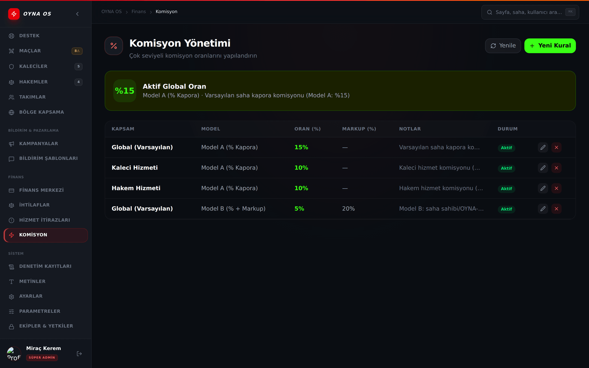</a>

_Şekil: Komisyon yapılandırması._

Komisyonun tek doğruluk kaynağı bu ekrandır; saha sahipleri komisyonu değiştiremez. Kapsamlar: **GLOBAL · PITCH (tek saha) · SERVICE_GK · SERVICE_REF · MATCH (tek maç)**. İki model vardır: **MODEL_A (kaporadan yüzde)** ve **MODEL_B (yüzde + markup)** — oran ve markup alanlarını doldurup aktif/pasif yaparsın. Dar kapsam genişi ezer (örneğin tek sahaya özel oran globalden önceliklidir).

---

## 8. Sistem

### 8.1 Denetim Günlüğü

<a href="gorseller/admin/12-denetim-gunlugu.png">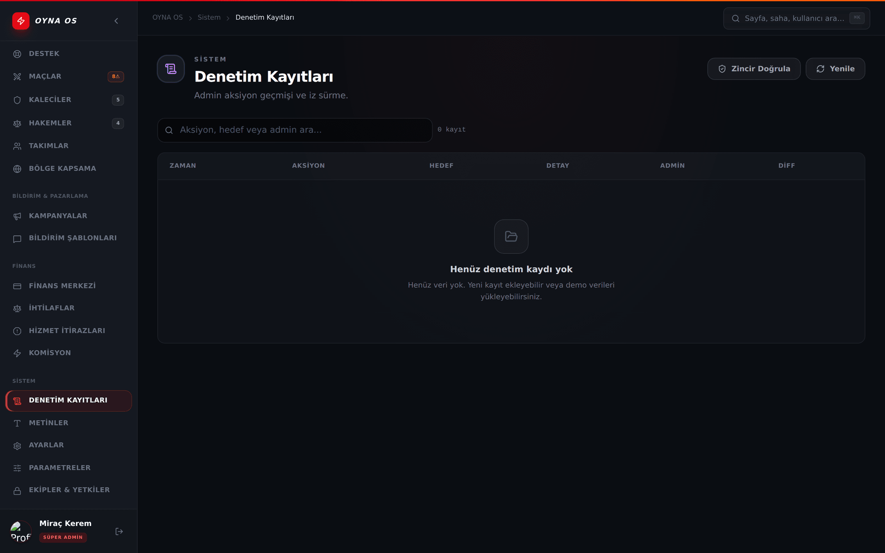</a>

_Şekil: Değiştirilemez denetim kaydı._

Her admin işlemi zaman, işlem, hedef, detay ve işlemi yapan bilgisiyle listelenir; **Diff** görünümü eski→yeni değerleri yan yana gösterir. **"Zinciri Doğrula"** butonu kayıtların el değmemişliğini kriptografik zincirle kontrol eder. Kayıtlar silinemez ve değiştirilemez.

### 8.2 Ayarlar

Temel platform ayarları: **Ödeme Yöntemi** (Sadece Nakit / Tamamı Kart / **Kapora Modu**), Min. Oyun Puanı, Kayıt Açık/Kapalı, Uygulama Adı, Günlük Maç Limiti, **Duyuru Bandı** (uygulama içinde herkese görünen şerit).

**MASTER BAKIM MODU:** Uygulamayı bakıma alır. Yanlışlıkla açılmasın diye onay kutusuna **BAKIM** yazman gerekir; işlem denetime yazılır.

### 8.3 Sistem Parametreleri

<a href="gorseller/admin/10-sistem-parametreleri.png">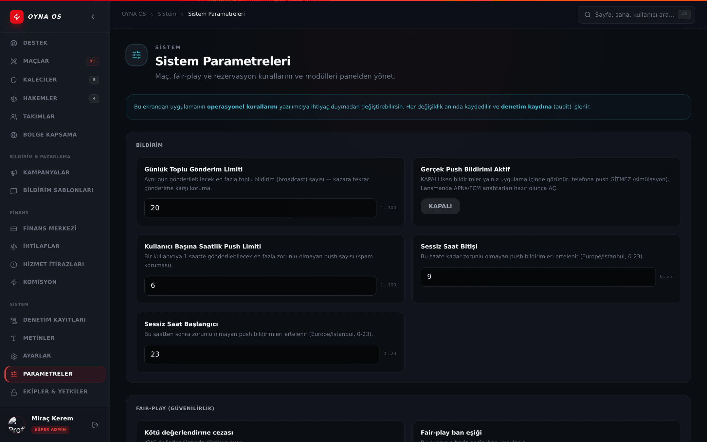</a>

_Şekil: İşletme kuralları ve Modül Anahtarları._

Platformun tüm işletme kuralları kategorilere ayrılmış parametrelerdir (MAÇ, FAIRPLAY, REZERVASYON, HESAP, SİSTEM, ÖDEME, BİLDİRİM, GÜVENLİK, HİZMET, GENEL). Her parametrenin min/max sınırı vardır; değişiklikler anında uygulanır ve denetime yazılır. Sık kullanılan örnekler:

| Parametre | Ne belirler |
|---|---|
| `match_min_player_pct` | Maçın kesinleşmesi için gereken doluluk yüzdesi |
| `match_confirm_window_hours` | Maç onay anının maçtan kaç saat önce olduğu |
| `app_booking_auto_approve_minutes` | Uygulama taleplerinin otomatik onay süresi |
| `direct_booking_deposit_default_pct` | Doğrudan rezervasyonda varsayılan kapora yüzdesi |
| `fairplay_warn_threshold` / `fairplay_restrict_threshold` / `fairplay_ban_threshold` | Güvenilirlik uyarı / kısıt / yasak eşikleri |
| `verification_sla_hours` | Başvuru onayı hedef süresi |
| `admin_idle_timeout_minutes` / `admin_session_max_hours` | Admin oturum süreleri |

Aynı sayfadaki **Modül Anahtarları** bölümünden kapsam dışı modülleri (Topluluklar, Turnuvalar, İndirim Kodları, SaaS Hesapları…) açıp kapatırsın — kapalı modül menüden kaybolur, kodu silinmez.

### 8.4 Ekipler & Yetkiler

<a href="gorseller/admin/11-yetkiler-acl.png">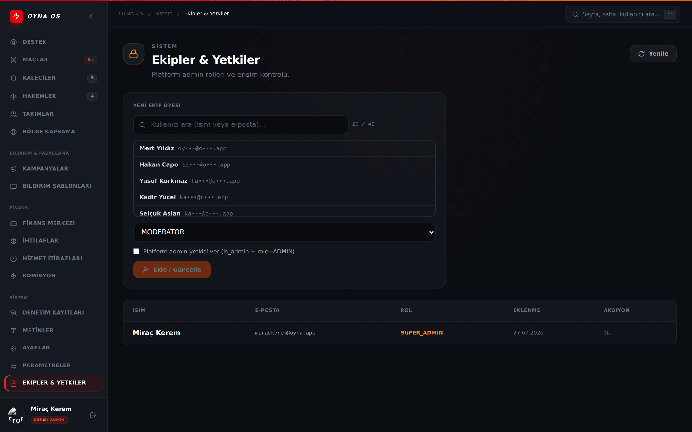</a>

_Şekil: Admin rolü atama._

Kullanıcı ara → rol seç (**Süper Admin / Admin / Moderatör / Finans / Destek**) → **Ekle/Güncelle**. Platform admin yetkisi verme kutusu, hesabı tam admin yapar. **Yetkiyi Kaldır** aynı ekrandadır; güvenlik gereği kendi yetkini kaldıramazsın.

### 8.5 Acil durum anahtarları

| Durum | Ne yaparsın |
|---|---|
| Uygulamada kritik hata / bakım gereği | Ayarlar → **MASTER BAKIM MODU** → onay kutusuna `BAKIM` yaz |
| Para akışında şüpheli durum | Sistem Parametreleri → Güvenlik → `admin_readonly_mode` **AÇIK** — tüm panel para işlemleri durur; sorun çözülünce kapat |

---

## 9. Günlük Operasyon Reçeteleri

**Her sabah (5 dakika):**
1. **Komuta Merkezi**'ni aç; kuyruklara bak: başvuru, tesis onayı, para çekme, ihtilaf, KVKK silme.
2. **Genel Bakış**'ta gelir/maç trendine ve bekleyen çekim bandına göz at.
3. SLA rozeti kızarmış başvuru varsa önce onları bitir.

**Yeni tesis onaylama:**
1. Doğrulama Merkezi → **Tesis Onayları** → tesisi aç.
2. Kontrol listesini gözden geçir (foto, tarife, konum, çalışma saatleri) — eksikse Onayla zaten kilitlidir; sahibiyle iletişime geç.
3. **Onayla** → tesis vitrine çıkabilir hale gelir (sahibinin yayın anahtarını açması gerekir). Gerekirse **Reddet** + gerekçe.

**Kaleci/Hakem başvurusu onaylama:**
1. Doğrulama Merkezi → **Kaleci/Hakem Başvuruları** → kartı aç.
2. Kimlik fotoğrafını aç (120 sn), ad-soyad tutarlılığına ve hakemse lisans beyanına bak.
3. **Onayla** (kullanıcı anında role geçer, bildirim gider) veya **Reddet** + not.

**Para çekme talebi işleme:** bkz. §7.1 (kimlik kontrolü → bankadan elle havale → **Tamamla** + referans).

**Sorunlu maça müdahale:**
1. Maçlar → maçı bul → kokpiti aç.
2. Şikâyet kadroysa **Kadro & Slot**; skorsa **Sonuç & Hakem** (skor düzeltme); paraysa **Ödeme** (iade/void).
3. Kadroyu bilgilendirmek için **Bildirim** sekmesinden duyuru gönder.
4. Gerekirse maçı **iptal + iade** ile kapat; her adım Kayıt sekmesinde izlenir.

---

## Sık Sorulan Sorular

**1. Panel adresini uygulamanın içinde bulamıyorum; nereden gireceğim?**
Panel ayrı bir web sayfasıdır: `/admin.html`. Oyuncu uygulamasındaki menülerden ulaşılmaz.

**2. Menümde Finans (veya başka bir modül) görünmüyor.**
Rolünün o modüle yetkisi yok. Yetki gerekiyorsa bir Süper Admin, Ekipler & Yetkiler'den rolünü güncellemeli.

**3. Doğrulama fotoğrafı açılmıyor / "süresi doldu" diyor.**
Kimlik fotoğrafı bağlantıları güvenlik gereği 120 saniyelik üretilir; kartı kapatıp yeniden açman yeterli.

**4. Bir kullanıcının cüzdan bakiyesini elle düzeltebilir miyim?**
Hayır; 360° Görünüm bakiyeyi salt-okunur gösterir. Parasal düzeltmeler ilgili ödeme kaydı üzerinden (Ödeme Müdahale: iade/void) yapılır.

**5. Payout'ta "Tamamla"ya basınca para otomatik gidiyor mu?**
Hayır. Havaleyi bankadan kendin yapar, referans numarasını girerek talebi kapatırsın. Panel şu an gerçek havale göndermez.

**6. Yanlışlıkla tamamlandı işaretlediğim payout'u geri alabilir miyim?**
Panelde bunun için ekran yok; kayıt düzeltmesi için teknik ekiple ilerlemen gerekir. Tamamlamadan önce kimlik ve tutar kontrolünü bitirdiğinden emin ol.

**7. Ghost Mode ile kullanıcı adına işlem yapabilir miyim?**
Ghost inceleme amaçlıdır: sebep zorunludur, 30 dakikayla sınırlıdır ve denetime yazılır. Kullanıcı adına işlem yapmak için kokpit/kullanıcı ekranlarındaki admin aksiyonlarını kullan.

**8. İndirim Kodları / Topluluklar / Turnuvalar menüde yok.**
Bu modüller Modül Anahtarları'ndan kapatılmış olabilir (lansman kapsamı dışı). Sistem Parametreleri → Modül Anahtarları'ndan açılabilir.

**9. Maç skorunu kim düzeltebilir?**
Kokpitin **Sonuç & Hakem** sekmesindeki skor düzeltme yetkisi admin'e aittir; hakemin girdiği resmî skor da buradan ezilebilir. İşlem denetime yazılır.

**10. Bakım modunu açtım; nasıl kapatırım?**
Aynı yerden: Ayarlar → MASTER BAKIM MODU anahtarını kapat. Açma da kapama da denetime yazılır.

**11. Komisyonu tek bir saha için farklı yapabilir miyim?**
Evet: Komisyon → kapsamı **PITCH** seçip sahayı belirt; saha kapsamı global oranı ezer.

**12. Toplu bildirimi yanlış segmente göndermekten korkuyorum.**
Gönder'den önce **Önizle** tam olarak kaç kişiye gideceğini gösterir; onaylamadan gönderim yapılmaz.

---

## Bilinen Sınırlamalar

- Panelden gerçek banka havalesi yapılmaz; payout "Tamamla" yalnız kaydı kapatır (havale elle yapılır).
- Yanlış tamamlanan payout **Geri Al** ile PENDING'e döndürülebilir (sebep zorunlu, denetim kaydına yazılır) — ama gerçekten havale yapıldıysa geri almayın; bu yalnız kayıt düzeltmesidir.
- Kullanıcı bakiyesine elle müdahale, kullanıcı profili aynasındaki ledger'lı düzeltme ile yapılır (FINANCE yetkisi, ±50.000 ₺ sınırı, denetim kaydı).
- **Destek Merkezi** hem oyuncu hem tesis kanallarını kapsar; kullanıcı uygulama içinden talep açar, panelden yanıtlarsınız.
- Saha sahipleriyle serbest mesajlaşma yoktur; iletişim Destek Merkezi ve e-posta ile yürür.
- Zamanlanmış (ileri tarihli) bakım modu yoktur; bakım anahtarı elle açılıp kapatılır.
- CSV indirme Cüzdan Ledger, Rezervasyon Ödemeleri, Owner Billing, **Payout Talepleri** ve **Ödeme Müdahale** sekmelerinde açıktır (Rapor sekmesinin kendi indirme düğmesi vardır); Sağlık ve Go-Live pano niteliğinde olduğu için CSV içermez. Payout CSV'sinde IBAN **maskeli** yazılır.
- Panel 2FA'sı bugün **kapalıdır** (`admin_mfa_required`); açmadan önce en az bir SUPER_ADMIN kurulum yapıp kurtarma kodlarını indirmelidir.
- **Hizmet İtirazları** kuyruğunda no-show/itiraz kayıtları için iki karar düğmesi vardır (Sağlayıcı Haklı / Cezayı Onayla); karar para hareketlerini ve taraf bildirimlerini otomatik yürütür.
- Hizmet ödemeleri, sağlayıcı onayladıysa ve itiraz yoksa maç bitiminden **48 saat** sonra otomatik serbest bırakılır (saatlik görev).

---

_Seri: [Kılavuz İndeksi](README.md) · [Genel](00-genel-kilavuz.md) · [Oyuncu](01-oyuncu-kilavuzu.md) · [Kaleci](02-kaleci-kilavuzu.md) · [Hakem](03-hakem-kilavuzu.md) · [Saha Sahibi](04-saha-sahibi-kilavuzu.md)_
